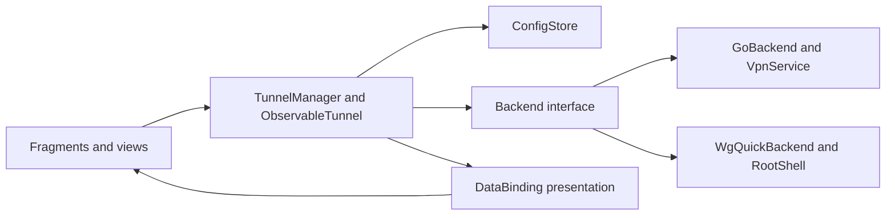
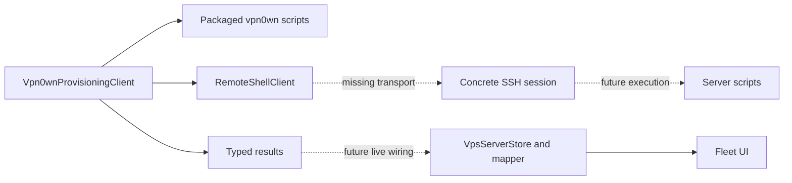

# Architecture and maintenance boundaries

Last updated: 2026-10-11 (Europe/Paris).

[Documentation index](../README.md#project-documentation) · Reviewed 2026-10-06

Preserve the existing Android DataBinding/Fragment foundation and upstream WireGuard config/backend ownership. This guide describes current code; planned integration and repairs are identified explicitly.

## Ownership

| Source/owner | Responsibility |
| --- | --- |
| `ui/.../Application.kt` | App initialization, selected backend, preferences and tunnel manager access. |
| `ui/.../activity`, `fragment`, `widget` | Navigation, lifecycle-bound views, user actions and Canvas rendering. |
| [BindingAdapters](../ui/src/main/java/com/vpn0wn/android/databinding/BindingAdapters.kt) | Simple XML presentation bindings and shared UI formatters. |
| [ObservableTunnel](../ui/src/main/java/com/vpn0wn/android/model/ObservableTunnel.kt), [TunnelManager](../ui/src/main/java/com/vpn0wn/android/model/TunnelManager.kt) | Observable tunnel data, config loading/persistence, selected operations and state notifications. TunnelManager also owns shared statistics requests and validates publication against the tunnel's session generation. |
| [Config types](../tunnel/src/main/java/com/vpn0wn/config/Config.java) | WireGuard parsing/serialization, interfaces, peers, addresses and endpoints. |
| [GoBackend](../tunnel/src/main/java/com/vpn0wn/android/backend/GoBackend.java), [WgQuickBackend](../tunnel/src/main/java/com/vpn0wn/android/backend/WgQuickBackend.java) | Userspace VPN/native activation and root/kernel command integration. |
| [Native tunnel handles](../tunnel/tools/libwg-go/tunnelhandles.go), [Android bind lifetime](../tunnel/tools/libwg-go/androidbind/bind.go), [UAPI server](../tunnel/tools/libwg-go/uapiserver/server.go) | Lookup admission and device/socket/client ownership; cancel owned I/O before draining queries and releasing the device/JNI context. |
| [RootShell](../tunnel/src/main/java/com/vpn0wn/android/util/RootShell.java) and native tools | Root command protocol and existing WireGuard tool execution. |
| [Provisioning client](../ui/src/main/java/com/vpn0wn/android/provisioning/Vpn0wnProvisioningClient.kt), models and script bundle | Remote orchestration, argument construction, packaged script upload and typed result parsing. |
| [Remote-shell boundary](../ui/src/main/java/com/vpn0wn/android/provisioning/RemoteShellClient.kt) | Transport factory and guarded execute/upload; concrete SSH/session implementation is still missing. |
| [VPS store](../ui/src/main/java/com/vpn0wn/android/provisioning/VpsServerStore.kt), [mapper](../ui/src/main/java/com/vpn0wn/android/provisioning/VpsDeployMapper.kt) | Transactional non-secret fleet records and projection into UI models. |
| [FileConfigStore](../ui/src/main/java/com/vpn0wn/android/configStore/FileConfigStore.kt) | Serialized local profile operations; private staged writes, file sync and native atomic rename preserve prior valid configs on failed updates. |
| [TunnelImporter](../ui/src/main/java/com/vpn0wn/android/util/TunnelImporter.kt), [QR scanner](../ui/src/main/java/com/vpn0wn/android/util/QrCodeFromFileScanner.kt), [ZIP exporter](../ui/src/main/java/com/vpn0wn/android/preference/ZipExporterPreference.kt) | Import result delivery, image retry/resource ownership and export children/output cleanup; models/stores retain profile ownership. |
| [Log viewer](../ui/src/main/java/com/vpn0wn/android/activity/LogViewerActivity.kt), [stream](../ui/src/main/java/com/vpn0wn/android/util/LogcatStream.kt), [buffer](../ui/src/main/java/com/vpn0wn/android/util/LogBuffer.kt) and [parser](../ui/src/main/java/com/vpn0wn/android/util/LogLineParser.kt) | Activity owns lifecycle/generation, adapter notifications and temporary shares; stream owns the process/reader and timed batches; Main owns bounded retention, continuations and filtered indices. |
| [vpn0wn scripts](../third_party/wireguard-install/vpn0wn/README.md) | Ubuntu/Debian operations, C2–C3 ownership/serialized recovery and C4 producer/consumer contracts; real-server proof remains separate. |

## Runtime flows

UI actions request model/backend changes; backend state/statistics return through observable data and bindings. Keep UI formatting separate from operation success, permission/service management and config parsing. Detail config/statistics jobs belong to the view lifecycle and guard completions by binding/selection identity. Manager admission owns state settlement; [the decision below](#tunnel-mutations-own-admission-and-settlement) describes #13's merged repairs and limits. #15's kernel transition decision is recorded below.

Peer detail rows consume nullable immutable `Statistics.PeerStats` snapshots mapped by public key. The fragment projects only a successful statistics completion for its current view, selection, resumed lifecycle and captured state; observed DOWN clears without requesting statistics. Binding helpers own localized RX/TX totals and empty/zero visibility. These view guards complement the manager's shared-cache session checks; they do not own them. The Add sheet retains native BottomSheetDialogFragment and fragment-result actions; its callback belongs to the sheet view, while existing importer/editor owners retain validation, failure and cancellation. See [source verification and device limits](development.md#add-sheet-and-peer-presentation-recovery--2026-10-06).

`View.applySafeAreaInsets` in `util/Extensions.kt` owns system-bar/display-cutout padding for MainActivity's single-/two-pane containers, TunnelCreatorActivity and SettingsActivity. The existing pure view behavior moved out of the tunnel-selection BaseActivity so Settings can reuse it without inheriting tunnel state. It clears the handled inset types for descendants while preserving IME/gesture insets. Fragments do not add the same header inset again. Settings uses PreferenceFragmentCompat with always-expanded native sections, unchanged preference keys/defaults and native action owners; eligibility filtering removes empty categories and defers the Connection header until backend/root checks finish. The editor uses a DataBinding header inside its existing fragment, matching the prototype title/context, Close and Save controls; both host activities hide their native ActionBar. Save and the retained keyboard/menu entry call the same validated persistence owner. `ObservableTunnel` retains the manager's resolved pending target for presentation, and BindingAdapters shares each rate calculation by statistics snapshot. See [presentation contracts](backend-contracts.md#persistence-and-presentation), [phone evidence](development.md#phone-ui-and-throughput-follow-up--2026-10-06) and [Settings proof/limits](development.md#settings-presentation-recovery--2026-10-06).

The Home vertical layout reserves its Add footer below a weighted scroll container. Standard Material `AppBarLayout` behavior lets the unchanged header/status scroll above the list or empty-state `NestedScrollView` in short viewports; entering or leaving selection expands the header, while count/statistics updates retain its position. Transient phone feedback reuses `Vpn0wnSnackbar` through `Snackbar.vpn0wnStyle()`, which clears the Material background tint before installing its local surface. Successful editor feedback belongs to the surviving Main/list view; Creator returns the message through the existing Android activity-result mechanism. Native Toasts remain only in the visibility contexts described in [operations](operations.md#import-edit-and-connect); no new feedback service or state model is introduced.

Import/export children belong to their operation rather than the application scope. Valid ZIP entries settle independently through the existing manager; completion feedback runs once afterward. QR decoding owns each reopened input/bitmap. Narrow error handling preserves cancellation and exposes programming defects while existing generic Backend/ConfigStore boundaries retain needed reconciliation/reporting. [Import/export contracts](backend-contracts.md#import-ordering-and-export) records failure and output-acquisition limits; no new service, parser or dependency is introduced.

The [G2 performance investigation](reviews/2026-10-07-performance-source-investigation.md) traces polling/model publication, view animation and native transfer owners. Resumed/attached presentation is not necessarily uncovered: single-pane Detail leaves Home active, and hidden attached widgets retain animator callbacks (#47). Its historical shared-statistics gap is addressed by the separately authorized #48 source implementation described below and in [presentation contracts](backend-contracts.md#persistence-and-presentation); current change acceptance belongs in its PR. Keep native packet/config ownership and defer measured optimization selection and physical evidence to G4. Source changes do not establish energy or throughput gains.

The provisioning client and scripts exist, while concrete SSH, protected credential persistence and live action/result wiring remain planned. Persisted fleet records already render. The dotted flow is not a claim of working deployment, user management or generated-profile QR.

## Boundaries and invariants

These are required maintenance invariants, not guarantees that all current owners already meet them. `VpsServerStore` uses DataStore transactions and nullable observed running health; `FileConfigStore` serializes operations and commits synced staged files through native atomic rename. PR #25 merged manager/detail/userspace lifecycle repair; #15 implements kernel transition serialization with controlled offline proof. Exact contracts and proof limits belong below and in the backend contracts.

- `.design/` supplies read-only visual intent; it does not establish runtime capability.
- Config parsers and backends preserve supported WireGuard behavior. Do not invent another parser for generated/imported profiles.
- Stores must preserve prior valid data and serialize conflicting mutations through the responsible persistence mechanism. Backend transitions must settle on success/failure/cancellation.
- Transport owns its channels/sessions, real deadlines and cancellation. A coroutine wrapper alone cannot prove cancellation of blocking library calls.
- Shell argument quoting protects shell construction; script/config validation and ownership checks protect privileged writes. Neither substitutes for the other.
- Logs/errors expose useful categories and non-secret status, not raw private config/credential payloads. Internal results may legitimately carry a generated profile; they are not safe to stringify into diagnostics.
- Revocation/install/uninstall success needs effective postconditions and recovery semantics. Recent synchronization is not running health.
- Keep [pinned upstream attribution](../third_party/wireguard-install/UPSTREAM.md). The original interactive installer is reference material, not the Android execution path.

See [backend contracts](backend-contracts.md) for known divergences and [the plan](improvement-plan.md) for repair ownership.

## Consequential decisions

### Handshake observations follow native protocol and activation owners — 2026-10-09

**Problem:** configured UP and cached handshake timestamps do not distinguish an attempted initiation, local send, authenticated completion or exhausted protocol retries. Statistics generations also change during reads/config/name work, so they cannot identify an entire native activation. Device-wide or timer-expiry labels can falsely attribute failure to every peer or to idle/Doze silence.

**Decision/status at 2026-10-09:** E5's first [#73](https://github.com/novakin/vpn0wn-android/issues/73) source slice was a local draft. Extend the existing version/match-checked overlay at the pinned WireGuard initiation, retry-exhaustion and authenticated-completion owners. `androidbind`, JNI and `GoBackend` deliver safe per-peer observations to `ObservableTunnel`; protocol owners retain all handshake/retry timing. Native callbacks stage bounded events only. The backend coalesces delivery through default `Tunnel` callbacks on a Handler outside all backend/native/context locks, and the model validates a distinct `HandshakeSession` lifetime before and after Main dispatch. [The handshake contract](backend-contracts.md#native-handshake-observations--73-draft) owns event meanings, unavailable values and clearing. Userspace is supported by this draft; kernel observations/recovery remain unavailable. Draft source and local controls do not complete #73, publish a PR, establish CI or authorize device/APK work.

**Alternatives/consequences:** statistics polling loses protocol progress and supplies no retained transport identity; a new monitor, ping loop, wake lock or scheduler duplicates existing owners. A broad upstream fork expands maintenance beyond the existing exact-pin overlay. Public read-only session/observation types and default `Tunnel` callbacks cross the tunnel-library/UI ownership boundary without a general subscription framework or synchronous backend queries. Keep per-peer observations separate from UP and reachability, without recovery counts or transport mutation in this slice. Preserve saved configuration, endpoint-free/multi-peer profiles, explicit ListenPort and protocol timing. The [bootstrap policy](operations.md#recovery-and-bootstrap-policy--73-draft) permits no outside-tunnel hostname DNS under lockdown and grants no exception for unknown policy.

**2026-10-10 status:** the bounded source slice is merged through [PR #101](https://github.com/novakin/vpn0wn-android/pull/101). [Private Android acceptance](reviews/2026-10-10-native-handshake-avd-acceptance.md) observes JNI protection entry, distinct protocol/model facts, manual session retirement/replacement and corrected forced screen-off idle/private wake reachability against an independent unchanged userspace peer. It retains failed reader attempts, debugger timing, protection-return and unavailable packet/physical limits. This updates the earlier draft status without changing owner/recovery decisions or claiming release, rebind or full #73 delivery.

**Rebind prerequisite identified before the next slice:** pinned `Device.BindUpdate` takes the network write lock before closing sockets, while `Peer.SendBuffers` holds its read lock during send. A JNI rebind under `GoBackend.stateLock` could therefore reproduce #68's blocked-send/DOWN deadlock. Retained-TUN recovery needed the existing handle borrow, invocation outside the Java state lock, captured-bind I/O cancellation before waiting, UAPI/recovery serialization and terminal shutdown/replacement rejection. This historical rationale remains valid; the source decision below addresses it without completing #73's higher-level recovery acceptance.

**Retained-TUN decision/status — 2026-10-10 (Europe/Paris):** the source implements `GoBackend.rebind(Tunnel)` and the pinned `Device.Rebind` overlay. Java captures tunnel, handle, exact service and activation under `stateLock`, invokes JNI outside it and rejects retired/replaced identity on return. Native handle admission borrows the existing device/context. `Device.Rebind` first uses the existing IPC mutex's `TryLock`; busy admission changes no sockets. It then closes the captured bind to settle sends before `BindUpdate` waits for the network write lock. Terminal bind shutdown and device-down checks prevent admitted recovery from reviving a retired activation. [The rebind contract](backend-contracts.md#retained-tun-userspace-rebind--73) owns return, failure and interruption details.

**Alternatives/consequences:** waiting for the network lock before cancelling sends retains the deadlock; holding Java state admission across JNI blocks manual DOWN and destruction. Rebuilding the entire VPN/TUN or adding a recovery service changes more ownership than this primitive needs. The chosen path retains the TUN, peers, configured port and handshake session; automatic-port warm-up intent remains unchanged. Inactive, unavailable, busy or obsolete activations return false without bringing a tunnel UP. Protection/open failures remain I/O failures and may leave the retained activation with unavailable transport; an unexpected retained JNI callback exception remains terminal under the existing context contract. Interrupted callers are refused before native entry; admitted work settles before interruption propagates, preserving the flag and activation context. Manual DOWN/replacement retires the old activation. This userspace primitive adds no automatic trigger, DNS, endpoint/config rewrite or UI; kernel recovery remains unsupported.

**Verification/publication limits:** local [native rebind controls](qa-test-plan.md#native-rebind-controls--73) and host race/JNI checks cover the lock/cancellation boundary, busy admission, protection failure, terminal closure, retirement and retained-context interruption. The current PR acceptance record owns exact-head independent review, required checks, publication and delivery state. [Rooted Android acceptance](reviews/2026-10-10-native-rebind-acceptance.md) separately records protected socket replacement with retained TUN/session, synthetic authenticated HTTP traffic, debugger-injected protection failure/retry and actual Android service destruction followed by fresh activation and restoration. It changes no owner decision. Actual OS protection denial, concurrent phone races, interruption, physical network transition, packet, IPv6 traffic, DPI and release acceptance remain unproved. #73 stays open for higher-level recovery, presentation and full runtime acceptance.

### Proposed exhaustion-only recovery — 2026-10-10

**Problem:** observations and retained-TUN rebind do not define automatic admission. A queued trigger can capture a replacement session of the same model; current boolean results hide mutation/obsolete distinctions. EXHAUSTED publication precedes native cleanup, and manager serialization held across blocking JNI would prevent DOWN from cancelling socket I/O.

**Decision/status — 2026-10-10 (Europe/Paris):** recommend the independently ultra-reviewed [bounded #73 planning contract](backend-contracts.md#proposed-bounded-automatic-recovery--73): fresh native exhaustion, current numeric endpoint, expected-session backend admission and a protocol-owned atomic claim of the triggering exhausted cycle. Documentation adoption does not approve new runtime/API policy or defaults, implement recovery or add runtime evidence. The maintainer must select the pilot/defaults before automatic implementation. Existing observation/rebind behavior remains unchanged; #113 presenter delivery is merged within its scoped acceptance.

**Ownership and rationale:** extend `TunnelManager`/`ObservableTunnel`, `GoBackend` and existing timer/bind/handle/JNI owners. Use short manager admission/reconciliation; keep blocking JNI off Main and outside both manager operation and backend state locks. Native exhaustion cleanup must settle before claiming that episode; the claim must reject authentication and delayed exhaustion A after cycle B. Preserve the existing cancellation-before-drain teardown path. Keep one activation-wide in-flight operation and finite conservative accounting under the contract; the exact native lock/claim design remains an implementation gate.

**Alternatives/consequences:** triggering on a transient send failure or stale age would bypass native retries and invent failure during idle/Doze. Continuous monitoring, ping, wake locks, a new service/scheduler and full VPN rebuild add unnecessary ownership. Calling existing boolean rebind blindly cannot prove non-mutation, admission or initiation. A qualifying peer's replacement affects all shared sockets, so transport state is activation-wide while initiation/authentication stay peer-attributed. The pilot preserves saved profiles, current numeric destinations, port/warm-up intent, protocol timing and manual transition/restoration behavior; kernel recovery, DNS/family rewriting and preemptive handover remain outside it. #73/#75 bootstrap and #74 arbitration require their separate policy choices.

**Verification/migration impact:** no source, public API, persistence format or migration changes with this proposal. Require [future deterministic owner controls](qa-test-plan.md#proposed-recovery-controls--73), final-head independent ultra review of code/owning docs and actual required checks before delivery. Separately authorized Android/packet proof retains its own scope. Revisit when the maintainer selects defaults, the native claim design changes, or broader DNS/network/arbitration scope is selected; full #73 remains open.

### Android owns system VPN policy — 2026-10-09

**Problem:** the prototype's always-on/kill-switch toggles could imply app-owned protection. Android policy, tunnel state and observed traffic have different owners and acceptance boundaries.

**Decision/status:** implement the authorized setup/status slice of [#75](https://github.com/novakin/vpn0wn-android/issues/75) in the existing `SettingsFragment`/native Preference owner. One nonpersistent action opens Android VPN Settings; foreground lifecycle refresh reuses existing backend policy getters with API/backend eligibility. Android retains policy writes. [Operations](operations.md#android-system-vpn-settings) owns setup/support and [backend contracts](backend-contracts.md#android-system-vpn-policy-observation) owns observation semantics. Missing service access remains unknown; kernel mode is unsupported by this userspace path.

**Alternatives and consequences:** app-owned Boolean toggles cannot configure ordinary-app system policy. A dummy VPN, SOCKS/netstack kill switch or extra service would change routing/lifecycle ownership without a bounded requirement. Reusing the Settings and backend owners adds no service, persistence migration or policy/routing change. Endpoint bootstrap and manual/recovery/automation arbitration remain undecided in #73/#74. Revisit this decision if those reviewed contracts require another owner-level change.

**Verification and limits:** require injected API/backend/admin/launch and lifecycle controls under [QA acceptance](qa-test-plan.md#android-system-vpn-policy-acceptance). Source checks do not establish rendered device output, system-policy enforcement or packet protection; full #75 acceptance remains open.

### Shared statistics belong to the manager — 2026-10-08

**Problem:** overlapping explicit readers and the bindable getter could issue duplicate backend calls. A delayed completion could refill the shared cache after DOWN, reconnect or replacement. Detail's view guards did not protect other consumers.

**Decision/status:** the maintainer separately authorized #48 implementation on 2026-10-08 (Europe/Paris). The source implementation makes `ObservableTunnel.statistics` cache-only. Existing Home/Detail/TV pollers request snapshots through `TunnelManager`, which shares equivalent reads in the existing application scope and validates session identity before Main publication. The model retains an atomic generation because backend notifications can arrive from worker threads before Main reconciliation; the cache getter also checks that generation. Mutation and backend-switch owners invalidate their affected sessions. [Presentation contracts](backend-contracts.md#persistence-and-presentation) own freshness, cancellation and unavailable-result details. The issue/PR own executed checks, independent review and delivery state; this decision record does not claim merge.

**Alternatives/consequences:** keeping one read per caller preserves duplicated work and gives no shared publication boundary. Running IO under the mutation lock would delay teardown. A new statistics service or polling scheduler duplicates the existing owners. Manager-owned sharing preserves each backend `Statistics` object and existing polling cadence without a new dependency, persistence format or protocol change.

**Verification/migration limits:** require synthetic overlap, session-change, cancellation/failure and retry controls, plus existing presentation/lifecycle regressions. `runInterruptible` can interrupt cooperative blocking Java work; it cannot guarantee cancellation of blocking JNI. Native resource owners remain responsible for IO teardown. No APK, phone, root/backend operation or speed/battery measurement forms part of this source slice. Revisit if supported statistics ownership or backend lifecycle changes.

### Native UAPI client lifetime — 2026-10-07

**Problem:** closing only the UAPI listener leaves accepted `IpcHandle` clients alive; partial requests can retain the device IPC lock. The pinned listener also queues accepted connections behind a producer that can remain blocked during close. Initial failure paths used inconsistent device cleanup.

**Decision/status:** source repair merged through [#67](https://github.com/novakin/vpn0wn-android/pull/67) at `5f4bbcd9`, closing [#66](https://github.com/novakin/vpn0wn-android/issues/66). The native handle owns a small `uapiserver.Server` backed directly by a standard Unix listener, standard connections and synchronization. Preserve the app-cache path, private socket permissions, active-socket refusal, bounded stale-path recovery and unlink-on-close. Stop admission, close tracked clients, then drain handlers before device cleanup. Startup failures use the same ordering; close the complete device after rejected initial settings. The enclosing Java/native query lifetime requires the separate repair below.

**Alternatives and consequences:** listener-only closure cannot cancel accepted reads or upstream queued connections. Device-only closure cannot release a client blocked while holding the IPC lock. Patching the upstream queue would retain file-duplication/watcher lifecycle and add build-overlay maintenance; direct standard listener ownership fits the Android handle and needs no new dependency or UAPI protocol. Upstream deletion monitoring only stopped acceptance, so removing it does not remove device shutdown/recovery behavior. External unlink still makes the path unreachable and does not terminate the device. Client closure settles I/O without rolling back admitted settings. Native builds invoke cached `go build` each time so Go/JNI/helper edits participate in dependency checking. This costs dependency evaluation on an unchanged build and avoids maintaining a second incomplete source list.

**Verification and limits:** Unix-listener race controls cover idle/partial requests, handler drain, concurrent close/admission, active-path refusal, stale-path/private-mode recovery and non-socket preservation; the partial-request fixture invokes the pinned real WireGuard handler. Native compilation covers all four supported ABI mappings, and a disposable source-edit fixture reproduces stale output before confirming a rebuild. No APK, phone, external peer or server operation establishes runtime delivery. See [executed checks](development.md#native-uapi-lifecycle-and-incremental-builds--2026-10-07).

### Native query admission and terminal bind shutdown — 2026-10-07

**Problem:** Java statistics held the transition lock while `IpcGet` could wait behind a partial UAPI request. DOWN could not enter native teardown to cancel that request. Native lookups also raced table removal, and reused IDs could target a replacement device. Pinned Android descriptor methods dereference missing UDP families without a nil guard.

**Decision/status:** shared source repair merged through [PR #69](https://github.com/novakin/vpn0wn-android/pull/69) at `6bb17579`, closing [#68](https://github.com/novakin/vpn0wn-android/issues/68). Snapshot tunnel/handle under Java's existing lock, query outside it and reject changed identity on return. The native table owns admission/removal under its mutex and admitted-query counting; never wait under that mutex. Remove admission, terminally close the captured bind, close/drain UAPI, drain queries, then close the device. Monotonic nonnegative process-local IDs fail at exhaustion instead of reusing identity. That shared repair used the retained baseline's standard-bind wrapper. Current native warm-up uses `androidbind.Bind` as the single generation/protection/shutdown owner and releases JNI context after device cleanup. Its overlay helper incorporates the same unavailable-family guards without retaining a second bind or helper.

**Alternatives and consequences:** waiting for queries before I/O cancellation retains the deadlock. Fetching `Device.Bind()` during close can wait on the network lock held by reconfiguration. A captured standard bind gives teardown its cancellation owner; terminal shutdown prevents admitted UAPI from reopening it. A narrow version/match-checked build overlay adds nil guards to the pinned descriptor owner, preserving unavailable-family `-1` results without mirrored family state, reflection or panic recovery. Host helper execution and per-ABI outputs preserve cross-compilation; cached upstream source is not patched, while module download may populate an empty cache. Remove the descriptor patch when a reviewed upstream update supplies equivalent guards; retain other patches until their own behavior is supplied upstream. Android sticky sockets are disabled, so this wrapper preserves its supported route behavior; host Linux route-listener behavior is not an Android guarantee.

**Verification and limits:** three JVM regressions fail before the shared Java repair; owner-level host race controls use the real pinned IPC handler and actual guarded Android descriptor methods, including both single-family cases. Four native ABI compilations cover build compatibility. The retained baseline's returned raw descriptors can become invalid after JNI returns; its late Java socket protection/rebind was outside #68. PR #63 incorporates those descriptor guards at its protection-before-publication boundary and adds actual-family protection controls; earlier reviews retain their original scope, and final-head review/CI belongs in #63. The shared-repair integration itself supplied no APK, physical lifecycle, external peer, speed, battery or DPI proof. See [the experiment record](reviews/2026-10-07-protocol-preflight-experiment.md#shared-master-repair-integration--2026-10-07).

### Retain compatible UDP warm-up behavior

Historical #37 recovery decision. The later native warm-up adoption below changes the transport owner and timing; it does not revive mandatory/random-port behavior.

2026-10-07 (Europe/Paris), #37 recovery decision. Problem: the preserved local experiment makes warm-up mandatory, substitutes a random native ListenPort and removes merged service-liveness/identity handling. Decision/status: retain GoBackend's existing preflight, config serialization and native-transition owners without porting the experiment. Recovery authorization covers this compatibility review, not a new mandatory rejection or forced-port policy.

Alternatives were copying the old complete file, selectively retaining extra packet/sleep behavior, or introducing configurable warm-up strategies. They either regress supported profiles/lifecycle settlement or add unproven behavior and maintenance surface. Consequences: endpoint-free eligibility and explicit ListenPort remain intact; expected warm-up I/O stays best effort. No format migration or new error/locales are needed. Native handoff, NAT, reconnect and performance remain unproven; revisit only with a concrete measured requirement and separately authorized compatibility decision. [Full source comparison and verification limits](reviews/2026-10-07-udp-compatibility-review.md) own the evidence.

### Tunnel mutations own admission and settlement

2026-10-06 (Europe/Paris), merged in PR #25. Independent caller jobs and cached no-op decisions could delete during activation, apply stale state snapshots or abandon reconciliation. The existing TunnelManager owns one coroutine mutex for mutations/state reads. Waiting admission is cancellable; admitted work runs noncancellable until backend/store/model settlement. Explicit state decisions observe the backend inside that owner. Notifications reconcile actual backend state while preserving restoration intent after spontaneous service loss. Backend switching reserves admission through restart or preference rollback. Inventory/backend initialization settles deferred failures and cancellation; failed inventory can retry. Detail jobs bind to the view and check selection identity.

GoBackend retains its existing native transition lock. VpnService destruction marks liveness and resets acquisition without waiting on that lock, then dispatches identity-checked cleanup through the existing CompletableFuture executor. Cleanup callbacks stay ordered under the transition lock. Preflight preserves its explicit-port/endpoint-free policy; expected I/O remains best effort, while UDP interruption aborts with the flag preserved.

Alternatives were UI busy flags alone, detached transition jobs or cancellation after partial backend/store effects. They do not protect queued callers or reconciliation. Extending current owners avoids another operation service. Admitted blocking work can delay cancellation; mutex/service checks do not interrupt hung native calls or prove device traffic, process restart or native reacquisition. WgQuickBackend's complete transition owner is implemented under #15 as recorded below. See [contracts](backend-contracts.md#wireguard-configuration-and-tunnel-state) and [verification](development.md#tunnel-lifecycle-and-transition-settlement--2026-10-06).

### Kernel backend owns complete transitions

2026-10-06 (Europe/Paris), implemented for #15. RootShell serializes commands individually, so concurrent UP requests could both snapshot an empty backend and activate separate tunnels with multiple mode disabled. WgQuickBackend uses its existing instance monitor to own the entire transition, running-name reads and mode changes. Application collects live mode changes on IO, so monitor contention does not block Main. Recovery failures remain attached to the primary error. Supported enabled multiple mode remains available.

Alternatives were relying on the root command lock or adding a separate transition service. The command lock cannot own multi-command state/map updates; another service would duplicate the backend owner. Synchronized methods extend current Java ownership without another lock/helper/dependency. This delays competing observers/settings while commands run and does not interrupt hung root/native commands, coordinate external tools/another backend instance or prove actual kernel rollback/traffic. See [contracts](backend-contracts.md#wireguard-configuration-and-tunnel-state) and [offline evidence](development.md#kernel-transition-serialization--2026-10-06).

### Local profiles commit through native atomic rename

2026-10-06 (Europe/Paris), merged in PR #24. Truncating the sole `.conf` file can destroy a valid profile on write failure. The existing single FileConfigStore owner serializes all operations and stages writes in its private files directory; successful file sync/close precedes Android `Os.rename` on the same filesystem. Rename errors propagate as IO failures. Create publishes no marker; conflicting names retain existing data. Names and wg-quick file format do not migrate.

Android/AndroidX AtomicFile helpers were considered, but their finish methods log some sync/rename failures without reporting them to the store caller. Native rename preserves observable commit failure at the existing owner without another persistence layer. Tests inject partial writes and rename failure through the existing Context and a Robolectric native-call shadow. This is JVM/file ordering proof, not Android filesystem or power-loss proof; directory durability, process death leaving an ignored private `.tmp`, external writers and multiple store instances remain outside the guarantee.

### Preserve the Android foundation

Status: current project contract. The redesign targets existing DataBinding/Fragment behavior. Reusing models, backends, resources and test infrastructure minimizes compatibility and lifecycle churn.

Alternatives include Compose/MVVM or a general controller/DI rewrite. Current requirements do not justify those migrations. A focused consolidation remains appropriate when the task exposes duplicated or obstructive ownership. Verification must protect surrounding behavior; a new requirement can reopen this decision with concrete evidence.

### Keep provisioning behind explicit transport and script contracts

Status: boundary implemented; concrete SSH integration pending. Existing client/factory separation supports injected remote responses and preserves non-interactive packaged scripts.

Alternatives include embedding all server management in Android or invoking the upstream interactive installer. Neither fits the current machine-readable flow. Before choosing an SSH dependency, record maintenance/Android fit, alternatives, host-key/auth behavior, deadlines, session cleanup and credential exposure. Real library verification remains required; no library choice is claimed here.

### Full transfer uses existing profile and metadata owners — 2026-10-09

**Problem:** the selected vpn0wn application ID has a separate sandbox, while the existing ZIP path transfers profiles only. Independent per-profile creates and fire-and-forget settings writes cannot preserve batch admission or report metadata failure safely. A stale destination restore marker can also match a newly imported profile.

**Decision/status:** the maintainer selected settings and saved VPS transfer in [#71](https://github.com/novakin/vpn0wn-android/issues/71#issuecomment-6086430555). This source slice adds a bounded versioned archive under the legacy ID, through existing Settings/biometric/Downloads/document-picker patterns. AppDataTransfer owns schema parsing; TunnelManager owns admission, config-file recovery and publication; the existing settings DataStore owns the combined settings/fleet commit. Lock order remains manager then DataStore. An optional preparatory edit validates fleet conflicts and durably clears stale restore markers matching absent profiles being imported before file creation; that invalid-intent cleanup is retained after later failure, preventing rollback survivors from boot activation. Strict archive fleet decoding is confined to transfer, with the original local-store shape's missing running observation normalized to unknown; normal legacy reads retain their current behavior. Pending last-used writes form an ordered chain, and transfer waits for that chain before reading or committing metadata. Restoration also captures current identities before asynchronous saved-state reads.

**Alternatives/consequences:** private sandbox copying is unavailable across independent app IDs and would bypass native permissions. Reusing ordinary ZIP creation would allow profiles-only partial migration. A new migration service or database would duplicate current ownership without making filesystem/DataStore commits globally atomic. The chosen batch skips identical data, rejects conflicting identities and rolls back only newly created files before metadata commit; failed rollback leaves owned survivors visible and reports the limit. Existing active tunnels and kernel selection are preserved. Historical server health remains an observation. The archive is unencrypted and must be handled privately.

**Verification/migration impact:** focused codec, fleet, manager, importer, Settings and Downloads controls cover schema, corruption, conflicts, cancellation, recovery and no-autoactivation. Their actual execution and final-head independent ultra verdict belong in the scoped PR. [Authorized synthetic AVD acceptance](reviews/2026-10-09-app-data-transfer-acceptance.md) adds native credential, picker, persistence and scoped layout proof; physical/conditional-provider/accessibility and old/new-installation gates remain open under [QA](qa-test-plan.md#full-app-data-transfer-acceptance). Ship a signer-compatible exporter update under the old ID before changing identity; preserve old app/data until migration and rollback are verified. This decision does not authorize another APK, root/server operation or release. [Backend contracts](backend-contracts.md#full-app-data-transfer) owns the exact schema and sequencing.

### Documentation has one owner per detailed fact

Status: owning guides established. The [development ownership table](development.md#document-ownership) routes facts and the plan owns improvement status. Keep consequential decision history on this page until separate ADR files have a demonstrated maintenance benefit.

### Native provisioning locks and operation-owned recovery

Status: implemented with offline proof on 2026-10-06 (Europe/Paris); live validation remains separate. Shared Bash helpers own ownership/input validation, private staging/snapshots and peer removal. Native `flock` serializes writers per interface; install/uninstall take a host lock first for shared package/forwarding state. Atomic rename commits disk changes; explicit operation postconditions and recovery preserve prior disk/runtime where possible. Cleanup after commit cannot roll back from partly deleted evidence.

Alternatives include unlocked in-place writes, process-substitution apply, nested removal subprocesses or a new transaction service. They either hide errors/races or add unnecessary infrastructure. Extending the shared script owner keeps one mutation/recovery path and reuses installed tools. It does not make apt/global forwarding transactional, serialize external tools/readers, validate all native stopped configs or prove live traffic. Verification uses synthetic command faults/concurrency in private user-namespace fixtures; [the script guide](../third_party/wireguard-install/vpn0wn/README.md#ownership-locking-and-recovery) owns detailed limits.

### Strict provisioning responses and explicit unknown health

Implemented on 2026-10-06 (Europe/Paris). The existing `ProvisioningJson` owner validates consumed fields, keeps success payloads available and replaces untrusted error text with safe categories and allowlisted codes. Models/store retain nullable running observations; explicit null counters stay unknown. The mapper uses freshness and observation independently and shares one projection for live/stored health. Existing DataStore records migrate without losing connection metadata.

Permissive optional getters and timestamp-only ONLINE hid malformed data and stopped/unobservable runtime. A new schema framework or health service would duplicate current ownership; typed getters, existing native observation and nullable fields meet the boundary. Recovery paths stay out of exceptions; result cleanup metadata remains available. [Backend contracts](backend-contracts.md) owns the schema and limits. Offline script/JSON/quoting/migration proof does not establish real SSH, packets or live UI wiring; revisit when C11–C12 connects those owners.

### Home selection owns identities and confirmation

2026-10-07 (Europe/Paris). Problem: numeric row positions change under sorted insertion/removal and can target the wrong tunnel for destructive actions. Decision/status: the existing TunnelListFragment owns one set of managed tunnel instances plus the necessary mode flag; source implementation is under #36. Saved names project selection into a freshly loaded inventory, with new confirmation required after view recreation. A view-owned native dialog captures instances and closes if a member leaves inventory; the manager retains mutation admission, teardown, persistence and rollback ownership.

Alternatives were preserving numeric ActionMode positions, keeping two parallel selection stores or introducing an operation service. They duplicate or misplace ownership and do not preserve destructive intent. Sequential manager calls simplify bounded partial progress and cancellation without a detached supervisor. The manager owns its internal NotManagedException rejection subtype so the UI can handle stale ownership and access failures while propagating unexpected runtime defects. Rename retains inventory membership during store I/O, then removes, renames and reinserts the same instance synchronously on Main under existing mutation admission. The fragment coalesces selection reconciliation through its existing posted binding invalidation; callbacks from an old view cannot clear a new view's pending work. Consequences: selection can remain active at zero; Back during deletion stops remaining work after admitted settlement. This is no cross-process identity guarantee or undo facility, and a source merge is not physical deletion/provider proof. No profile migration is needed. [Regression and native/device verification limits](development.md#home-selection-and-safe-delete-recovery--2026-10-07) own acceptance; revisit only if inventory identity or supported multi-process ownership changes.

### vpn0wn migration coverage and tools ownership — 2026-10-09

**Problem:** the selected `com.vpn0wn.android` application ID creates a separate Android sandbox. Existing tunnel ZIP export omits settings and saved VPS records. The current tools installer also deletes/recreates the upstream Magisk tools directory, which cannot provide independent fork ownership.

**Decision/status:** on 2026-10-09 (Europe/Paris), the maintainer selected [settings and VPS transfer](https://github.com/novakin/vpn0wn-android/issues/71#issuecomment-6086430555) alongside tunnel profiles, with the existing app and data preserved. The maintainer also confirmed [tools ownership policy](https://github.com/novakin/vpn0wn-android/issues/71#issuecomment-6086531004): reuse compatible installed tools; install vpn0wn's own module only when command paths are free; never overwrite WireGuard's module. [Legacy-ID transfer preparation](#full-transfer-uses-existing-profile-and-metadata-owners--2026-10-09) was implemented separately under these policies. The [2026-10-11 namespace slice](#coordinate-source-and-application-namespace--2026-10-11) changes current source/configured IDs; ownership-safe installer integration and complete migration remain open.

**Alternatives/consequences:** tunnels-only ZIP transfer does not meet the selected coverage. A renamed app cannot read the old private sandbox; the exporter must first be available in a signer-compatible update under the existing application ID. Reuse existing config, preference, fleet and native file-selection owners rather than copying arbitrary private files. [The transfer contract](backend-contracts.md#full-app-data-transfer) now defines validation, destination conflicts, cancellation and recovery before mutation. Persisted runtime state, permissions, tile confirmation and installation consent are not portable settings. Preserve unrelated destination records and original fleet observations; import is not a fresh health check or VPN activation.

Using an existing compatible tools module remains supported by the policy. Sharing installer ownership would couple updates and failure cleanup. A separate module ID alone does not prevent `wg`/`wg-quick` path collisions. Validate compatibility and privileged ownership before writes, refuse conflicting paths, and limit cleanup to owned admitted artifacts. The actual command names and shared WireGuard kernel driver retain their protocol identities. Normal non-root userspace VPN behavior does not depend on system-wide tools installation.

**Verification/migration limits:** the transfer implementation and its scoped synthetic/provider evidence are recorded in [the owning transfer decision](#full-transfer-uses-existing-profile-and-metadata-owners--2026-10-09) and [QA acceptance](qa-test-plan.md#full-app-data-transfer-acceptance). Complete old/new-app migration, remaining provider/physical/accessibility proof, renamed-artifact acceptance, installer repair and conditional root/kernel proof remain open. APK installation, root writes and release remain separate actions; the authorized repository-location delivery is recorded in [development](development.md#setup-and-source-boundaries). [Operations](operations.md#planned-vpn0wn-migration) owns the current user-facing limits. Revisit this decision if transfer coverage or ownership requirements change.

### Retire the upstream app updater — 2026-10-10

**Problem:** the upstream updater owns WireGuard's release endpoint, signing key and installer flow. Its non-debug startup guard rejects a package outside `com.wireguard.`; removing only that guard would retain the wrong distribution owner for the selected vpn0wn identity.

**Decision/status:** this bounded [#71](https://github.com/novakin/vpn0wn-android/issues/71) preparation slice removed the updater, signature verifier, Home update Snackbar, startup monitor, package-replacement receiver, installer permission and localized prompts while retaining the then-current legacy application-ID configuration. There is no replacement updater or dependency. The [later namespace slice](#coordinate-source-and-application-namespace--2026-10-11) changes current IDs without reinstating an updater. Existing stored updater keys remain inert, with no cleanup migration or new transfer eligibility.

**Alternatives/consequences:** retaining the guard blocks renamed release startup; bypassing it leaves upstream downloads and installation policy active. A fork updater would require a separately approved authenticated vpn0wn distribution/signing policy and maintenance scope. Manual or channel-managed updates must use a signer-compatible artifact; this source change establishes no published release. Backend initialization/cancellation, tunnel configuration and supported legacy transfer remain at their existing owners.

**Verification/migration impact:** `ApplicationBackendLifecycleTest` wraps the app context with `com.vpn0wn.android` and cancels initialization before backend/native work. The targeted release unit-test task exercises `BuildConfig.DEBUG=false`; CI retains its report alongside existing gates. Transfer fixtures preserve destination updater metadata and reject it from archives. Inspect merged debug/release/googleplay manifests for installer permission/receiver absence. This proof does not establish an APK, Android installation, complete identity migration or old/new-app acceptance. [Update operations](operations.md#app-updates) and [QA](qa-test-plan.md#upstream-app-updater-retirement--71) own the user boundary and checks. Revisit only after a separate authenticated vpn0wn distribution/signing policy is approved.

### Coordinate source and application namespace — 2026-10-11

**Problem:** adopting the selected independent `com.vpn0wn.android` identity requires coherent source/generated packages, manifests, binding types, native JNI names and variant-native package paths. A partial rename can leave missing classes/symbols or use the wrong private UAPI path. Reusing upstream installed IDs would not fulfil the selected separate-installation boundary.

**Decision/status:** the current #71 source slice moves 150 main/test package files to `com.vpn0wn.*`, updates generated references and components, changes release/debug IDs to `com.vpn0wn.android`/`.debug`, and updates all five current JNI exports. Gradle properties/project naming and fork tunnel POM metadata use vpn0wn. The existing Fragment/DataBinding, backend, parser, store and provisioning owners remain. [The exact identity contract](backend-contracts.md#application-and-source-identity--71) defines canonical control actions and the sole retained legacy REFRESH alias required by pinned `wg-quick`.

**Alternatives/consequences:** a source-only rename under the old installed ID would preserve one sandbox but miss the selected identity; package aliases would add an unrequested compatibility API. The new identity has its own data, permission, provider and tile namespaces. Retain the old installation/exporter and rollback artifact. Do not rename WireGuard protocol/configuration, native loader/CLI/cache names, external/legal identities or persisted provisioning/lock contracts as branding. The namespace slice left first-party Tunnl helper/resource/log/export naming for bounded follow-up; [the identity contract](backend-contracts.md#application-and-source-identity--71) now records current helper names and remaining naming gaps.

The legacy `ToolsInstaller.install` admission guard intentionally retains `com.wireguard.` and denies the new package before privileged installation. Weakening it would admit deletion of upstream module/shared paths. Draft #103 is not integrated; the 2026-10-09 owned-module/free-path/compatible-reuse policy and root runtime gates remain required.

**Verification/migration impact:** implementation alone establishes no final-head check, merge, APK, device, native lifecycle or complete cross-app transfer result. [Namespace QA](qa-test-plan.md#source-and-application-namespace-checks--71) requires matching test inventory, debug/non-debug manifests/compilation, JNI/ABI symbols and runtime boundaries. Historical executed commands/revisions and package identities keep their original scope. Revisit the alias when the supported pinned CLI stops emitting it, and the installer guard only with reviewed ownership-safe integration and its separate authorized root acceptance. This slice changes no licensing payload, upstream notice or publication/release authority.

The [separate 2026-10-11 acceptance record](reviews/2026-10-11-namespace-acceptance.md) adds executed local source/host/artifact checks and rooted new-ID synthetic import, activation/traffic, manual protected rebind and sequential DOWN/reconnect. No bracketing descriptor/native-generation snapshot establishes retained TUN for that artifact, and destruction observers timed out. Checked restoration preserves the original installation/data/settings and removes session-owned resources. A Python-generated transfer fixture establishes no old-app-exporter migration; complete #71 and integration gates remain open.

### Native same-socket warm-up draft — 2026-10-07

**Problem:** the retained Java baseline sends warm-up from a separate socket and protects native descriptors after activation. That supplies no native socket continuity and can allow native sends before protection. The maintainer selected unchanged standard servers and approved one best-effort attempt before every eligible outgoing initiation. The 2026-10-07 first draft stayed on `experiment/protocol-preflight` with PR #63 draft/unmerged; the 2026-10-08 adoption authorization below supersedes that restriction.

**Decision/status:** on 2026-10-08 (Europe/Paris), the maintainer authorized adoption through PR #63. PR #63 records exact-head review/checks and actual delivery state. Current source uses the existing `conn.Bind` seam around fresh `StdNetBind` generations. Protection inside `Open` precedes readiness for every send at socket creation/rebind, including cookies; warm-up and initiation capture the same generation/Endpoint and recheck liveness after warm-up. Explicit nonzero ListenPort enables one best-effort one-byte zero datagram attempt before each outgoing initiation; absent/zero disables it. Exact-service JNI context owns worker attachment, startup-thread checks and retained callback exceptions. Handle removal stops new reads; terminal bind/UAPI cancellation precedes admitted-query drain, device close and JNI reference release. The handle table never waits for query work under its lock. Process-local non-reused IDs prevent delayed JNI lookups from acquiring a replacement context; ID exhaustion fails startup. Java queries outside its state lock and rejects stale results after tunnel/handle recheck. A narrow version/match-checked build overlay preserves requested-port recovery, reports explicit UAPI port intent and guards unavailable-family descriptors; per-ABI overlay outputs avoid concurrent build writers. Cached upstream source is not patched; cold builds may download the validated module. Handshake/crypto, configuration, Android foundation and kernel backend remain unchanged.

**Alternatives/consequences:** retaining Java preflight cannot establish same-socket continuity. A recognized/acknowledged protocol message requires a modified receiver, contrary to the selected compatibility boundary. A full dependency fork, new networking service or global send lock would add ownership and maintenance without this requirement. The warm-up slice added a concrete JNI lifetime and three pinned-source overlay files that must fail closed when upstream changes; [#73's later draft](#handshake-observations-follow-native-protocol-and-activation-owners--2026-10-09) extends that owner. Expected warm-up I/O failure remains best effort, while failed protection/cancellation/closure never becomes a successful send. Concurrent unrelated packets may interleave; there is no global adjacency promise, added delay, retry loop or wake lock.

**Verification/migration limits:** native race/port/cardinality controls, JNI worker/exception tests, standard-peer authenticated loopback traffic, Android native compilation and affected JVM/static checks establish source boundaries; final-head acceptance belongs in PR #63. No profile migration or server update is needed. Returning to the retained baseline APK/source preserves configuration, but installation/rollback still requires authorization and preservation checks. Scoped Pixel activation and the 195-second forced deep Doze recovery retain their separately authorized evidence. On 2026-10-08, the maintainer reported sleep/wake recovery without manual action; this report adds no independently measured hardware-suspend, packet or timing proof. [The later manual rebind record](reviews/2026-10-10-native-rebind-acceptance.md) adds scoped rooted-phone protection/socket/lifecycle/traffic proof. Protection timing on the wire, hardware deep suspend, underlying-network handover, broader unchanged kernel-server interoperability and DPI benefit remain unverified. #61 stays open for remaining physical, unchanged-server and DPI acceptance; G4/#47/#48 stay separate. [The experiment record](reviews/2026-10-07-protocol-preflight-experiment.md) owns detailed proof and rejection criteria. Adoption does not establish a DPI, speed or battery gain.
