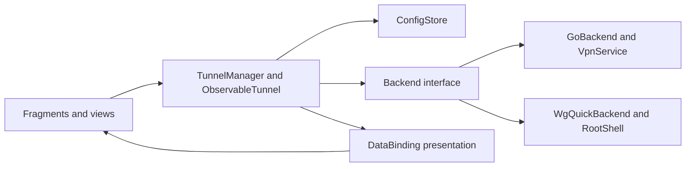
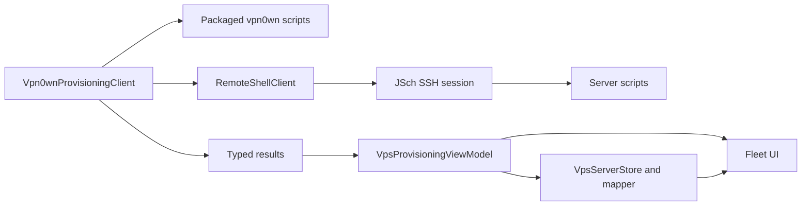

# Architecture and maintenance boundaries

Last updated: 2026-10-17 (Europe/Paris).

[Documentation index](../README.md#project-documentation) · Reviewed 2026-10-06

Preserve the existing Android DataBinding/Fragment foundation and upstream WireGuard config/backend ownership. This guide describes current code; planned integration and repairs are identified explicitly.

## Ownership

| Source/owner | Responsibility |
| --- | --- |
| `ui/.../Application.kt` | App initialization, selected backend, preferences and tunnel manager access. |
| `ui/.../activity`, `fragment`, `widget` | Navigation, lifecycle-bound views, user actions and Canvas rendering. |
| [BindingAdapters](../ui/src/main/java/com/vpn0wn/android/databinding/BindingAdapters.kt) | Simple XML presentation bindings and shared UI formatters. |
| [ObservableTunnel](../ui/src/main/java/com/vpn0wn/android/model/ObservableTunnel.kt), [TunnelManager](../ui/src/main/java/com/vpn0wn/android/model/TunnelManager.kt) | Observable tunnel data, config loading/persistence, selected operations and state notifications. TunnelManager also owns shared statistics requests and validates publication against the tunnel's session generation. |
| [Config types](../tunnel/src/main/java/com/vpn0wn/config/Config.java) | WireGuard parsing/serialization, interfaces, peers, addresses and endpoints. |
| [GoBackend](../tunnel/src/main/java/com/vpn0wn/android/backend/GoBackend.java), [WgQuickBackend](../tunnel/src/main/java/com/vpn0wn/android/backend/WgQuickBackend.java) | Userspace VPN/native activation and root/kernel command integration. |
| [Native tunnel handles](../tunnel/tools/libwg-go/tunnelhandles.go), [Android bind lifetime](../tunnel/tools/libwg-go/androidbind/bind.go), [UAPI server](../tunnel/tools/libwg-go/uapiserver/server.go) | Lookup admission and device/socket/client ownership; cancel owned I/O before draining queries and releasing the device/JNI context. |
| [RootShell](../tunnel/src/main/java/com/vpn0wn/android/util/RootShell.java) and native tools | Root command protocol and existing WireGuard tool execution. |
| [Provisioning client](../ui/src/main/java/com/vpn0wn/android/provisioning/Vpn0wnProvisioningClient.kt), models and script bundle | Remote orchestration, argument construction, packaged script upload and typed result parsing. |
| [Remote-shell boundary](../ui/src/main/java/com/vpn0wn/android/provisioning/RemoteShellClient.kt), [JSch transport](../ui/src/main/java/com/vpn0wn/android/provisioning/JschRemoteShellClientFactory.kt) | Guarded execute/upload and flow-owned SSH socket, channels, session and local close. |
| [VPS store](../ui/src/main/java/com/vpn0wn/android/provisioning/VpsServerStore.kt), [mapper](../ui/src/main/java/com/vpn0wn/android/provisioning/VpsDeployMapper.kt) | Shared fleet/credential mutation admission, non-secret records and projection into UI models; the separate credential file owns encryption and atomic ciphertext replacement. |
| [FileConfigStore](../ui/src/main/java/com/vpn0wn/android/configStore/FileConfigStore.kt) | Serialized local profile operations; private staged writes, file sync and native atomic rename preserve prior valid configs on failed updates. |
| [TunnelImporter](../ui/src/main/java/com/vpn0wn/android/util/TunnelImporter.kt), [QR scanner](../ui/src/main/java/com/vpn0wn/android/util/QrCodeFromFileScanner.kt), [ZIP exporter](../ui/src/main/java/com/vpn0wn/android/preference/ZipExporterPreference.kt) | Import result delivery, image retry/resource ownership and export children/output cleanup; models/stores retain profile ownership. |
| [Log viewer](../ui/src/main/java/com/vpn0wn/android/activity/LogViewerActivity.kt), [stream](../ui/src/main/java/com/vpn0wn/android/util/LogcatStream.kt), [buffer](../ui/src/main/java/com/vpn0wn/android/util/LogBuffer.kt) and [parser](../ui/src/main/java/com/vpn0wn/android/util/LogLineParser.kt) | Activity owns lifecycle/generation, adapter notifications and temporary shares; stream owns the process/reader and timed batches; Main owns bounded retention, continuations and filtered indices. |
| [vpn0wn scripts](../third_party/wireguard-install/vpn0wn/README.md) | Ubuntu/Debian operations, C2–C3 ownership/serialized recovery and C4 producer/consumer contracts; real-server proof remains separate. |

## Runtime flows

UI actions request model/backend changes; backend state/statistics return through observable data and bindings. Keep UI formatting separate from operation success, permission/service management and config parsing. Detail config/statistics jobs belong to the view lifecycle and guard completions by binding/selection identity. Manager admission owns state settlement; [the decision below](#tunnel-mutations-own-admission-and-settlement) describes #13's merged repairs and limits. #15's kernel transition decision is recorded below.

Peer detail rows consume nullable immutable `Statistics.PeerStats` snapshots mapped by public key. The fragment projects only a successful statistics completion for its current view, selection, resumed lifecycle and captured state; observed DOWN clears without requesting statistics. Binding helpers own localized RX/TX totals and empty/zero visibility. These view guards complement the manager's shared-cache session checks; they do not own them. The Add sheet retains native BottomSheetDialogFragment and fragment-result actions; its callback belongs to the sheet view, while existing importer/editor owners retain validation, failure and cancellation. See [source verification and device limits](development.md#add-sheet-and-peer-presentation-recovery--2026-10-06).

`View.applySafeAreaInsets` in `util/Extensions.kt` owns system-bar/display-cutout padding for MainActivity's single-/two-pane containers, TunnelCreatorActivity and SettingsActivity. The existing pure view behavior moved out of the tunnel-selection BaseActivity so Settings can reuse it without inheriting tunnel state. It clears the handled inset types for descendants while preserving IME/gesture insets. Fragments do not add the same header inset again. Settings uses PreferenceFragmentCompat with always-expanded native sections, unchanged preference keys/defaults and native action owners; eligibility filtering removes empty categories and defers the Connection header until backend/root checks finish. The editor uses a DataBinding header inside its existing fragment, matching the prototype title/context, Close and Save controls; both host activities hide their native ActionBar. Save and the retained keyboard/menu entry call the same validated persistence owner. `ObservableTunnel` retains the manager's resolved pending target for presentation, and BindingAdapters shares each rate calculation by statistics snapshot. See [presentation contracts](backend-contracts.md#persistence-and-presentation), [phone evidence](development.md#phone-ui-and-throughput-follow-up--2026-10-06) and [Settings proof/limits](development.md#settings-presentation-recovery--2026-10-06).

The Home vertical layout reserves its Add footer below a weighted scroll container. Standard Material `AppBarLayout` behavior lets the unchanged header/status scroll above the list or empty-state `NestedScrollView` in short viewports; entering or leaving selection expands the header, while count/statistics updates retain its position. Transient phone feedback reuses `Vpn0wnSnackbar` through `Snackbar.vpn0wnStyle()`, which clears the Material background tint before installing its local surface. Successful editor feedback belongs to the surviving Main/list view; Creator returns the message through the existing Android activity-result mechanism. Native Toasts remain only in the visibility contexts described in [operations](operations.md#import-edit-and-connect); no new feedback service or state model is introduced.

Import/export children belong to their operation rather than the application scope. Valid ZIP entries settle independently through the existing manager; completion feedback runs once afterward. QR decoding owns each reopened input/bitmap. Narrow error handling preserves cancellation and exposes programming defects while existing generic Backend/ConfigStore boundaries retain needed reconciliation/reporting. [Import/export contracts](backend-contracts.md#import-ordering-and-export) records failure and output-acquisition limits; no new service, parser or dependency is introduced.

For #166, `BiometricAuthenticator` owns one pending native authentication session per Activity through a retained ViewModel. AndroidX 1.1.0 shares a mutable callback between that Activity's fragments, so independent per-view request tokens alone cannot prevent an old native success being retargeted to a new request. The Activity constructor, one-session admission and immediate native-event capture preserve the original callback through rotation and queued delivery; existing sensitive-action owners still validate current policy/view/configuration before output. A fragment-local prompt, immediate slot release on view destruction or a plain Activity-keyed map would lose this retained ownership. A pending prompt must reach its native terminal event before another native action can start; permanent Activity destruction settles the caller. This changes neither configured-authentication/no-lock policy nor app storage format. Focused shared-callback controls and separately scoped native DPC/PIN evidence are linked from [the audit follow-up](reviews/2026-10-12-app-root-security-audit.md).

The [G2 performance investigation](reviews/2026-10-07-performance-source-investigation.md) traces polling/model publication, view animation and native transfer owners. Resumed/attached presentation is not necessarily uncovered: the investigated single-pane Detail left Home active, and hidden attached widgets retain animator callbacks (#47). The later [#193 navigation repair](qa-test-plan.md#detail-header-action-controls--193) hides the retained phone Home view within the Detail transaction; it does not remove that Fragment or establish a polling/energy improvement. Its historical shared-statistics gap is addressed by the separately authorized #48 source implementation described below and in [presentation contracts](backend-contracts.md#persistence-and-presentation); current change acceptance belongs in its PR. Keep native packet/config ownership and defer measured optimization selection and physical evidence to G4. Source changes do not establish energy or throughput gains.

The provisioning client, scripts, concrete transport and protected credential store connect to the read-only Detect/Plan wizard. Its retained ViewModel owns draft/operation lifetime and local save outcomes; the Fragment presents typed results and saved-access controls. Confirmed fresh installation is delivered through merged [PR #201](https://github.com/novakin/vpn0wn-android/pull/201). Guarded creation/encrypted retention extends the same owners. [Combined source checks and scoped synthetic output](qa-test-plan.md#scoped-integrated-create-verification--2026-10-16) pass. [PR #202](https://github.com/novakin/vpn0wn-android/pull/202) delivered guarded creation/encrypted retention after independent ultra review and final-head CI; native/live acceptance remains pending. The delivered [authenticated profile-access slice](backend-contracts.md#fresh-online-authenticated-profile-access--143) extends these owners with fresh-online QR/export/local DOWN import; its [focused source gates and corrected synthetic output](qa-test-plan.md#corrected-synthetic-profile-output--2026-10-16) pass. [PR #203](https://github.com/novakin/vpn0wn-android/pull/203) delivered this source after independent ultra review and final-head CI; native/live acceptance remains open. Confirmed exact-identity removal extends these owners with durable uncertainty and read-only reconciliation; overwrite/reinstall, revoke/archive and rotation remain unavailable. Synthetic transport/owner controls and rendered profile output establish no physical Android wizard/transport, live deployment, live user-management or camera-scanned QR acceptance. The separate [native API-24/28 storage record](reviews/2026-10-15-native-ssh-credential-storage-acceptance.md) adds seven bounded Keystore/store/filesystem controls on an isolated acceptance artifact.

## Boundaries and invariants

These are required maintenance invariants, not guarantees that all current owners already meet them. `VpsServerStore` uses DataStore transactions and nullable observed running health; `FileConfigStore` serializes operations and commits synced staged files through native atomic rename. PR #25 merged manager/detail/userspace lifecycle repair; #15 implements kernel transition serialization with controlled offline proof. Exact contracts and proof limits belong below and in the backend contracts.

- `.design/` supplies read-only visual intent; it does not establish runtime capability.
- Config parsers and backends preserve supported WireGuard behavior. Do not invent another parser for generated/imported profiles.
- Stores must preserve prior valid data and serialize conflicting mutations through the responsible persistence mechanism. Backend transitions must settle on success/failure/cancellation.
- Transport owns its channels/sessions, real deadlines and cancellation. A coroutine wrapper alone cannot prove cancellation of blocking library calls.
- Shell argument quoting protects shell construction; script/config validation and ownership checks protect privileged writes. Neither substitutes for the other.
- Logs/errors expose useful categories and non-secret status, not raw private config/credential payloads. Internal results may legitimately carry a generated profile; they are not safe to stringify into diagnostics.
- Revocation/install/uninstall success needs effective postconditions and recovery semantics. Recent synchronization is not running health.
- Keep [pinned upstream attribution](../third_party/wireguard-install/UPSTREAM.md). The original interactive installer is reference material, not the Android execution path.

See [backend contracts](backend-contracts.md) for known divergences and [the plan](improvement-plan.md) for repair ownership.

## Consequential decisions

### Stage pinned native source for supported Go overlays — #215, 2026-10-17

**Problem:** the former Go 1.24.3 runtime/module pins are outside the selected supported release lines and retain advisory version matches. Go 1.26 rejects the existing overlay's module-cache targets. Updating the compiler alone therefore breaks the native build and host ownership controls.

**Decision/status:** the authorized #215 maintenance source selects Go 1.26.9, `x/crypto v0.58.0`, `x/net v0.61.0` and `x/sys v0.49.0`. The WireGuard pin and runtime patch remain unchanged. Extend the existing overlay generator: validate the original exact pin/reject original replacements, refresh a per-output copy of upstream source, then generate private module files with one relative local replacement. Apply the same exact-match overlays to that stage. Android Make and host tests pass the generated module file explicitly; production per-ABI stages and the host stage remain distinct. Go's standard package cache handles rebuilds without the old module-index override.

**Alternatives and consequences:** a compiler-only upgrade cannot keep module-cache overlays working. Vendoring would expand the maintained generated source/module tree beyond this adaptation. Selecting Go 1.26 preserves its macOS 12 minimum; Go 1.27 raises that minimum to macOS 13. The staged-source approach adds an owned disposable copy without changing tracked dependency source or shared cache bytes. A generated local replacement omits the original dependency h1 from embedded Go metadata, although the required version remains. Keep original `go.sum`, verified download identity and explicit source/cache comparisons as provenance. `go mod verify` passed in this run; ordinary product builds do not execute it on every invocation. Relative replacement metadata avoids embedding an absolute workstation path.

**Verification and limits:** [the dated maintenance record](reviews/2026-10-17-native-toolchain-maintenance.md) owns the native race/JNI, four-ABI, unchanged patch, incremental, notice and exact-artifact scanner evidence. Separate-package API24 x86_64 activation, authenticated loopback traffic, retained-session rebind and explicit DOWN pass there. The packaged stripped arm64 library has no scanner symbol inventory; its byte-matched unstripped counterpart provides bounded symbol evidence. Full repository gates and final-head acceptance remain pending. Darwin execution, hardware suspend, external peers, signed distribution, DPI and energy gains are unverified. No packet scheduling, port policy, JNI lifetime, recovery algorithm or protocol change is selected. Existing #61/#73 and release/distribution gates remain separate.

### Capture managed server state before portable recovery — 2026-10-16

**Problem:** the old backup read config without writer admission and returned only a revoked count. It could mix generations and could not preserve revoked records for disaster recovery. Per-mutation recovery directories are not portable backups; the fresh-restore source owner below separately preserves its prior empty history for rollback.

**Decision/status:** the first [#196](https://github.com/novakin/vpn0wn-android/issues/196) slice extends the existing backup command/result with a bounded, versioned, lossless-text snapshot of owned config and retained revoked bodies under the same interface lock as writers. Keep existing orchestration and response fields; require the matching packaged parser/scripts. Archive basenames remain metadata, not extraction destinations. This snapshot slice reuses Bash/coreutils/`iconv` and Android's installed JSON/time support without an archive framework, transport or crypto dependency. The separate experimental codec decision below adds one concrete KDF dependency; it does not change snapshot acquisition. [Backend contracts](backend-contracts.md#managed-server-snapshot--196) owns exact schema and limits.

**Alternatives/consequences:** counting revoked files loses the evidence needed to preserve access decisions; taking independent unlocked reads permits mixed generations. A tar/ZIP filesystem extraction layer adds paths and file types this snapshot does not need. Reusing Keystore ciphertext as the portable format prevents recovery without the original device. The experimental codec and fresh-destination restore preparation below are separate source slices; recovery-secret/file UI and integrated operational acceptance remain unfinished. Keep server WireGuard identity separate from destination SSH trust and client private-profile retention.

**Verification/migration impact:** offline shell controls exercise exact text, complete history, writer exclusion, unsafe state, limits and payload-free failure; Android and injected harness controls consume the versioned response. No live restore, file export or packet outcome is established. The fresh-destination slice below adds prior-empty-history rollback, captured keys and regenerated destination rules; replacing an existing installation still needs complete retained-history recovery, preview and operational proof. No destructive target is authorized by this record.

### Experimental portable backup cryptography — #196, 2026-10-16

**Problem:** the chosen-password recovery requirement must survive loss of the original installation while preserving minSdk 24. The device Keystore credential file cannot provide portable recovery. Android documents platform PBKDF2-SHA256 at API 26+, while current OWASP guidance reserves SHA1 PBKDF2 for legacy systems.

**Decision/status:** source preparation uses one internal `VpsBackupArchive` owner, BC 1.86's lightweight Argon2id byte API at one fixed 19 MiB/two-pass/one-lane profile across API 24+, and provider-neutral platform AES-256-GCM. No provider registration, custom KDF, native crypto fork, scheduler or general archive service is added. The user selected a chosen password; this source candidate does not establish independent approval of a final format. The later [private export candidate](backend-contracts.md#private-encrypted-server-export-candidate--196) uses this owner; no public writer-format freeze follows. [The contract](backend-contracts.md#experimental-password-archive-codec--196) owns framing, Unicode, bounds and cancellation; [license provenance](license-attribution.md#bouncy-castle-backup-kdf-notice) owns the pin and complete notice.

**Alternatives/consequences:** a random recovery code avoids KDF cost but does not satisfy the selected password workflow. Device-only keys cannot recover after installation loss. Raising minSdk, using a hidden/platform-provider fallback or hand-writing PBKDF2 would violate compatibility or ownership. BC PBKDF2-SHA256 is interoperable but requires the same new dependency and lacks the selected Argon2id memory cost. BC adds maintenance, notice, packaging and heap responsibilities; pure Java source compatibility is not Android runtime proof. A single reviewed profile bounds attacker-selected work and keeps a later cost/version transition explicit.

**Dependency interaction:** JSch's base optional XDH/EdDSA implementations become loadable when BC classes exist. Its default signature probe list is broader than this app's admitted host profile. The existing session owner now pins `CheckSignatures` to the unchanged RSA/ECDSA host list; cipher/KEX checks already intersect their explicit app profile. The fail-on-init excluded-probe regression retains actual RSA/ECDSA peer connections and restores temporary global mappings after cleanup. The [scoped JVM run](qa-test-plan.md#experimental-password-archive-controls--196) includes 29 passing SSH controls with BC present. This avoids adopting optional probes while preserving supported negotiation/authentication and PEM formats; final integrated-head checks and native SSH regression remain separate.

**Verification/migration limits:** the initial source checkpoint was uncompiled/unexecuted; subsequent scoped JVM/static and [native API24/API36 evidence](reviews/2026-10-16-native-backup-codec-acceptance.md) retain their producer revisions. Native linkage/interoperability and named memory/GC/cancellation controls pass, but initial API36 cold p95 exceeds the proposed target. A separately predeclared settled diagnostic passes only that conditioned scope. The profile/format remains experimental and unchanged; overall cold-performance, oldest physical/OEM cost and production UI/ANR gates are not accepted. Final integrated-head checks/review remain required. No app data or existing archive migration occurs; no production writer or old-format compatibility reader is installed. These controls do not establish safe restore directives, file-provider cleanup, cross-installation user recovery or live-server results.

### Reuse existing owners for private encrypted export — #196, 2026-10-17

**Problem/decision:** the committed Backup placeholder truthfully reported unavailable but had no real file path. The private candidate now extends the existing Fragment/ViewModel, protected credential access, provisioning client, archive codec and Downloads writer; no generic document service, SAF framework, scheduler or new crypto dependency is added. The exact current saved record/pin and selected/fresh/captured WireGuard identity guard the exported snapshot. ViewModel busy lifetime includes encryption and the output consumer; Fragment owns authentication, password editors and selected-view authorization. Passwords and plaintext are never durable operation state.

**Alternatives/consequences:** an unused IO foundation would lack a supported caller; adding a file-inspection surface would not complete the requested export. Existing Downloads ownership/cleanup fits this first complete path. Lifecycle retirement deliberately requires reauthentication/reentry rather than restoring a sensitive draft. Output failure and process death can leave encrypted provider residue; clearing arrays cannot erase immutable snapshot strings or provider/library copies. The candidate keeps the fixed KDF and retains the failed cold target. The [scoped API34 native writer record](reviews/2026-10-17-native-backup-export-acceptance.md) passes responsiveness, cancellation/drain and independent owned-output recovery under the conditional policy below; final integrated-head checks/review still gate publication/merge. [Contract](backend-contracts.md#private-encrypted-server-export-candidate--196) and [QA](qa-test-plan.md#private-encrypted-server-export-controls--196) own precise behavior and proof.

### Reuse native document-result ownership for local inspection — #196, 2026-10-17

**Problem/decision; source candidate:** encrypted export needs a real local recovery reader before guarded restore. Extend the current Fragment, ViewModel and codec with native `OpenDocument`, existing device authentication and a format-specific bounded reader. Retain only the outstanding-picker boolean across recreation: actual registry probes show restored request-code reuse and result delivery before the view starts. Keep URI/password/snapshot out of app-owned durable state and defer presentation until the original view starts. Android can save a pending native picker Intent/URI; the restored fence discards it before authentication/read rather than promising framework-wide URI erasure. Existing lifecycle/dialog ownership retires secret phases; no new screen, document framework or background service is needed.

**Consequences/alternatives:** restoring a secret session or attaching an old result to a new launch would bypass action ownership. The picker fence can delay another launch until the old result drains. Native cancellation and owned descriptor closure cannot guarantee an arbitrary provider returns promptly; keep busy until actual drain. Publish a safe public summary only, without pretending successful decryption validates the stricter restore grammar. [Contracts](backend-contracts.md#local-encrypted-backup-inspection--196) and [QA](qa-test-plan.md#local-encrypted-backup-inspection-controls--196) own detailed bounds and actual proof. No server or persisted-record migration follows this local reader.

### Private writer derivation-cost acceptance policy — #196, 2026-10-17

**Problem/status:** the fixed minimum Argon2id profile has interoperable native evidence but its initial API36 cold p95 is 3044.284840 ms, above the proposed 2000 ms UX target. The independent source/format assessment considers the fixed profile defensible and recommends accepting occasional multi-second derivation only with responsive integrated UI and settled cancellation. The [scoped API34 writer trial](reviews/2026-10-17-native-backup-export-acceptance.md) and independent evidence review now pass this bounded conditional gate at unchanged costs. The candidate remains unpublished, with final integrated-head checks/review separate; this accepts neither a writer-format freeze nor universal cold performance.

**Decision/alternatives:** keep Argon2id v1.3 at 19,456 KiB, two passes and one lane, exact password encoding, authenticated envelope and existing bounds. Treat the proposed two-second p95 as a measurement target, not a universal security or shipping condition. The candidate's publication acceptance instead requires targeted evidence on the available Android API34 environment that Main remains responsive during actual snapshot/encryption/write, progress is truthful, Cancel immediately retires UI authorization and structured workers/resources drain without success or secret retention. Do not weaken the KDF, pool/prune the failed cohort, repeat benchmarks to obtain a preferred result or perform hidden password/KDF warm-up. A security/format change still requires a separately reviewed version/compatibility decision.

**Consequences/verification:** preserve the initial API36 FAIL, the separate settled diagnostic and the fresh-boot cohort including its first 6004.295886 ms maximum. Actual API34 proof must identify its final source/artifact, operation, responsiveness observations, cancellation/drain/readback and restoration scope before acceptance is claimed. A passing targeted UI control will not establish universal derivation latency, oldest physical/OEM performance, every provider/process-death outcome, restore or release acceptance. Keep those coverage limits explicit. [QA](qa-test-plan.md#private-encrypted-server-export-controls--196) owns the integrated checks; the [dated native export record](reviews/2026-10-17-native-backup-export-acceptance.md) owns the passing observations, retained failures and independent evidence verdict. Final integrated-head acceptance remains separate.

### Restrict initial restore to a fresh destination — #196, 2026-10-16

**Problem/decision:** an authenticated snapshot can still contain unsupported privileged directives, stale revocations or a server identity unrelated to the intended source. Extend the existing packaged-script, provisioning client and mutation owners with a source-only fresh `wg0` path. Validate the whole ordered supported server/peer grammar before writes, confirm the derived source server key, independently authenticate destination SSH and require absent config/interface, empty history, protected root-owned directories and a free destination UDP port. Observed IPv4 address prefixes/routes must be disjoint from the pool, except ordinary unicast default routing. Reuse installed tools without package installation. The snapshot/codec foundation is delivered through merged [PR #204](https://github.com/novakin/vpn0wn-android/pull/204); source delivery subsequently completed through merged [PR #205](https://github.com/novakin/vpn0wn-android/pull/205), after final-head independent ultra review and CI.

**Alternatives/consequences:** replaying raw hooks or using the Android client Config parser would admit the wrong grammar. Replacing an existing owned installation would require a separate preview, approval and complete historical-state rollback boundary. A new orchestration service or generic archive framework is unnecessary. The script regenerates known hooks and endpoint metadata, retains keys/PSKs and revoked bytes, and admits historical subnet/name/address reuse while rejecting active/revoked key overlap. Host-then-interface locks and existing checked config/runtime/service recovery gain restore-only prior-history and live-forwarding restoration. External writers, killed processes and lost responses still need reconciliation.

**Verification/migration impact:** `ProvisioningJson.encodeBackup` becomes the shared bounded snapshot serializer for codec and client; archive framing, KDF costs, password rules and persisted fleet/profile schemas stay unchanged. The client uploads private files under its existing operation directory and correlates the typed receipt with captured CIDR/active peer count as well as identity/destination/history. Existing remote cleanup attempts bounded same-client removal under `NonCancellable` before final transport close; handling cleanup Throwables within that context preserves identity/suppression. [Contracts](backend-contracts.md#fresh-destination-restore-source--196) own exact admission, grammar, postconditions and limits; [QA](qa-test-plan.md#fresh-destination-restore-controls--196) records passing scoped checks, retained failed attempts and subsequent source delivery. No UI, writer-format freeze, same-host replacement, client endpoint rewrite, live restore/traffic, native SSH or release acceptance follows. Revisit replacement or broader grammar only with its explicit contract and proof.

### Handshake observations follow native protocol and activation owners — 2026-10-09

**Problem:** configured UP and cached handshake timestamps do not distinguish an attempted initiation, local send, authenticated completion or exhausted protocol retries. Statistics generations also change during reads/config/name work, so they cannot identify an entire native activation. Device-wide or timer-expiry labels can falsely attribute failure to every peer or to idle/Doze silence.

**Decision/status at 2026-10-09:** E5's first [#73](https://github.com/novakin/vpn0wn-android/issues/73) source slice was a local draft. Extend the existing version/match-checked overlay at the pinned WireGuard initiation, retry-exhaustion and authenticated-completion owners. `androidbind`, JNI and `GoBackend` deliver safe per-peer observations to `ObservableTunnel`; protocol owners retain all handshake/retry timing. Native callbacks stage bounded events only. The backend coalesces delivery through default `Tunnel` callbacks on a Handler outside all backend/native/context locks, and the model validates a distinct `HandshakeSession` lifetime before and after Main dispatch. [The handshake contract](backend-contracts.md#native-handshake-observations--73-draft) owns event meanings, unavailable values and clearing. Userspace is supported by this draft; kernel observations/recovery remain unavailable. Draft source and local controls do not complete #73, publish a PR, establish CI or authorize device/APK work.

**Alternatives/consequences:** statistics polling loses protocol progress and supplies no retained transport identity; a new monitor, ping loop, wake lock or scheduler duplicates existing owners. A broad upstream fork expands maintenance beyond the existing exact-pin overlay. Public read-only session/observation types and default `Tunnel` callbacks cross the tunnel-library/UI ownership boundary without a general subscription framework or synchronous backend queries. Keep per-peer observations separate from UP and reachability, without recovery counts or transport mutation in this slice. Preserve saved configuration, endpoint-free/multi-peer profiles, explicit ListenPort and protocol timing. The [bootstrap policy](operations.md#recovery-and-bootstrap-policy--73-draft) permits no outside-tunnel hostname DNS under lockdown and grants no exception for unknown policy.

**2026-10-10 status:** the bounded source slice is merged through [PR #101](https://github.com/novakin/vpn0wn-android/pull/101). [Private Android acceptance](reviews/2026-10-10-native-handshake-avd-acceptance.md) observes JNI protection entry, distinct protocol/model facts, manual session retirement/replacement and corrected forced screen-off idle/private wake reachability against an independent unchanged userspace peer. It retains failed reader attempts, debugger timing, protection-return and unavailable packet/physical limits. This updates the earlier draft status without changing owner/recovery decisions or claiming release, rebind or full #73 delivery.

**Rebind prerequisite identified before the next slice:** pinned `Device.BindUpdate` takes the network write lock before closing sockets, while `Peer.SendBuffers` holds its read lock during send. A JNI rebind under `GoBackend.stateLock` could therefore reproduce #68's blocked-send/DOWN deadlock. Retained-TUN recovery needed the existing handle borrow, invocation outside the Java state lock, captured-bind I/O cancellation before waiting, UAPI/recovery serialization and terminal shutdown/replacement rejection. This historical rationale remains valid; the source decision below addresses it without completing #73's higher-level recovery acceptance.

**Retained-TUN decision/status — 2026-10-10 (Europe/Paris):** the source implements `GoBackend.rebind(Tunnel)` and the pinned `Device.Rebind` overlay. Java captures tunnel, handle, exact service and activation under `stateLock`, invokes JNI outside it and rejects retired/replaced identity on return. Native handle admission borrows the existing device/context. `Device.Rebind` first uses the existing IPC mutex's `TryLock`; busy admission changes no sockets. It then closes the captured bind to settle sends before `BindUpdate` waits for the network write lock. Terminal bind shutdown and device-down checks prevent admitted recovery from reviving a retired activation. [The rebind contract](backend-contracts.md#retained-tun-userspace-rebind--73) owns return, failure and interruption details.

**Alternatives/consequences:** waiting for the network lock before cancelling sends retains the deadlock; holding Java state admission across JNI blocks manual DOWN and destruction. Rebuilding the entire VPN/TUN or adding a recovery service changes more ownership than this primitive needs. The chosen path retains the TUN, peers, configured port and handshake session; automatic-port warm-up intent remains unchanged. Inactive, unavailable, busy or obsolete activations return false without bringing a tunnel UP. Protection/open failures remain I/O failures and may leave the retained activation with unavailable transport; an unexpected retained JNI callback exception remains terminal under the existing context contract. Interrupted callers are refused before native entry; admitted work settles before interruption propagates, preserving the flag and activation context. Manual DOWN/replacement retires the old activation. This userspace primitive adds no automatic trigger, DNS, endpoint/config rewrite or UI; kernel recovery remains unsupported.

**Verification/publication limits:** local [native rebind controls](qa-test-plan.md#native-rebind-controls--73) and host race/JNI checks cover the lock/cancellation boundary, busy admission, protection failure, terminal closure, retirement and retained-context interruption. The current PR acceptance record owns exact-head independent review, required checks, publication and delivery state. [Rooted Android acceptance](reviews/2026-10-10-native-rebind-acceptance.md) separately records protected socket replacement with retained TUN/session, synthetic authenticated HTTP traffic, debugger-injected protection failure/retry and actual Android service destruction followed by fresh activation and restoration. It changes no owner decision. Actual OS protection denial, concurrent phone races, interruption, physical network transition, packet, IPv6 traffic, DPI and release acceptance remain unproved. #73 stays open for higher-level recovery, presentation and full runtime acceptance.

### Proposed exhaustion-only recovery — 2026-10-10

**Problem:** observations and retained-TUN rebind do not define automatic admission. A queued trigger can capture a replacement session of the same model; current boolean results hide mutation/obsolete distinctions. EXHAUSTED publication precedes native cleanup, and manager serialization held across blocking JNI would prevent DOWN from cancelling socket I/O.

**Decision/status — 2026-10-10 (Europe/Paris):** recommend the independently ultra-reviewed [bounded #73 planning contract](backend-contracts.md#proposed-bounded-automatic-recovery--73): fresh native exhaustion, current numeric endpoint, expected-session backend admission and a protocol-owned atomic claim of the triggering exhausted cycle. Documentation adoption does not approve new runtime/API policy or defaults, implement recovery or add runtime evidence. The maintainer must select the pilot/defaults before automatic implementation. Existing observation/rebind behavior remains unchanged; #113 presenter delivery is merged within its scoped acceptance.

**Ownership and rationale:** extend `TunnelManager`/`ObservableTunnel`, `GoBackend` and existing timer/bind/handle/JNI owners. Use short manager admission/reconciliation; keep blocking JNI off Main and outside both manager operation and backend state locks. Native exhaustion cleanup must settle before claiming that episode; the claim must reject authentication and delayed exhaustion A after cycle B. Preserve the existing cancellation-before-drain teardown path. Keep one activation-wide in-flight operation and finite conservative accounting under the contract; the exact native lock/claim design remains an implementation gate.

**Alternatives/consequences:** triggering on a transient send failure or stale age would bypass native retries and invent failure during idle/Doze. Continuous monitoring, ping, wake locks, a new service/scheduler and full VPN rebuild add unnecessary ownership. Calling existing boolean rebind blindly cannot prove non-mutation, admission or initiation. A qualifying peer's replacement affects all shared sockets, so transport state is activation-wide while initiation/authentication stay peer-attributed. The pilot preserves saved profiles, current numeric destinations, port/warm-up intent, protocol timing and manual transition/restoration behavior; kernel recovery, DNS/family rewriting and preemptive handover remain outside it. #73/#75 bootstrap and #74 arbitration require their separate policy choices.

**Verification/migration impact:** no source, public API, persistence format or migration changes with this proposal. Require [future deterministic owner controls](qa-test-plan.md#proposed-recovery-controls--73), final-head independent ultra review of code/owning docs and actual required checks before delivery. Separately authorized Android/packet proof retains its own scope. Revisit when the maintainer selects defaults, the native claim design changes, or broader DNS/network/arbitration scope is selected; full #73 remains open.

### Bounded manager recovery controller — 2026-10-12

**Problem:** the selected #73 primitive cannot by itself bound automatic requests, preserve charges across cancellation or attribute delayed completion to the current native activation. Holding the manual mutation lock across recovery would prevent DOWN from reaching native teardown.

**Decision/status:** implement the maintainer-selected pilot in `TunnelManager` and `ObservableTunnel`, reusing the existing expected-session `GoBackend.recover` entry. The manager owns one record keyed by managed model, backend and exact native session, with bounded per-configured-peer episode evidence, two charged attempts, 30-second charged spacing, four actual entries and one pending/in-flight request. Claim that request before waiting for the existing mutex; drop competing evidence without queued replay. A fresh receipt for each backend entry records entered/result/failure before dispatch. Interruptible IO runs outside the mutation lock; cancellation-safe child join, Main accounting and slot release settle before cancellation or unexpected defects propagate. One explicit nonmutating reusable BUSY result permits one cancellable 1-second deferral.

**Alternatives/consequences:** a general recovery service/provider/clock framework adds ownership this fixed flow does not need. Reusing statistics-read cancellation would discard mutation evidence; clearing counters on a no-op UP would permit a third same-session replacement. Manual invalidation therefore cancels the request generation without resetting same-session accounting or known transport facts, and never joins while locked. Restoration retains the existing serialized transition owner without the public manual hook. Only native retirement/new session hides/refills the record. The snapshot reports counts, fixed categories, observed power and shared transport facts without converting historical authentication into health. Expected I/O failure disables further automatic work when settlement is unknown; no logs retain exception payloads.

**Verification and limits:** actual manager/final-GoBackend tests use native-only responses, coroutine scheduling and Android elapsed time for admission, refusal, Doze, pending bursts, no-op manual intent, cancellation and blocked DOWN. Focused checks, final-head independent ultra and required CI remain distinct gates; [scoped integrated Android acceptance](reviews/2026-10-13-bounded-recovery-acceptance.md) records natural explicit/omitted-port recovery, fresh two-attempt budget execution with four live TUN identity samples and sampled restoration. [PR #164](https://github.com/novakin/vpn0wn-android/pull/164) owns final controller-head review/CI and integration delivery; broader Android/packet proof retains its separate gates. The underlying primitive is delivered through [PR #162](https://github.com/novakin/vpn0wn-android/pull/162). No recovery UI, DNS/family/config rewrite, network trigger, monitoring/ping/wake lock, UP or restoration-intent write is added. Full #73, hostname/handover/bootstrap and #74 arbitration remain open.

### Expected-session recovery primitive — 2026-10-12

**Problem:** the approved bounded pilot needs exact native exhaustion admission; Java sequence and existing boolean rebind cannot prove cycle identity, nonmutation or usable settlement. Authentication can precede its diagnostic callback, and a public-key peer can be removed/re-added within one device.

**Decision/status:** following [maintainer selection](https://github.com/novakin/vpn0wn-android/issues/73#issuecomment-6121757274) on 2026-10-12 (Europe/Paris), implement the first separately reviewable primitive in existing overlay/bind/handle/JNI/`GoBackend` owners. Device-wide monotonic tokens and a short peer recovery owner coordinate settled exhaustion, ordinary initiation eligibility, accepted protocol state and responder confirmation. Static identity precedes recovery during preparation; an internal caller-owned-static-lock helper avoids recursive read-lock acquisition with a pending writer. Non-waiting IPC/peer claim validates the exact episode and numeric endpoint. Locks release before native I/O and observation publication. Java validates expected session inside state admission, calls JNI outside `stateLock`, and retains mutation evidence when completion becomes obsolete.

**Alternatives/consequences:** an IPC-only gate misses timer/authentication races; per-peer reset counters permit same-key replacement ABA. Holding recovery across a send would block cancellation, while introducing a monitor/service would duplicate established owners. The explicit library API exposes fixed settlement facts needed by the selected application controller, preserving `rebind(Tunnel)` and the prior observation constructor. No app caller/automatic trigger, budget/accounting, persistence or migration is added. Shared replacement affects all peers; failed transport can require manual reconnect. The [contract](backend-contracts.md#expected-session-exhausted-cycle-recovery-primitive--73) defines outcomes and initiation/cancellation linearization.

**Verification and limits:** require actual timer/protocol claim and progress-window controls, pending-static-writer and blocked-send teardown proof, JNI token/interruption/context checks, expected-session Java lifecycle controls and all native ABIs. Final-head independent ultra and required CI remain separate gates. Existing manual-rebind/device evidence cannot establish this primitive or automatic recovery runtime; full #73 and controller integration/runtime acceptance remain open.

### Android owns system VPN policy — 2026-10-09

**Problem:** the prototype's always-on/kill-switch toggles could imply app-owned protection. Android policy, tunnel state and observed traffic have different owners and acceptance boundaries.

**Decision/status:** implement the authorized setup/status slice of [#75](https://github.com/novakin/vpn0wn-android/issues/75) in the existing `SettingsFragment`/native Preference owner. One nonpersistent action opens Android VPN Settings; foreground lifecycle refresh reuses existing backend policy getters with API/backend eligibility. Android retains policy writes. [Operations](operations.md#android-system-vpn-settings) owns setup/support and [backend contracts](backend-contracts.md#android-system-vpn-policy-observation) owns observation semantics. Missing service access remains unknown; kernel mode is unsupported by this userspace path.

**Alternatives and consequences:** app-owned Boolean toggles cannot configure ordinary-app system policy. A dummy VPN, SOCKS/netstack kill switch or extra service would change routing/lifecycle ownership without a bounded requirement. Reusing the Settings and backend owners adds no service, persistence migration or policy/routing change. Endpoint bootstrap and manual/recovery/automation arbitration remain undecided in #73/#74. Revisit this decision if those reviewed contracts require another owner-level change.

**Verification and limits:** require injected API/backend/admin/launch and lifecycle controls under [QA acceptance](qa-test-plan.md#android-system-vpn-policy-acceptance). Source checks do not establish rendered device output, system-policy enforcement or packet protection; full #75 acceptance remains open.

### Shared statistics belong to the manager — 2026-10-08

**Problem:** overlapping explicit readers and the bindable getter could issue duplicate backend calls. A delayed completion could refill the shared cache after DOWN, reconnect or replacement. Detail's view guards did not protect other consumers.

**Decision/status:** the maintainer separately authorized #48 implementation on 2026-10-08 (Europe/Paris). The source implementation makes `ObservableTunnel.statistics` cache-only. Existing Home/Detail/TV pollers request snapshots through `TunnelManager`, which shares equivalent reads in the existing application scope and validates session identity before Main publication. The model retains an atomic generation because backend notifications can arrive from worker threads before Main reconciliation; the cache getter also checks that generation. Mutation and backend-switch owners invalidate their affected sessions. [Presentation contracts](backend-contracts.md#persistence-and-presentation) own freshness, cancellation and unavailable-result details. The issue/PR own executed checks, independent review and delivery state; this decision record does not claim merge.

**Alternatives/consequences:** keeping one read per caller preserves duplicated work and gives no shared publication boundary. Running IO under the mutation lock would delay teardown. A new statistics service or polling scheduler duplicates the existing owners. Manager-owned sharing preserves each backend `Statistics` object and existing polling cadence without a new dependency, persistence format or protocol change.

**Verification/migration limits:** require synthetic overlap, session-change, cancellation/failure and retry controls, plus existing presentation/lifecycle regressions. `runInterruptible` can interrupt cooperative blocking Java work; it cannot guarantee cancellation of blocking JNI. Native resource owners remain responsible for IO teardown. No APK, phone, root/backend operation or speed/battery measurement forms part of this source slice. Revisit if supported statistics ownership or backend lifecycle changes.

### Native UAPI client lifetime — 2026-10-07

**Problem:** closing only the UAPI listener leaves accepted `IpcHandle` clients alive; partial requests can retain the device IPC lock. The pinned listener also queues accepted connections behind a producer that can remain blocked during close. Initial failure paths used inconsistent device cleanup.

**Decision/status:** source repair merged through [#67](https://github.com/novakin/vpn0wn-android/pull/67) at `5f4bbcd9`, closing [#66](https://github.com/novakin/vpn0wn-android/issues/66). The native handle owns a small `uapiserver.Server` backed directly by a standard Unix listener, standard connections and synchronization. Preserve the app-cache path, private socket permissions, active-socket refusal, bounded stale-path recovery and unlink-on-close. Stop admission, close tracked clients, then drain handlers before device cleanup. Startup failures use the same ordering; close the complete device after rejected initial settings. The enclosing Java/native query lifetime requires the separate repair below.

**Alternatives and consequences:** listener-only closure cannot cancel accepted reads or upstream queued connections. Device-only closure cannot release a client blocked while holding the IPC lock. Patching the upstream queue would retain file-duplication/watcher lifecycle and add build-overlay maintenance; direct standard listener ownership fits the Android handle and needs no new dependency or UAPI protocol. Upstream deletion monitoring only stopped acceptance, so removing it does not remove device shutdown/recovery behavior. External unlink still makes the path unreachable and does not terminate the device. Client closure settles I/O without rolling back admitted settings. Native builds invoke cached `go build` each time so Go/JNI/helper edits participate in dependency checking. This costs dependency evaluation on an unchanged build and avoids maintaining a second incomplete source list.

**Verification and limits:** Unix-listener race controls cover idle/partial requests, handler drain, concurrent close/admission, active-path refusal, stale-path/private-mode recovery and non-socket preservation; the partial-request fixture invokes the pinned real WireGuard handler. Native compilation covers all four supported ABI mappings, and a disposable source-edit fixture reproduces stale output before confirming a rebuild. No APK, phone, external peer or server operation establishes runtime delivery. See [executed checks](development.md#native-uapi-lifecycle-and-incremental-builds--2026-10-07).

### Native query admission and terminal bind shutdown — 2026-10-07

**Problem:** Java statistics held the transition lock while `IpcGet` could wait behind a partial UAPI request. DOWN could not enter native teardown to cancel that request. Native lookups also raced table removal, and reused IDs could target a replacement device. Pinned Android descriptor methods dereference missing UDP families without a nil guard.

**Decision/status:** shared source repair merged through [PR #69](https://github.com/novakin/vpn0wn-android/pull/69) at `6bb17579`, closing [#68](https://github.com/novakin/vpn0wn-android/issues/68). Snapshot tunnel/handle under Java's existing lock, query outside it and reject changed identity on return. The native table owns admission/removal under its mutex and admitted-query counting; never wait under that mutex. Remove admission, terminally close the captured bind, close/drain UAPI, drain queries, then close the device. Monotonic nonnegative process-local IDs fail at exhaustion instead of reusing identity. That shared repair used the retained baseline's standard-bind wrapper. Current native warm-up uses `androidbind.Bind` as the single generation/protection/shutdown owner and releases JNI context after device cleanup. Its overlay helper incorporates the same unavailable-family guards without retaining a second bind or helper.

**Alternatives and consequences:** waiting for queries before I/O cancellation retains the deadlock. Fetching `Device.Bind()` during close can wait on the network lock held by reconfiguration. A captured standard bind gives teardown its cancellation owner; terminal shutdown prevents admitted UAPI from reopening it. A narrow version/match-checked build overlay adds nil guards to the pinned descriptor owner, preserving unavailable-family `-1` results without mirrored family state, reflection or panic recovery. Host helper execution and per-ABI outputs preserve cross-compilation; cached upstream source is not patched, while module download may populate an empty cache. Remove the descriptor patch when a reviewed upstream update supplies equivalent guards; retain other patches until their own behavior is supplied upstream. Android sticky sockets are disabled, so this wrapper preserves its supported route behavior; host Linux route-listener behavior is not an Android guarantee.

**Verification and limits:** three JVM regressions fail before the shared Java repair; owner-level host race controls use the real pinned IPC handler and actual guarded Android descriptor methods, including both single-family cases. Four native ABI compilations cover build compatibility. The retained baseline's returned raw descriptors can become invalid after JNI returns; its late Java socket protection/rebind was outside #68. PR #63 incorporates those descriptor guards at its protection-before-publication boundary and adds actual-family protection controls; earlier reviews retain their original scope, and final-head review/CI belongs in #63. The shared-repair integration itself supplied no APK, physical lifecycle, external peer, speed, battery or DPI proof. See [the experiment record](reviews/2026-10-07-protocol-preflight-experiment.md#shared-master-repair-integration--2026-10-07).

### Retain compatible UDP warm-up behavior

Historical #37 recovery decision. The later native warm-up adoption below changes the transport owner and timing; it does not revive mandatory/random-port behavior.

2026-10-07 (Europe/Paris), #37 recovery decision. Problem: the preserved local experiment makes warm-up mandatory, substitutes a random native ListenPort and removes merged service-liveness/identity handling. Decision/status: retain GoBackend's existing preflight, config serialization and native-transition owners without porting the experiment. Recovery authorization covers this compatibility review, not a new mandatory rejection or forced-port policy.

Alternatives were copying the old complete file, selectively retaining extra packet/sleep behavior, or introducing configurable warm-up strategies. They either regress supported profiles/lifecycle settlement or add unproven behavior and maintenance surface. Consequences: endpoint-free eligibility and explicit ListenPort remain intact; expected warm-up I/O stays best effort. No format migration or new error/locales are needed. Native handoff, NAT, reconnect and performance remain unproven; revisit only with a concrete measured requirement and separately authorized compatibility decision. [Full source comparison and verification limits](reviews/2026-10-07-udp-compatibility-review.md) own the evidence.

### Tunnel mutations own admission and settlement

2026-10-06 (Europe/Paris), merged in PR #25. Independent caller jobs and cached no-op decisions could delete during activation, apply stale state snapshots or abandon reconciliation. The existing TunnelManager owns one coroutine mutex for mutations/state reads. Waiting admission is cancellable; admitted work runs noncancellable until backend/store/model settlement. Explicit state decisions observe the backend inside that owner. Notifications reconcile actual backend state while preserving restoration intent after spontaneous service loss. Backend switching reserves admission through restart or preference rollback. Inventory/backend initialization settles deferred failures and cancellation; failed inventory can retry. Detail jobs bind to the view and check selection identity.

GoBackend retains its existing native transition lock. VpnService destruction marks liveness and resets acquisition without waiting on that lock, then dispatches identity-checked cleanup through the existing CompletableFuture executor. Cleanup callbacks stay ordered under the transition lock. Preflight preserves its explicit-port/endpoint-free policy; expected I/O remains best effort, while UDP interruption aborts with the flag preserved.

Alternatives were UI busy flags alone, detached transition jobs or cancellation after partial backend/store effects. They do not protect queued callers or reconciliation. Extending current owners avoids another operation service. Admitted blocking work can delay cancellation; mutex/service checks do not interrupt hung native calls or prove device traffic, process restart or native reacquisition. WgQuickBackend's complete transition owner is implemented under #15 as recorded below. See [contracts](backend-contracts.md#wireguard-configuration-and-tunnel-state) and [verification](development.md#tunnel-lifecycle-and-transition-settlement--2026-10-06).

### VPN consent intent belongs to the retained fragment — 2026-10-14

**Problem/decision:** Android can return VPN consent to a recreated fragment after its ordinary fields are lost; Activity-owned preparation can also resume after its fragment is removed. For [#177](https://github.com/novakin/vpn0wn-android/issues/177), `BaseFragment` gives preparation to the fragment's `lifecycleScope` and retains original model/direction in its Fragment-scoped AndroidX ViewModel. The callback consumes ephemeral intent once and delegates approved transitions to the existing Activity/manager owners. [The contract](backend-contracts.md#vpn-consent-continuation--177) owns failure settlement; tunnel-state ownership stays unchanged.

**Alternatives/consequences:** persisting a tunnel name could authorize a replacement profile; Activity-wide pending intent/preparation would outlive the requesting fragment. Original identity and Fragment ownership preserve configuration recreation, removal cancellation and manager stale-model checks without a dependency or persistence change. Process death and permanent fragment removal discard unconsumed intent for manual retry. Approved transitions keep their existing Activity scope across navigation; Activity destruction cancels waiting admission, while admitted manager mutations reconcile before propagating cancellation. [QA gates](qa-test-plan.md#vpn-consent-continuation-acceptance--177) keep native Android consent/service and traffic proof separate. Revisit persistent continuation only if a concrete requirement defines identity and authorization after process death.

### Kernel backend owns complete transitions

2026-10-06 (Europe/Paris), implemented for #15. RootShell serializes commands individually, so concurrent UP requests could both snapshot an empty backend and activate separate tunnels with multiple mode disabled. WgQuickBackend uses its existing instance monitor to own the entire transition, running-name reads and mode changes. Application collects live mode changes on IO, so monitor contention does not block Main. Recovery failures remain attached to the primary error. Supported enabled multiple mode remains available.

Alternatives were relying on the root command lock or adding a separate transition service. The command lock cannot own multi-command state/map updates; another service would duplicate the backend owner. Synchronized methods extend current Java ownership without another lock/helper/dependency. This delays competing observers/settings while commands run and does not interrupt hung root/native commands, coordinate external tools/another backend instance or prove actual kernel rollback/traffic. See [contracts](backend-contracts.md#wireguard-configuration-and-tunnel-state) and [offline evidence](development.md#kernel-transition-serialization--2026-10-06).

### Local profiles commit through native atomic rename

2026-10-06 (Europe/Paris), merged in PR #24. Truncating the sole `.conf` file can destroy a valid profile on write failure. The existing single FileConfigStore owner serializes all operations and stages writes in its private files directory; successful file sync/close precedes Android `Os.rename` on the same filesystem. Rename errors propagate as IO failures. Create publishes no marker; conflicting names retain existing data. Names and wg-quick file format do not migrate.

Android/AndroidX AtomicFile helpers were considered, but their finish methods log some sync/rename failures without reporting them to the store caller. Native rename preserves observable commit failure at the existing owner without another persistence layer. Tests inject partial writes and rename failure through the existing Context and a Robolectric native-call shadow. This is JVM/file ordering proof, not Android filesystem or power-loss proof; directory durability, process death leaving an ignored private `.tmp`, external writers and multiple store instances remain outside the guarantee.

### Preserve the Android foundation

Status: current project contract. The redesign targets existing DataBinding/Fragment behavior. Reusing models, backends, resources and test infrastructure minimizes compatibility and lifecycle churn.

Alternatives include Compose/MVVM or a general controller/DI rewrite. Current requirements do not justify those migrations. A focused consolidation remains appropriate when the task exposes duplicated or obstructive ownership. Verification must protect surrounding behavior; a new requirement can reopen this decision with concrete evidence.

### Keep provisioning behind explicit transport and script contracts

Status: boundary, bounded transport, protected storage and read-only Detect/Plan capture/reuse implemented; fresh installation is delivered through [PR #201](https://github.com/novakin/vpn0wn-android/pull/201), and scoped native API-24/28 storage proof is recorded. Creation/encrypted retention is delivered through [PR #202](https://github.com/novakin/vpn0wn-android/pull/202). The profile-access slice is delivered through [PR #203](https://github.com/novakin/vpn0wn-android/pull/203) after independent ultra review and final-head CI, with corrected synthetic output retained separately; remaining peer mutation UI and Android/native/live proof remain open under [#143](https://github.com/novakin/vpn0wn-android/issues/143). Existing client/factory separation supports injected remote responses and preserves non-interactive packaged scripts.

Alternatives include embedding all server management in Android or invoking the upstream interactive installer. Neither fits the current machine-readable flow.

### Bounded JSch transport — 2026-10-15

**Problem/decision:** the provisioning boundary lacked a concrete SSH owner. Select maintained [mwiede JSch 2.28.8](https://github.com/mwiede/jsch/releases/tag/jsch-2.28.8), whose [published POM](https://repo.maven.apache.org/maven2/com/github/mwiede/jsch/2.28.8/jsch-2.28.8.pom) declares no required transitive dependencies. [SSHJ 0.41.2](https://github.com/hierynomus/sshj/releases/tag/v0.41.2) also remains maintained, but adds SLF4J, Bouncy Castle and ASN.1 dependencies. JSch supplies the required exec/SFTP/auth/socket hooks without those additional runtime owners. This source slice retains the existing factory, guard and orchestration rather than adding another transport layer.

**Consequences/limits:** require a canonical out-of-band SHA256 host-key pin and numeric IPv4/IPv6 address before networking; the legacy trust Boolean never bypasses verification. Use ordinary VPN routing. Support password and bounded traditional RSA/ECDSA PEM credentials, with RSA-SHA2/ECDSA host/auth algorithms, SHA2 key exchanges/MACs and AES ciphers. No Ed25519/provider dependency, OpenSSH/PKCS8 key format, hostname resolution, fingerprint enrollment or credential persistence is added. Expected library failures expose fixed messages without raw causes; private-key stringification is redacted. The [transport contract](backend-contracts.md#concrete-ssh-transport--c11) owns exact limits and teardown.

**Verification/migration impact:** Apache MINA SSHD 2.20.0 is test-only, providing a synthetic authenticated loopback SSH/SFTP peer within existing JUnit/Robolectric infrastructure. Controlled blocking sockets additionally exercise cancellation before socket connect returns, banner IO and channel-open waits. JSch declares Java 8; desktop/Robolectric checks do not certify Android API 24 crypto, desugaring or networking. Android/API-24 transport runtime and mutation/profile/live-server acceptance remain open under #143; read-only capture/reuse wiring is described below. No persisted contract or live server is migrated. [Offline attribution](license-attribution.md#jsch-transport-notices) retains JSch, JZlib and jBCrypt notices.

### Keystore-backed saved SSH credentials — 2026-10-15

**Problem and selection:** C11 needs reusable credentials without placing passwords, PEM keys or passphrases in non-secret fleet preferences or transfer archives. The maintainer selected encrypted saved passwords on 2026-10-15 (Europe/Paris), superseding the prototype's bootstrap-only password policy. The storage-only slice left the wizard as a preview; the read-only wizard decision below connects capture without claiming mutation acceptance.

**Decision/status:** use native AndroidKeyStore AES-GCM and one authenticated ciphertext snapshot under `noBackupFilesDir`, with checked private staging, sync/close and atomic rename. Keep record serialization separate from encryption/file ownership. One Application-owned `VpsServerStore` coordinates fleet and credential admission, including import's existing tunnel-owned mutation. A private gate spans complete DataStore commits and any recovery; putting it only inside the edit lambda would release recovery ownership too soon. [The credential contract](backend-contracts.md#saved-ssh-credentials--c11) owns exact binding, missing/corrupt behavior and cancellation rules.

**Alternatives/consequences:** an extra encrypted-preferences library or general vault/provider framework adds no required capability. Per-use biometric authorization would change reconnect/session behavior and is not introduced. Atomicity across the existing settings file and the new ciphertext is not claimed. Vault-first deletion, positively checked recovery and rejection of new-ID orphan collisions prevent automatic credential reassociation without adding a second persisted binding-token schema. Corrupt/key-lost protection remains observable and is never replaced automatically. Unrelated settings/profile exports and safe status/display updates do not require credential decryption.

**Verification and migration limits:** tests use real JVM AES-GCM with injected keys/commit failures and existing DataStore/transfer controls. Those source controls do not establish Android runtime. The separate [native API-24/28 storage record](reviews/2026-10-15-native-ssh-credential-storage-acceptance.md) passes seven scoped Keystore/store/filesystem checks on an isolated acceptance artifact; process-restart Keystore lifecycle, backup/OEM behavior and power-loss durability remain unverified. There is no prior credential file to migrate; stored fleet and transfer schemas remain unchanged. Read-only capture/reuse/removal wiring is described below; native verification of that UI integration, Android transport, mutation and generated-profile acceptance keep #143 open. Revisit the policy before adding another process that writes fleet/credential state or changing recovery behavior.

### Retain generated user profiles in a separate device vault — 2026-10-16

**Problem and selection:** the add-peer response is the only copy of a generated client's private profile; public status and server backups cannot recreate its private key. On 2026-10-16 (Europe/Paris), the maintainer selected encrypted retention on this phone so later QR/export can reopen a successfully received profile. The same selection chose user-password protection for future portable server backups; that separate #196 format is not implemented here.

**Decision/status:** one Application-owned `VpsUserProfileStore` serializes a separate strict profile schema and uses native AndroidKeyStore AES-256-GCM through `VpsUserProfileFile`. Its purpose header, key alias and no-backup ciphertext file are distinct from SSH credentials. Generated profiles pass existing WireGuard parsing plus request/result/config correlation before persistence. Identity is the exact fleet ID, textual SSH host/port/user and both server/client WireGuard public keys; names are labels. Identical saves are idempotent; differing content under the same identity conflicts. Checked deletion compares the complete retained profile and supports deliberate orphan cleanup without looking up current fleet membership.

**Alternatives and consequences:** session-only retention loses reopening after process death. Ordinary tunnel import writes through the existing plaintext `FileConfigStore`, which does not meet this retention choice. Adding profile fields to the SSH schema would mix purpose and lifecycle. A separate small ciphertext owner follows the existing credential-file pattern without a generic vault framework or dependency. Vault admission settles its own writes before cancellation; it neither mutates fleet metadata nor promises a transaction across files. Later actual-action integration must reuse current fleet/credential admission before publishing or disclosing profiles. Revocation/fleet removal does not automatically delete a retained profile or imported tunnel.

**Verification and migration impact:** focused test sources cover response correlation, identity isolation, strict schema, real JVM AES-GCM and injected storage/cancellation failures. The create/retention slice passes [combined source checks and scoped synthetic output](qa-test-plan.md#scoped-integrated-create-verification--2026-10-16) and is delivered in [PR #202](https://github.com/novakin/vpn0wn-android/pull/202) after independent ultra review and final-head CI. Earlier scoped tests/reviews retain their named revisions. This source foundation adds no QR/export/import UI and does not satisfy #143. Key loss, uninstall and app-ID change can make this device vault unrecoverable; no transfer or platform-backup migration is added. Existing SSH storage evidence does not verify this new key/file owner. [The contract](backend-contracts.md#retained-generated-user-profiles--143) owns limits and errors; [QA controls](qa-test-plan.md#retained-user-profile-controls--143) own pending native proof.

### Journal exact user removal before guarded dispatch — #143, 2026-10-17

**Problem/decision:** disk peer rows cannot establish live-peer absence, and cancellation/lost replies cannot prove that a privileged removal stopped. Extend the existing Fragment/ViewModel/client/store/script owners with fresh exact-identity review, both server/client guards under the current interface lock, nullable complete configured-key and actual runtime inventories and one non-secret durable removal intent admitted immediately before dispatch. The store's existing mutex excludes conflicting writers and protects the captured record/pin. Read-only reconciliation never replays remove.

**Alternatives/consequences:** a valid receipt or missing disk marker alone could discard retained private material while a live-only peer remains. A scheduler, remote job service or generic mutation layer would add ownership without resolving that observation gap. Settlement requires the original server key, target key absent from the complete configured inventory and all named disk rows, plus known live absence or a known stopped interface; then delete the exact vault profile and commit fleet metadata plus intent removal. Vault/DataStore are separate commits, so an interrupted local settlement can leave an already deleted profile with a durable fence; reconciliation settles this idempotently. Imported/exported copies remain. Unknown outcomes stay fenced for trusted inspection, while known pretransaction identity/absence rejection preserves the profile and retires only its checked intent.

**Verification/migration impact:** an additive nullable status field preserves older payloads as unknown; optional script server-key guard preserves legacy operator CLI. Existing fleet, SSH and vault formats remain unchanged; the removal preference is excluded from transfer. [Contracts](backend-contracts.md#confirmed-exact-identity-user-removal--143) and [QA controls](qa-test-plan.md#confirmed-user-removal-controls--143) own exact behavior/proof. No archive/rotation, APK/device/live server or causal revocation guarantee follows from source/offline checks.

### Retain private creation receipts before dispatcher return — 2026-10-16

**Problem/decision:** add-peer returns its only client-private profile after remote commit. Saving only after an IO-to-Main return could lose a valid received response to cancellation. Extend the existing client with admission/received callbacks and the retained ViewModel's native Add flow. The received callback settles bounded local validation/encrypted retention before dispatcher return; SSH remains cancellable. A non-secret pending-add intent reuses the shared server store's existing admission gate, current record/pin checks and transfer exclusion. No worker, remote job service, new dependency or generic mutation framework is added.

**Consequences and alternatives:** status exposes an independently derived server key and the add command rechecks it under the existing server lock. Public names never establish private-profile ownership. Received profiles persist under their captured identity even after owner drift; full current ownership controls display/publication. Vault and intent commits remain separate, so a crash between them requires exact vault/status reconciliation rather than another add. An unknown/lost private response cannot be reconstructed; its durable fence stays blocked for trusted inspection. Only known pretransaction duplicate-name/server-key rejections retire their checked unretained intent. Keeping all failures retryable could duplicate peers or lose private material.

**Verification and migration impact:** test sources exercise actual parser-to-vault flow, stale confirmations, record/pin drift, cancellation, file failure, vault/intent commit gaps, lost/malformed replies, and source UI dialog controls. [Combined source checks and scoped synthetic output](qa-test-plan.md#scoped-integrated-create-verification--2026-10-16) pass. [PR #202](https://github.com/novakin/vpn0wn-android/pull/202) delivered the source after independent ultra review and final-head CI. Source review does not establish native/live proof. Existing fleet/SSH/vault/ordinary transfer schemas retain their purpose; the new pending-add preference is non-secret and excluded from transfer. Authenticated QR/export/import and offline disclosure remain separate. [The contract](backend-contracts.md#confirmed-user-creation-and-encrypted-receipt-settlement--143) owns exact states and limits.

### Consume retained profiles through fresh authenticated observations — 2026-10-16

**Problem/decision:** reopening an encrypted private profile needs current ownership and deliberate disclosure, rather than cached status or public-name matching. Extend the existing Fragment/ViewModel/client/vault owners: native per-action device authentication, a fresh pinned status read, full current-record/pin checks and exact retained server/client identity. QR/export/import consumers receive only operation-local parsed material; no profile enters StateFlow, arguments or saved state. Offline disclosure remains outside this source slice.

**Alternatives/consequences:** a new profile service, session framework or close-wrapper would add ownership without improving immutable Config/String erasure. Cached status alone cannot detect replacement peers/rekeys. Rewriting old endpoint/DNS settings would change retained content and is rejected. Native ZXing, secure Material dialogs, the existing Downloads saver and `TunnelManager.create` supply output, cleanup and local DOWN import. Downloads adds Fragment-owned early permission registration while retaining existing Activity callers. Local import deliberately crosses into the existing ordinary config store after authentication; administrator export restrictions retain their QR/file scope.

**Verification/migration impact:** no persisted schema, vault key/file, remote script, server state or installed dependency changes. Source controls target fresh-only identity admission, cancellation, authentication/policy/lifecycle ownership, canonical QR/export payload and editable DOWN import. The focused JVM/static gates and [corrected synthetic output](qa-test-plan.md#corrected-synthetic-profile-output--2026-10-16) pass within their separate scopes. [PR #203](https://github.com/novakin/vpn0wn-android/pull/203) delivered this source after independent ultra review and final-head CI; native/live acceptance remains pending. The secure QR square is capped to the measured viewport, and the import note/form share one native scroll body with fixed title/actions; the shared naming layout and security owners are unchanged. Public status cannot verify the remote PSK or traffic health. Revisit offline access only with an explicit policy choice; [the contract](backend-contracts.md#fresh-online-authenticated-profile-access--143) owns current limits.

### Confirm fresh installation through existing owners — 2026-10-16

**Problem/decision:** a local cancelled/lost install response does not prove the remote process stopped. An in-memory flag would disappear on owner/process recreation and permit a blind repeat. Extend the existing retained wizard, client callback and shared store: exact current-plan confirmation precedes the operation; a non-secret pending target/request is durably admitted immediately before `install.sh`, and matching metadata/admission settlement uses one DataStore commit. Preserve the existing server-side ownership/locks/recovery and `force=false` boundary. No worker, scheduler, remote job service or second persistence system is added.

**Consequences/alternatives:** normal success needs the validated install result and a separate actual running-status observation. Public status cannot reconstruct a missing server-key receipt, so uncertain matching-state reconciliation remains OBSERVED rather than invented install success. Unknown absent outcomes require trusted server inspection. A received unchanged/restored failure plus fresh absent-config reconciliation can return to a new Plan/confirmation only while that admission remains unsettled. Both marker settlements consume recovery evidence; public wizard Detect and process death conservatively discard it before adopting pending state. The internal Detect in immediate same-attempt reconciliation preserves its receipt. This prevents a retained owner from applying its earlier receipt to a later unknown admission on the same unchanged target without adding a marker generation or format. Keeping every case retryable would hide uncertain effects; adding remote operation journaling is outside this slice. Pending intent is local non-secret workflow state, excluded from transfer and retained when a fleet record is removed. [Scoped local verification](qa-test-plan.md#scoped-integrated-install-verification--2026-10-16) records scoped checks/output. [PR #201](https://github.com/novakin/vpn0wn-android/pull/201) delivered installation head `3e24c0c7` into `master` as `7627703d` after [exact-head independent ultra acceptance](https://github.com/novakin/vpn0wn-android/pull/201#pullrequestreview-5550687962) and passing [CI run 38932052551](https://github.com/novakin/vpn0wn-android/actions/runs/38932052551). This delivery does not verify later integrated create/profile changes or native/live behavior; #143 remains open. No production restore claim follows. [The contract](backend-contracts.md#confirmed-fresh-install-and-reconciliation--143) owns exact behavior.

### Retain read-only SSH wizard ownership — 2026-10-15

**Navigation ownership:** the approved Home Servers icon delegates through `TunnelListFragment.onOpenServers` to `MainActivity.openServers`. MainActivity owns phone/tablet container selection and the existing Fragment back stack, as it does for tunnel detail/editor navigation. Reopening an already displayed fleet preserves its retained operation owner; the provisioning Fragment owns its internal fleet/detail/wizard navigation. Visible tunnel rows enter through `MainActivity.selectTunnel`, which first removes Servers and cancels its wizard owner. Editor-specific selection handling checks the displayed Fragment as well as its existing stack depth, so restoration of a selected tunnel cannot dismiss Servers during recreation. Existing detail/editor Back semantics are retained.

**Problem/decision:** Fragment-owned draft fields and a view-lifecycle preview timer lost credentials on rotation and produced fabricated Apply completion. Use one Fragment-scoped `VpsProvisioningViewModel` with the existing client, transport factory, parsers and shared store. It owns one admitted operation and in-memory draft; the Fragment collects current state while STARTED. No new transport/store interface, scheduler or application service is needed. Saved-access reuse decrypts only an operation-owned copy. Required external pin entry replaces the prototype trust toggle.

The Fragment retains its existing editable hierarchy for input-driven feedback and verification invalidation, updating status/actions and the saved/manual credential subsection in place. Operation/step changes still rebuild their presentation. This keeps native focus, cursor and IME ownership with the existing EditText while the ViewModel remains the source of draft and verification truth; no form controller or saved secret state is introduced.

**Consequences/alternatives:** saving secrets in instance state would serialize them; keeping every operation in the view scope would cancel on rotation. ViewModel lifetime preserves rotation while permanent removal cancels and clears its draft. Detect/Plan upload scripts to an operation-owned temporary directory but make no managed VPN mutation. Once an authenticated local save starts, settle metadata/credential effects before cancellation; preserve metadata-only/unverified outcomes instead of inventing rollback across two files. The original read-only phase kept Apply disabled; the separate confirmed fresh-install slice now owns its mutation/reconciliation contract. The existing add-peer response is the only source of its generated client private config; later lost-result handling must expose an unavailable profile and reconcile rather than automatically retry or invent a profile.

**Verification and migration impact:** focused injected-factory controls cover actual client requests, persistence outcomes, cancellation, result matching and saved reuse; Fragment controls cover actions, rotation, saved state and permanent removal. [Scoped C12 local verification](qa-test-plan.md#scoped-c12-local-verification--2026-10-15) records the scoped integration checks; their PR owns final-head checks and independent review. No fleet/credential/transfer schema changes occur. Native proof of Android wizard/transport integration, transport crypto/routing, rendered accessibility and real-server postconditions remains separate under #143. [The contract](backend-contracts.md#read-only-ssh-detect-and-plan--143) owns exact input, state and result rules.

### Full transfer uses existing profile and metadata owners — 2026-10-09

**Problem:** the selected vpn0wn application ID has a separate sandbox, while the existing ZIP path transfers profiles only. Independent per-profile creates and fire-and-forget settings writes cannot preserve batch admission or report metadata failure safely. A stale destination restore marker can also match a newly imported profile.

**Decision/status:** the maintainer selected settings and saved VPS transfer in [#71](https://github.com/novakin/vpn0wn-android/issues/71#issuecomment-6086430555). This source slice adds a bounded versioned archive under the legacy ID, through existing Settings/biometric/Downloads/document-picker patterns. AppDataTransfer owns schema parsing; TunnelManager owns admission, config-file recovery and publication; the existing settings DataStore owns the combined settings/fleet commit. The original lock order was manager then DataStore; the [2026-10-15 credential-storage decision](#keystore-backed-saved-ssh-credentials--2026-10-15) adds shared fleet admission between them for imports. An optional preparatory edit validates fleet conflicts and durably clears stale restore markers matching absent profiles being imported before file creation; that invalid-intent cleanup is retained after later failure, preventing rollback survivors from boot activation. Strict archive fleet decoding is confined to transfer, with the original local-store shape's missing running observation normalized to unknown; normal legacy reads retain their current behavior. Pending last-used writes form an ordered chain, and transfer waits for that chain before reading or committing metadata. Restoration also captures current identities before asynchronous saved-state reads.

**Alternatives/consequences:** private sandbox copying is unavailable across independent app IDs and would bypass native permissions. Reusing ordinary ZIP creation would allow profiles-only partial migration. A new migration service or database would duplicate current ownership without making filesystem/DataStore commits globally atomic. The chosen batch skips identical data, rejects conflicting identities and rolls back only newly created files before metadata commit; failed rollback leaves owned survivors visible and reports the limit. Existing active tunnels and kernel selection are preserved. Historical server health remains an observation. The archive is unencrypted and must be handled privately.

**Verification/migration impact:** focused codec, fleet, manager, importer, Settings and Downloads controls cover schema, corruption, conflicts, cancellation, recovery and no-autoactivation. Their actual execution and final-head independent ultra verdict belong in the scoped PR. [Authorized synthetic AVD acceptance](reviews/2026-10-09-app-data-transfer-acceptance.md) adds native credential, picker, persistence and scoped layout proof; physical/conditional-provider/accessibility and old/new-installation gates remain open under [QA](qa-test-plan.md#full-app-data-transfer-acceptance). Ship a signer-compatible exporter update under the old ID before changing identity; preserve old app/data until migration and rollback are verified. This decision does not authorize another APK, root/server operation or release. [Backend contracts](backend-contracts.md#full-app-data-transfer) owns the exact schema and sequencing.

### Documentation has one owner per detailed fact

Status: owning guides established. The [development ownership table](development.md#document-ownership) routes facts and the plan owns improvement status. Keep consequential decision history on this page until separate ADR files have a demonstrated maintenance benefit.

### Native provisioning locks and operation-owned recovery

Status: implemented with offline proof on 2026-10-06 (Europe/Paris); live validation remains separate. Shared Bash helpers own ownership/input validation, private staging/snapshots and peer removal. Native `flock` serializes writers per interface; install/uninstall take a host lock first for shared package/forwarding state. Atomic rename commits disk changes; explicit operation postconditions and recovery preserve prior disk/runtime where possible. Cleanup after commit cannot roll back from partly deleted evidence.

Alternatives include unlocked in-place writes, process-substitution apply, nested removal subprocesses or a new transaction service. They either hide errors/races or add unnecessary infrastructure. Extending the shared script owner keeps one mutation/recovery path and reuses installed tools. It does not make apt/global forwarding transactional, serialize external tools/readers, validate all native stopped configs or prove live traffic. Verification uses synthetic command faults/concurrency in private user-namespace fixtures; [the script guide](../third_party/wireguard-install/vpn0wn/README.md#ownership-locking-and-recovery) owns detailed limits.

### Strict provisioning responses and explicit unknown health

Implemented on 2026-10-06 (Europe/Paris). The existing `ProvisioningJson` owner validates consumed fields, keeps success payloads available and replaces untrusted error text with safe categories and allowlisted codes. Models/store retain nullable running observations; explicit null counters stay unknown. The mapper uses freshness and observation independently and shares one projection for live/stored health. Existing DataStore records migrate without losing connection metadata.

Permissive optional getters and timestamp-only ONLINE hid malformed data and stopped/unobservable runtime. A new schema framework or health service would duplicate current ownership; typed getters, existing native observation and nullable fields meet the boundary. Recovery paths stay out of exceptions; result cleanup metadata remains available. [Backend contracts](backend-contracts.md) owns the schema and limits. Offline script/JSON/quoting/migration proof does not establish real SSH, packets or live UI wiring; revisit when C11–C12 connects those owners.

### Home selection owns identities and confirmation

2026-10-07 (Europe/Paris). Problem: numeric row positions change under sorted insertion/removal and can target the wrong tunnel for destructive actions. Decision/status: the existing TunnelListFragment owns one set of managed tunnel instances plus the necessary mode flag; source implementation is under #36. Saved names project selection into a freshly loaded inventory, with new confirmation required after view recreation. A view-owned native dialog captures instances and closes if a member leaves inventory; the manager retains mutation admission, teardown, persistence and rollback ownership.

Alternatives were preserving numeric ActionMode positions, keeping two parallel selection stores or introducing an operation service. They duplicate or misplace ownership and do not preserve destructive intent. Sequential manager calls simplify bounded partial progress and cancellation without a detached supervisor. The manager owns its internal NotManagedException rejection subtype so the UI can handle stale ownership and access failures while propagating unexpected runtime defects. Rename retains inventory membership during store I/O, then removes, renames and reinserts the same instance synchronously on Main under existing mutation admission. The fragment coalesces selection reconciliation through its existing posted binding invalidation; callbacks from an old view cannot clear a new view's pending work. Consequences: selection can remain active at zero; Back during deletion stops remaining work after admitted settlement. This is no cross-process identity guarantee or undo facility, and a source merge is not physical deletion/provider proof. No profile migration is needed. [Regression and native/device verification limits](development.md#home-selection-and-safe-delete-recovery--2026-10-07) own acceptance; revisit only if inventory identity or supported multi-process ownership changes.

### vpn0wn migration coverage and tools ownership — 2026-10-09

**Problem:** the selected `com.vpn0wn.android` application ID creates a separate Android sandbox. Existing tunnel ZIP export omits settings and saved VPS records. The current tools installer also deletes/recreates the upstream Magisk tools directory, which cannot provide independent fork ownership.

**Decision/status:** on 2026-10-09 (Europe/Paris), the maintainer selected [settings and VPS transfer](https://github.com/novakin/vpn0wn-android/issues/71#issuecomment-6086430555) alongside tunnel profiles, with the existing app and data preserved. The maintainer also confirmed [tools ownership policy](https://github.com/novakin/vpn0wn-android/issues/71#issuecomment-6086531004): reuse compatible installed tools; install vpn0wn's own module only when command paths are free; never overwrite WireGuard's module. [Legacy-ID transfer preparation](#full-transfer-uses-existing-profile-and-metadata-owners--2026-10-09) was implemented separately under these policies. The [2026-10-11 namespace slice](#coordinate-source-and-application-namespace--2026-10-11) changes current source/configured IDs; ownership-safe installer integration and complete migration remain open.

**Alternatives/consequences:** tunnels-only ZIP transfer does not meet the selected coverage. A renamed app cannot read the old private sandbox; the exporter must first be available in a signer-compatible update under the existing application ID. Reuse existing config, preference, fleet and native file-selection owners rather than copying arbitrary private files. [The transfer contract](backend-contracts.md#full-app-data-transfer) now defines validation, destination conflicts, cancellation and recovery before mutation. Persisted runtime state, permissions, tile confirmation and installation consent are not portable settings. Preserve unrelated destination records and original fleet observations; import is not a fresh health check or VPN activation.

Using an existing compatible tools module remains supported by the policy. Sharing installer ownership would couple updates and failure cleanup. A separate module ID alone does not prevent `wg`/`wg-quick` path collisions. Validate compatibility and privileged ownership before writes, refuse conflicting paths, and limit cleanup to owned admitted artifacts. The actual command names and shared WireGuard kernel driver retain their protocol identities. Normal non-root userspace VPN behavior does not depend on system-wide tools installation.

**Verification/migration limits:** the transfer implementation and its scoped synthetic/provider evidence are recorded in [the owning transfer decision](#full-transfer-uses-existing-profile-and-metadata-owners--2026-10-09) and [QA acceptance](qa-test-plan.md#full-app-data-transfer-acceptance). Complete old/new-app migration, remaining provider/physical/accessibility proof, renamed-artifact acceptance, installer repair and conditional root/kernel proof remain open. APK installation, root writes and release remain separate actions; the authorized repository-location delivery is recorded in [development](development.md#setup-and-source-boundaries). [Operations](operations.md#planned-vpn0wn-migration) owns the current user-facing limits. Revisit this decision if transfer coverage or ownership requirements change.

### Retire the upstream app updater — 2026-10-10

**Problem:** the upstream updater owns WireGuard's release endpoint, signing key and installer flow. Its non-debug startup guard rejects a package outside `com.wireguard.`; removing only that guard would retain the wrong distribution owner for the selected vpn0wn identity.

**Decision/status:** this bounded [#71](https://github.com/novakin/vpn0wn-android/issues/71) preparation slice removed the updater, signature verifier, Home update Snackbar, startup monitor, package-replacement receiver, installer permission and localized prompts while retaining the then-current legacy application-ID configuration. There is no replacement updater or dependency. The [later namespace slice](#coordinate-source-and-application-namespace--2026-10-11) changes current IDs without reinstating an updater. Existing stored updater keys remain inert, with no cleanup migration or new transfer eligibility.

**Alternatives/consequences:** retaining the guard blocks renamed release startup; bypassing it leaves upstream downloads and installation policy active. A fork updater would require a separately approved authenticated vpn0wn distribution/signing policy and maintenance scope. Manual or channel-managed updates must use a signer-compatible artifact; this source change establishes no published release. Backend initialization/cancellation, tunnel configuration and supported legacy transfer remain at their existing owners.

**Verification/migration impact:** `ApplicationBackendLifecycleTest` wraps the app context with `com.vpn0wn.android` and cancels initialization before backend/native work. The targeted release unit-test task exercises `BuildConfig.DEBUG=false`; CI retains its report alongside existing gates. Transfer fixtures preserve destination updater metadata and reject it from archives. Inspect merged debug/release/googleplay manifests for installer permission/receiver absence. This proof does not establish an APK, Android installation, complete identity migration or old/new-app acceptance. [Update operations](operations.md#app-updates) and [QA](qa-test-plan.md#upstream-app-updater-retirement--71) own the user boundary and checks. Revisit only after a separate authenticated vpn0wn distribution/signing policy is approved.

### Coordinate source and application namespace — 2026-10-11

**Problem:** adopting the selected independent `com.vpn0wn.android` identity requires coherent source/generated packages, manifests, binding types, native JNI names and variant-native package paths. A partial rename can leave missing classes/symbols or use the wrong private UAPI path. Reusing upstream installed IDs would not fulfil the selected separate-installation boundary.

**Decision/status:** the current #71 source slice moves 150 main/test package files to `com.vpn0wn.*`, updates generated references and components, changes release/debug IDs to `com.vpn0wn.android`/`.debug`, and updates all five current JNI exports. Gradle properties/project naming and fork tunnel POM metadata use vpn0wn. The existing Fragment/DataBinding, backend, parser, store and provisioning owners remain. [The exact identity contract](backend-contracts.md#application-and-source-identity--71) defines canonical control actions and the sole retained legacy REFRESH alias required by pinned `wg-quick`.

**Alternatives/consequences:** a source-only rename under the old installed ID would preserve one sandbox but miss the selected identity; package aliases would add an unrequested compatibility API. The new identity has its own data, permission, provider and tile namespaces. Retain the old installation/exporter and rollback artifact. Do not rename WireGuard protocol/configuration, native loader/CLI/cache names, external/legal identities or persisted provisioning/lock contracts as branding. The namespace slice left first-party Tunnl helper/resource/log/export naming for bounded follow-up; [the identity contract](backend-contracts.md#application-and-source-identity--71) now records current helper names and remaining naming gaps.

The legacy `ToolsInstaller.install` admission guard intentionally retains `com.wireguard.` and denies the new package before privileged installation. Weakening it would admit deletion of upstream module/shared paths. Draft #103 is not integrated; the 2026-10-09 owned-module/free-path/compatible-reuse policy and root runtime gates remain required.

**Verification/migration impact:** implementation alone establishes no final-head check, merge, APK, device, native lifecycle or complete cross-app transfer result. [Namespace QA](qa-test-plan.md#source-and-application-namespace-checks--71) requires matching test inventory, debug/non-debug manifests/compilation, JNI/ABI symbols and runtime boundaries. Historical executed commands/revisions and package identities keep their original scope. Revisit the alias when the supported pinned CLI stops emitting it, and the installer guard only with reviewed ownership-safe integration and its separate authorized root acceptance. This slice changes no licensing payload, upstream notice or publication/release authority.

The [separate 2026-10-11 acceptance record](reviews/2026-10-11-namespace-acceptance.md) adds executed local source/host/artifact checks and rooted new-ID synthetic import, activation/traffic, manual protected rebind and sequential DOWN/reconnect. No bracketing descriptor/native-generation snapshot establishes retained TUN for that artifact, and destruction observers timed out. Checked restoration preserves the original installation/data/settings and removes session-owned resources. A Python-generated transfer fixture establishes no old-app-exporter migration; complete #71 and integration gates remain open.

### Native same-socket warm-up draft — 2026-10-07

**Problem:** the retained Java baseline sends warm-up from a separate socket and protects native descriptors after activation. That supplies no native socket continuity and can allow native sends before protection. The maintainer selected unchanged standard servers and approved one best-effort attempt before every eligible outgoing initiation. The 2026-10-07 first draft stayed on `experiment/protocol-preflight` with PR #63 draft/unmerged; the 2026-10-08 adoption authorization below supersedes that restriction.

**Decision/status:** on 2026-10-08 (Europe/Paris), the maintainer authorized adoption through PR #63. PR #63 records exact-head review/checks and actual delivery state. Current source uses the existing `conn.Bind` seam around fresh `StdNetBind` generations. Protection inside `Open` precedes readiness for every send at socket creation/rebind, including cookies; warm-up and initiation capture the same generation/Endpoint and recheck liveness after warm-up. Explicit nonzero ListenPort enables one best-effort one-byte zero datagram attempt before each outgoing initiation; absent/zero disables it. Exact-service JNI context owns worker attachment, startup-thread checks and retained callback exceptions. Handle removal stops new reads; terminal bind/UAPI cancellation precedes admitted-query drain, device close and JNI reference release. The handle table never waits for query work under its lock. Process-local non-reused IDs prevent delayed JNI lookups from acquiring a replacement context; ID exhaustion fails startup. Java queries outside its state lock and rejects stale results after tunnel/handle recheck. A narrow version/match-checked build overlay preserves requested-port recovery, reports explicit UAPI port intent and guards unavailable-family descriptors; per-ABI overlay outputs avoid concurrent build writers. Cached upstream source is not patched; cold builds may download the validated module. Handshake/crypto, configuration, Android foundation and kernel backend remain unchanged.

**Alternatives/consequences:** retaining Java preflight cannot establish same-socket continuity. A recognized/acknowledged protocol message requires a modified receiver, contrary to the selected compatibility boundary. A full dependency fork, new networking service or global send lock would add ownership and maintenance without this requirement. The warm-up slice added a concrete JNI lifetime and three pinned-source overlay files that must fail closed when upstream changes; [#73's later draft](#handshake-observations-follow-native-protocol-and-activation-owners--2026-10-09) extends that owner. Expected warm-up I/O failure remains best effort, while failed protection/cancellation/closure never becomes a successful send. Concurrent unrelated packets may interleave; there is no global adjacency promise, added delay, retry loop or wake lock.

**Verification/migration limits:** native race/port/cardinality controls, JNI worker/exception tests, standard-peer authenticated loopback traffic, Android native compilation and affected JVM/static checks establish source boundaries; final-head acceptance belongs in PR #63. No profile migration or server update is needed. Returning to the retained baseline APK/source preserves configuration, but installation/rollback still requires authorization and preservation checks. Scoped Pixel activation and the 195-second forced deep Doze recovery retain their separately authorized evidence. On 2026-10-08, the maintainer reported sleep/wake recovery without manual action; this report adds no independently measured hardware-suspend, packet or timing proof. [The later manual rebind record](reviews/2026-10-10-native-rebind-acceptance.md) adds scoped rooted-phone protection/socket/lifecycle/traffic proof. Protection timing on the wire, hardware deep suspend, underlying-network handover, broader unchanged kernel-server interoperability and DPI benefit remain unverified. #61 stays open for remaining physical, unchanged-server and DPI acceptance; G4/#47/#48 stay separate. [The experiment record](reviews/2026-10-07-protocol-preflight-experiment.md) owns detailed proof and rejection criteria. Adoption does not establish a DPI, speed or battery gain.
