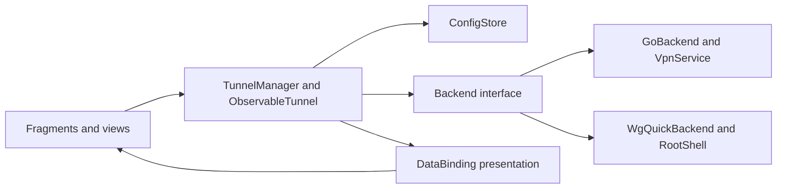
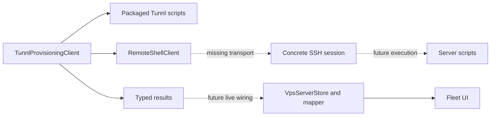

# Architecture and maintenance boundaries

Last updated: 2026-10-06 (Europe/Paris).

[Documentation index](../README.md#project-documentation) · Reviewed 2026-10-06

Preserve the existing Android DataBinding/Fragment foundation and upstream WireGuard config/backend ownership. This guide describes current code; planned integration and repairs are identified explicitly.

## Ownership

| Source/owner | Responsibility |
| --- | --- |
| `ui/.../Application.kt` | App initialization, selected backend, preferences and tunnel manager access. |
| `ui/.../activity`, `fragment`, `widget` | Navigation, lifecycle-bound views, user actions and Canvas rendering. |
| [BindingAdapters](../ui/src/main/java/com/wireguard/android/databinding/BindingAdapters.kt) | Simple XML presentation bindings and shared UI formatters. |
| [ObservableTunnel](../ui/src/main/java/com/wireguard/android/model/ObservableTunnel.kt), [TunnelManager](../ui/src/main/java/com/wireguard/android/model/TunnelManager.kt) | Observable tunnel data, config loading/persistence, selected operations and state notifications. |
| [Config types](../tunnel/src/main/java/com/wireguard/config/Config.java) | WireGuard parsing/serialization, interfaces, peers, addresses and endpoints. |
| [GoBackend](../tunnel/src/main/java/com/wireguard/android/backend/GoBackend.java), [WgQuickBackend](../tunnel/src/main/java/com/wireguard/android/backend/WgQuickBackend.java) | Userspace VPN/native activation and root/kernel command integration. |
| [RootShell](../tunnel/src/main/java/com/wireguard/android/util/RootShell.java) and native tools | Root command protocol and existing WireGuard tool execution. |
| [Provisioning client](../ui/src/main/java/com/wireguard/android/provisioning/TunnlProvisioningClient.kt), models and script bundle | Remote orchestration, argument construction, packaged script upload and typed result parsing. |
| [Remote-shell boundary](../ui/src/main/java/com/wireguard/android/provisioning/RemoteShellClient.kt) | Transport factory and guarded execute/upload; concrete SSH/session implementation is still missing. |
| [VPS store](../ui/src/main/java/com/wireguard/android/provisioning/VpsServerStore.kt), [mapper](../ui/src/main/java/com/wireguard/android/provisioning/VpsDeployMapper.kt) | Transactional non-secret fleet records and projection into UI models. |
| [Tunnl scripts](../third_party/wireguard-install/tunnl/README.md) | Ubuntu/Debian operations, C2–C3 ownership/serialized recovery and machine-readable results; C4 contracts and live proof remain open. |

## Runtime flows

UI actions request model/backend changes; backend state/statistics return through observable data and bindings. Keep UI formatting separate from operation success, permission/service management and config parsing. View-bound work must not update a destroyed view or a superseded selection. Known lifecycle/transition repairs are [C5–C6](improvement-plan.md#codebase-actions).

The provisioning client and scripts exist, while concrete SSH, protected credential persistence and live action/result wiring remain planned. Persisted fleet records already render. The dotted flow is not a claim of working deployment, user management or generated-profile QR.

## Boundaries and invariants

These are required maintenance invariants, not guarantees that all current owners already meet them. `VpsServerStore` uses DataStore transactions; `FileConfigStore` currently writes files directly without atomic replacement or transaction serialization. Transition/cancellation, persistence and health repairs remain open in the improvement plan.

- `.design/` supplies read-only visual intent; it does not establish runtime capability.
- Config parsers and backends preserve supported WireGuard behavior. Do not invent another parser for generated/imported profiles.
- Stores must preserve prior valid data and serialize conflicting mutations through the responsible persistence mechanism. Backend transitions must settle on success/failure/cancellation.
- Transport owns its channels/sessions, real deadlines and cancellation. A coroutine wrapper alone cannot prove cancellation of blocking library calls.
- Shell argument quoting protects shell construction; script/config validation and ownership checks protect privileged writes. Neither substitutes for the other.
- Logs/errors expose useful categories and non-secret status, not raw private config/credential payloads. Internal results may legitimately carry a generated profile; they are not safe to stringify into diagnostics.
- Revocation/install/uninstall success needs effective postconditions and recovery semantics. Recent synchronization is not running health.
- Keep [pinned upstream attribution](../third_party/wireguard-install/UPSTREAM.md). The original interactive installer is reference material, not the Android execution path.

See [backend contracts](backend-contracts.md) for known divergences and [the plan](improvement-plan.md) for repair ownership.

## Consequential decisions

### Preserve the Android foundation

Status: current project contract. The redesign targets existing DataBinding/Fragment behavior. Reusing models, backends, resources and test infrastructure minimizes compatibility and lifecycle churn.

Alternatives include Compose/MVVM or a general controller/DI rewrite. Current requirements do not justify those migrations. A focused consolidation remains appropriate when the task exposes duplicated or obstructive ownership. Verification must protect surrounding behavior; a new requirement can reopen this decision with concrete evidence.

### Keep provisioning behind explicit transport and script contracts

Status: boundary implemented; concrete SSH integration pending. Existing client/factory separation supports injected remote responses and preserves non-interactive packaged scripts.

Alternatives include embedding all server management in Android or invoking the upstream interactive installer. Neither fits the current machine-readable flow. Before choosing an SSH dependency, record maintenance/Android fit, alternatives, host-key/auth behavior, deadlines, session cleanup and credential exposure. Real library verification remains required; no library choice is claimed here.

### Documentation has one owner per detailed fact

Status: owning guides established. The [development ownership table](development.md#document-ownership) routes facts and the plan owns improvement status. Keep consequential decision history on this page until separate ADR files have a demonstrated maintenance benefit.

### Native provisioning locks and operation-owned recovery

Status: implemented with offline proof on 2026-10-06 (Europe/Paris); live validation remains separate. Shared Bash helpers own ownership/input validation, private staging/snapshots and peer removal. Native `flock` serializes writers per interface; install/uninstall take a host lock first for shared package/forwarding state. Atomic rename commits disk changes; explicit operation postconditions and recovery preserve prior disk/runtime where possible. Cleanup after commit cannot roll back from partly deleted evidence.

Alternatives include unlocked in-place writes, process-substitution apply, nested removal subprocesses or a new transaction service. They either hide errors/races or add unnecessary infrastructure. Extending the shared script owner keeps one mutation/recovery path and reuses installed tools. It does not make apt/global forwarding transactional, serialize external tools/readers, validate all native stopped configs or prove live traffic. Verification uses synthetic command faults/concurrency in private user-namespace fixtures; [the script guide](../third_party/wireguard-install/tunnl/README.md#ownership-locking-and-recovery) owns detailed limits.
