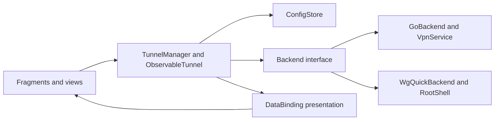
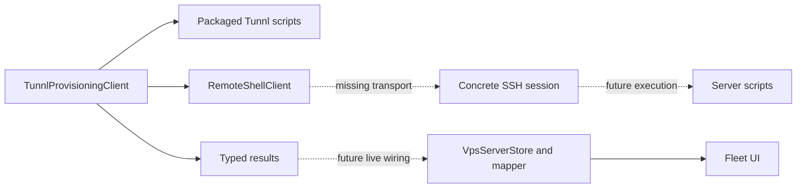

# Architecture and maintenance boundaries

Last updated: 2026-10-07 (Europe/Paris).

[Documentation index](../README.md#project-documentation) · Reviewed 2026-10-06

Preserve the existing Android DataBinding/Fragment foundation and upstream WireGuard config/backend ownership. This guide describes current code; planned integration and repairs are identified explicitly.

## Ownership

| Source/owner | Responsibility |
| --- | --- |
| `ui/.../Application.kt` | App initialization, selected backend, preferences and tunnel manager access. |
| `ui/.../activity`, `fragment`, `widget` | Navigation, lifecycle-bound views, user actions and Canvas rendering. |
| [BindingAdapters](../ui/src/main/java/com/wireguard/android/databinding/BindingAdapters.kt) | Simple XML presentation bindings and shared UI formatters. |
| [ObservableTunnel](../ui/src/main/java/com/wireguard/android/model/ObservableTunnel.kt), [TunnelManager](../ui/src/main/java/com/wireguard/android/model/TunnelManager.kt) | Observable tunnel data, config loading/persistence, selected operations and state notifications. |
| [Config types](../tunnel/src/main/java/com/wireguard/config/Config.java) | WireGuard parsing/serialization, interfaces, peers, addresses and endpoints. |
| [GoBackend](../tunnel/src/main/java/com/wireguard/android/backend/GoBackend.java), [WgQuickBackend](../tunnel/src/main/java/com/wireguard/android/backend/WgQuickBackend.java) | Userspace VPN/native activation and root/kernel command integration. |
| [RootShell](../tunnel/src/main/java/com/wireguard/android/util/RootShell.java) and native tools | Root command protocol and existing WireGuard tool execution. |
| [Provisioning client](../ui/src/main/java/com/wireguard/android/provisioning/TunnlProvisioningClient.kt), models and script bundle | Remote orchestration, argument construction, packaged script upload and typed result parsing. |
| [Remote-shell boundary](../ui/src/main/java/com/wireguard/android/provisioning/RemoteShellClient.kt) | Transport factory and guarded execute/upload; concrete SSH/session implementation is still missing. |
| [VPS store](../ui/src/main/java/com/wireguard/android/provisioning/VpsServerStore.kt), [mapper](../ui/src/main/java/com/wireguard/android/provisioning/VpsDeployMapper.kt) | Transactional non-secret fleet records and projection into UI models. |
| [FileConfigStore](../ui/src/main/java/com/wireguard/android/configStore/FileConfigStore.kt) | Serialized local profile operations; private staged writes, file sync and native atomic rename preserve prior valid configs on failed updates. |
| [TunnelImporter](../ui/src/main/java/com/wireguard/android/util/TunnelImporter.kt), [QR scanner](../ui/src/main/java/com/wireguard/android/util/QrCodeFromFileScanner.kt), [ZIP exporter](../ui/src/main/java/com/wireguard/android/preference/ZipExporterPreference.kt) | Import result delivery, image retry/resource ownership and export children/output cleanup; models/stores retain profile ownership. |
| [Log viewer](../ui/src/main/java/com/wireguard/android/activity/LogViewerActivity.kt), [stream](../ui/src/main/java/com/wireguard/android/util/LogcatStream.kt), [buffer](../ui/src/main/java/com/wireguard/android/util/LogBuffer.kt) and [parser](../ui/src/main/java/com/wireguard/android/util/LogLineParser.kt) | Activity owns lifecycle/generation, adapter notifications and temporary shares; stream owns the process/reader and timed batches; Main owns bounded retention, continuations and filtered indices. |
| [Tunnl scripts](../third_party/wireguard-install/tunnl/README.md) | Ubuntu/Debian operations, C2–C3 ownership/serialized recovery and C4 producer/consumer contracts; real-server proof remains separate. |

## Runtime flows

UI actions request model/backend changes; backend state/statistics return through observable data and bindings. Keep UI formatting separate from operation success, permission/service management and config parsing. Detail config/statistics jobs belong to the view lifecycle and guard completions by binding/selection identity. Manager admission owns state settlement; [the decision below](#tunnel-mutations-own-admission-and-settlement) describes #13's merged repairs and limits. #15's kernel transition decision is recorded below.

Peer detail rows consume nullable immutable `Statistics.PeerStats` snapshots mapped by public key. The fragment projects only a successful statistics completion for its current view, selection, resumed lifecycle and captured state; observed DOWN clears without requesting statistics. Binding helpers own localized RX/TX totals and empty/zero visibility. This presentation boundary does not add a session-generation guard to the model cache. The Add sheet retains native BottomSheetDialogFragment and fragment-result actions; its callback belongs to the sheet view, while existing importer/editor owners retain validation, failure and cancellation. See [source verification and device limits](development.md#add-sheet-and-peer-presentation-recovery--2026-10-06).

`View.applySafeAreaInsets` in `util/Extensions.kt` owns system-bar/display-cutout padding for MainActivity's single-/two-pane containers, TunnelCreatorActivity and SettingsActivity. The existing pure view behavior moved out of the tunnel-selection BaseActivity so Settings can reuse it without inheriting tunnel state. It clears the handled inset types for descendants while preserving IME/gesture insets. Fragments do not add the same header inset again. Settings uses PreferenceFragmentCompat with always-expanded native sections, unchanged preference keys/defaults and native action owners; eligibility filtering removes empty categories and defers the Connection header until backend/root checks finish. The editor uses a DataBinding header inside its existing fragment, matching the prototype title/context, Close and Save controls; both host activities hide their native ActionBar. Save and the retained keyboard/menu entry call the same validated persistence owner. `ObservableTunnel` retains the manager's resolved pending target for presentation, and BindingAdapters shares each rate calculation by statistics snapshot. See [presentation contracts](backend-contracts.md#persistence-and-presentation), [phone evidence](development.md#phone-ui-and-throughput-follow-up--2026-10-06) and [Settings proof/limits](development.md#settings-presentation-recovery--2026-10-06).

The Home vertical layout reserves its Add footer below the weighted list. Transient phone feedback reuses `TunnlSnackbar`, which clears the Material background tint before installing its local surface. Successful editor feedback belongs to the surviving Main/list view; Creator returns the message through the existing Android activity-result mechanism. Native Toasts remain only in the visibility contexts described in [operations](operations.md#import-edit-and-connect); no new feedback service or state model is introduced.

Import/export children belong to their operation rather than the application scope. Valid ZIP entries settle independently through the existing manager; completion feedback runs once afterward. QR decoding owns each reopened input/bitmap. Narrow error handling preserves cancellation and exposes programming defects while existing generic Backend/ConfigStore boundaries retain needed reconciliation/reporting. [Import/export contracts](backend-contracts.md#import-ordering-and-export) records failure and output-acquisition limits; no new service, parser or dependency is introduced.

The provisioning client and scripts exist, while concrete SSH, protected credential persistence and live action/result wiring remain planned. Persisted fleet records already render. The dotted flow is not a claim of working deployment, user management or generated-profile QR.

## Boundaries and invariants

These are required maintenance invariants, not guarantees that all current owners already meet them. `VpsServerStore` uses DataStore transactions and nullable observed running health; `FileConfigStore` serializes operations and commits synced staged files through native atomic rename. PR #25 merged manager/detail/userspace lifecycle repair; #15 implements kernel transition serialization with controlled offline proof. Exact contracts and proof limits belong below and in the backend contracts.

- `.design/` supplies read-only visual intent; it does not establish runtime capability.
- Config parsers and backends preserve supported WireGuard behavior. Do not invent another parser for generated/imported profiles.
- Stores must preserve prior valid data and serialize conflicting mutations through the responsible persistence mechanism. Backend transitions must settle on success/failure/cancellation.
- Transport owns its channels/sessions, real deadlines and cancellation. A coroutine wrapper alone cannot prove cancellation of blocking library calls.
- Shell argument quoting protects shell construction; script/config validation and ownership checks protect privileged writes. Neither substitutes for the other.
- Logs/errors expose useful categories and non-secret status, not raw private config/credential payloads. Internal results may legitimately carry a generated profile; they are not safe to stringify into diagnostics.
- Revocation/install/uninstall success needs effective postconditions and recovery semantics. Recent synchronization is not running health.
- Keep [pinned upstream attribution](../third_party/wireguard-install/UPSTREAM.md). The original interactive installer is reference material, not the Android execution path.

See [backend contracts](backend-contracts.md) for known divergences and [the plan](improvement-plan.md) for repair ownership.

## Consequential decisions

### Tunnel mutations own admission and settlement

2026-10-06 (Europe/Paris), merged in PR #25. Independent caller jobs and cached no-op decisions could delete during activation, apply stale state snapshots or abandon reconciliation. The existing TunnelManager owns one coroutine mutex for mutations/state reads. Waiting admission is cancellable; admitted work runs noncancellable until backend/store/model settlement. Explicit state decisions observe the backend inside that owner. Notifications reconcile actual backend state while preserving restoration intent after spontaneous service loss. Backend switching reserves admission through restart or preference rollback. Inventory/backend initialization settles deferred failures and cancellation; failed inventory can retry. Detail jobs bind to the view and check selection identity.

GoBackend retains its existing native transition lock. VpnService destruction marks liveness and resets acquisition without waiting on that lock, then dispatches identity-checked cleanup through the existing CompletableFuture executor. Cleanup callbacks stay ordered under the transition lock. Preflight preserves its explicit-port/endpoint-free policy; expected I/O remains best effort, while UDP interruption aborts with the flag preserved.

Alternatives were UI busy flags alone, detached transition jobs or cancellation after partial backend/store effects. They do not protect queued callers or reconciliation. Extending current owners avoids another operation service. Admitted blocking work can delay cancellation; mutex/service checks do not interrupt hung native calls or prove device traffic, process restart or native reacquisition. WgQuickBackend's complete transition owner is implemented under #15 as recorded below. See [contracts](backend-contracts.md#wireguard-configuration-and-tunnel-state) and [verification](development.md#tunnel-lifecycle-and-transition-settlement--2026-10-06).

### Kernel backend owns complete transitions

2026-10-06 (Europe/Paris), implemented for #15. RootShell serializes commands individually, so concurrent UP requests could both snapshot an empty backend and activate separate tunnels with multiple mode disabled. WgQuickBackend uses its existing instance monitor to own the entire transition, running-name reads and mode changes. Application collects live mode changes on IO, so monitor contention does not block Main. Recovery failures remain attached to the primary error. Supported enabled multiple mode remains available.

Alternatives were relying on the root command lock or adding a separate transition service. The command lock cannot own multi-command state/map updates; another service would duplicate the backend owner. Synchronized methods extend current Java ownership without another lock/helper/dependency. This delays competing observers/settings while commands run and does not interrupt hung root/native commands, coordinate external tools/another backend instance or prove actual kernel rollback/traffic. See [contracts](backend-contracts.md#wireguard-configuration-and-tunnel-state) and [offline evidence](development.md#kernel-transition-serialization--2026-10-06).

### Local profiles commit through native atomic rename

2026-10-06 (Europe/Paris), merged in PR #24. Truncating the sole `.conf` file can destroy a valid profile on write failure. The existing single FileConfigStore owner serializes all operations and stages writes in its private files directory; successful file sync/close precedes Android `Os.rename` on the same filesystem. Rename errors propagate as IO failures. Create publishes no marker; conflicting names retain existing data. Names and wg-quick file format do not migrate.

Android/AndroidX AtomicFile helpers were considered, but their finish methods log some sync/rename failures without reporting them to the store caller. Native rename preserves observable commit failure at the existing owner without another persistence layer. Tests inject partial writes and rename failure through the existing Context and a Robolectric native-call shadow. This is JVM/file ordering proof, not Android filesystem or power-loss proof; directory durability, process death leaving an ignored private `.tmp`, external writers and multiple store instances remain outside the guarantee.

### Preserve the Android foundation

Status: current project contract. The redesign targets existing DataBinding/Fragment behavior. Reusing models, backends, resources and test infrastructure minimizes compatibility and lifecycle churn.

Alternatives include Compose/MVVM or a general controller/DI rewrite. Current requirements do not justify those migrations. A focused consolidation remains appropriate when the task exposes duplicated or obstructive ownership. Verification must protect surrounding behavior; a new requirement can reopen this decision with concrete evidence.

### Keep provisioning behind explicit transport and script contracts

Status: boundary implemented; concrete SSH integration pending. Existing client/factory separation supports injected remote responses and preserves non-interactive packaged scripts.

Alternatives include embedding all server management in Android or invoking the upstream interactive installer. Neither fits the current machine-readable flow. Before choosing an SSH dependency, record maintenance/Android fit, alternatives, host-key/auth behavior, deadlines, session cleanup and credential exposure. Real library verification remains required; no library choice is claimed here.

### Documentation has one owner per detailed fact

Status: owning guides established. The [development ownership table](development.md#document-ownership) routes facts and the plan owns improvement status. Keep consequential decision history on this page until separate ADR files have a demonstrated maintenance benefit.

### Native provisioning locks and operation-owned recovery

Status: implemented with offline proof on 2026-10-06 (Europe/Paris); live validation remains separate. Shared Bash helpers own ownership/input validation, private staging/snapshots and peer removal. Native `flock` serializes writers per interface; install/uninstall take a host lock first for shared package/forwarding state. Atomic rename commits disk changes; explicit operation postconditions and recovery preserve prior disk/runtime where possible. Cleanup after commit cannot roll back from partly deleted evidence.

Alternatives include unlocked in-place writes, process-substitution apply, nested removal subprocesses or a new transaction service. They either hide errors/races or add unnecessary infrastructure. Extending the shared script owner keeps one mutation/recovery path and reuses installed tools. It does not make apt/global forwarding transactional, serialize external tools/readers, validate all native stopped configs or prove live traffic. Verification uses synthetic command faults/concurrency in private user-namespace fixtures; [the script guide](../third_party/wireguard-install/tunnl/README.md#ownership-locking-and-recovery) owns detailed limits.

### Strict provisioning responses and explicit unknown health

Implemented on 2026-10-06 (Europe/Paris). The existing `ProvisioningJson` owner validates consumed fields, keeps success payloads available and replaces untrusted error text with safe categories and allowlisted codes. Models/store retain nullable running observations; explicit null counters stay unknown. The mapper uses freshness and observation independently and shares one projection for live/stored health. Existing DataStore records migrate without losing connection metadata.

Permissive optional getters and timestamp-only ONLINE hid malformed data and stopped/unobservable runtime. A new schema framework or health service would duplicate current ownership; typed getters, existing native observation and nullable fields meet the boundary. Recovery paths stay out of exceptions; result cleanup metadata remains available. [Backend contracts](backend-contracts.md) owns the schema and limits. Offline script/JSON/quoting/migration proof does not establish real SSH, packets or live UI wiring; revisit when C11–C12 connects those owners.

### Home selection owns identities and confirmation

2026-10-07 (Europe/Paris). Problem: numeric row positions change under sorted insertion/removal and can target the wrong tunnel for destructive actions. Decision/status: the existing TunnelListFragment owns one set of managed tunnel instances plus the necessary mode flag; source implementation is under #36. Saved names project selection into a freshly loaded inventory, with new confirmation required after view recreation. A view-owned native dialog captures instances and closes if a member leaves inventory; the manager retains mutation admission, teardown, persistence and rollback ownership.

Alternatives were preserving numeric ActionMode positions, keeping two parallel selection stores or introducing an operation service. They duplicate or misplace ownership and do not preserve destructive intent. Sequential manager calls simplify bounded partial progress and cancellation without a detached supervisor. The manager owns its internal NotManagedException rejection subtype so the UI can handle stale ownership and access failures while propagating unexpected runtime defects. Rename retains inventory membership during store I/O, then removes, renames and reinserts the same instance synchronously on Main under existing mutation admission. The fragment coalesces selection reconciliation through its existing posted binding invalidation; callbacks from an old view cannot clear a new view's pending work. Consequences: selection can remain active at zero; Back during deletion stops remaining work after admitted settlement. This is no cross-process identity guarantee or undo facility, and a source merge is not physical deletion/provider proof. No profile migration is needed. [Regression and native/device verification limits](development.md#home-selection-and-safe-delete-recovery--2026-10-07) own acceptance; revisit only if inventory identity or supported multi-process ownership changes.
