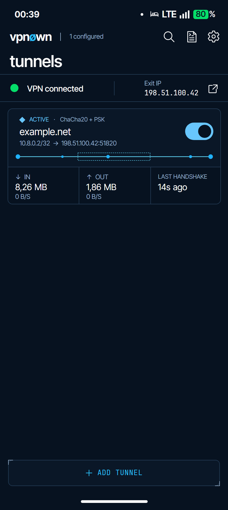

# Tunnl UI Redesign Roadmap

Last updated: 2026-10-09 (Europe/Paris).

## Design Source

Reference: `.design/` — React/JSX prototype for **Tunnl**, a WireGuard tunnel manager with an engineering-console visual language. Read-only. Never modify.

Prototype sections below describe visual targets, not implemented Android guarantees. Initial committed-source reconciliation used `11d4a9b1`; the Done ledger also retains superseded implementation history. Read the explicit gaps and [full documentation review](reviews/2026-10-06-full-documentation-review.md) for evidence limits.

| File | Contents |
|------|----------|
| `screens-home.jsx` | Home screen, `TunnelCard`, `MiniDiagram` (3 variants), multi-select mode, status strip |
| `screens-detail.jsx` | `DetailScreen`, `EditorScreen`, `AddSheet`/`AddOption`, `LogsScreen`, `DiagnosticsScreen`, `OnDemandScreen`, `QRScanScreen`, `MoreSheet`, `ShareSheet` |
| `screens-settings.jsx` | `SettingsScreen` — 5 `SettingsGroup` sections |
| `screens-deploy.jsx` | `ServerFleetScreen`, `ServerDetailScreen`, `ServerProvisionScreen`, `VpnUserScreen`, `QROverlay` |
| `schematic.jsx` | `SchematicDiagram` / `WireDiagram` — SVG reference for Android `TunnelThroughputView` |
| `data.jsx` | Seed tunnels + server data; `fmtBytes`, `fmtRate`, `fmtAgo` formatters |
| `app.jsx` | App shell + full routing state machine |
| `styles.css` | All design tokens, utility classes, CSS animations |
| `icons.jsx` | Complete icon set (hand-rolled SVG, single `<path>`) |
| `tweaks-panel.jsx` | Prototype-only floating tweaks panel |
| `android-frame.jsx` | Prototype-only device frame component |
| `index.html` | Main prototype (all screens) |
| `index-selection.html` | Selection-mode + multi-tunnel proposal |
| `index-deploy.html` | Server fleet / VPS deployment standalone |

---

### Home visual handoff — 2026-10-08

The [Home mockup](assets/home-ui-2026-10-08.png) and [editable HTML reference](assets/home-ui-2026-10-08.html) preserve the selected palette and requested Home refinements from the 2026-10-08 (Europe/Paris) design work. The stored reference uses `example.net`, documentation address `198.51.100.42` and synthetic client address `10.8.0.2/32`; it is illustrative, not a host report. The HTML uses the repository fonts and can be opened locally.



This is a single active-tunnel visual reference. Author self-review is satisfied with this mockup; independent visual review found no clipping or overlap. It does not establish whole-app “100/100” quality, native Android implementation, device acceptance or broader branding approval. Existing multi-tunnel aggregation and DEGRADED-state requirements remain open below.

The selected Home target keeps the compact two-row wordmark/count/title header, a document-style Logs icon, a flat connection-status band, the compact tunnel card and its dotted encrypted-segment enclosure. Use `VPN connected` instead of the broad `Device protected` claim. The right-hand `Exit IP` label is appropriate only for an observed public IP; current Android presentation uses the active peer endpoint host and performs no WAN lookup. Preserve that contract and use a truthful endpoint label when no observed public IP exists; this handoff does not request a new lookup.

Use lighter tunnel-name and stat-value typography, readable value/unit spacing, and `LAST HANDSHAKE` with a relative age such as `14s ago`. The HTML uses Inter Tight for some data text to approximate the selected raster; it does not supersede the native semantic font roles below. Apply the weight/spacing intent through existing native styles and compare actual Android output. Keep Add anchored above the bottom safe area: full width, 48dp design height, solid thin border, existing card-surface fill, 13sp regular JetBrains Mono with modest tracking, a 14dp plus icon, an 8dp label gap, and the prototype's small top-left/bottom-right engineering corner ticks.

Generative edits drifted in color, so the retained reference is rendered from fixed role colors sampled from the selected image. These were preview samples at the handoff. The 2026-10-09 palette mapping now applies matching shared roles and separates diagram-node, diagram-line and connection-dot colors; [scoped installed verification](#installed-palette-verification--2026-10-09) records native proof and its limits. Keep the separate diagram, button and switch blues.

| Preview role | Fixed color |
| --- | --- |
| Page and stats background | `#071220` |
| Card and Add surface | `#0A1727` |
| Borders | `#233B54` |
| Primary text | `#FAFAFA` |
| Secondary text and corner ticks | `#94AECB` |
| Add label/icon | `#2ABFF7` |
| Diagram nodes | `#20B2FD` |
| Diagram line/enclosure | `#63DAFC` |
| Switch | `#68C6FD` |
| Connection dot | `#05DE6A` |

Local handoff proof covers an 840×1872 browser render of a 420×936 design canvas, loaded repository fonts, label fit, footer geometry and sampled exported colors. Flat fills and font rendering differ from the earlier generated raster. Android source was unchanged at that handoff; no APK, phone, VPN or whole-app runtime checks were performed for it. The later palette mapping and scoped AVD checks did not implement Home geometry or typography. The source adaptation below applies those refinements while preserving the existing wordmark for #71; #80 integration verification and device acceptance remain pending. The existing Redesign QA list below owns the remaining app-wide review.

## Design System

### Typography

| Role | Font family | Weight | Usage |
|------|-------------|--------|-------|
| UI labels, titles, body | `Inter Tight` | 400 / 500 / 600 | Screen titles, settings labels, action buttons |
| All data, keys, addresses, monospace fields | `JetBrains Mono` | 400 / 500 | Tunnel names, endpoints, keys, rates, IP addresses |

**CSS font features applied to mono:**
- `font-feature-settings: "ss01", "zero"` — stylistic alternates + slashed zero
- `font-variant-numeric: tabular-nums` — tabular numbers everywhere data is displayed
- `-webkit-font-smoothing: antialiased` on body

**Android equivalents:**
- `@font/inter_tight` — UI labels/titles
- `@font/jetbrains_mono_regular` / `jetbrains_mono_medium` — data fields

**Type scale (JSX):**

| Class / usage | Family | Size | Weight | Color token |
|---------------|--------|------|--------|-------------|
| `.label` | Mono | 10px | 400 | `--ink-3`, `text-transform: uppercase`, `letter-spacing: 0.08em` |
| `TopBar` title (big) | Mono | 26px | 500 | `--ink` |
| `TopBar` title (normal) | Mono | 18px | 500 | `--ink` |
| `TopBar` sub-label | `.label` | 10px | — | `--ink-3` |
| Tunnel name / prominent values | Mono | 16px | 500 | `--ink` |
| Config row value | Mono | 13px | 400 | `--ink` |
| Config row label | `.label` | 10px | — | `--ink-3` |
| Sub-text, hints | Mono | 10–11px | 400 | `--ink-3` |
| Stat value | Mono tabular | 18–26px | 500 | `--ink` / status color |
| Terminal / log output | Mono | 10px | 400 | varied |

**Android text styles (from `res/values/styles.xml`):**

| Style | Size | Font | Color |
|-------|------|------|-------|
| `TunnlLabelText` | 10sp | JetBrains Mono | `tunnl_ink_3` |
| `TunnlMonoValueText` | 15sp | JetBrains Mono | `tunnl_ink` |
| `TunnlMonoSubText` | 10sp | JetBrains Mono | `tunnl_ink_3` |
| `TunnlConfigRowLabel` | 10sp | JetBrains Mono | `tunnl_ink_3` |
| `TunnlConfigRowValue` | 13sp | JetBrains Mono | `tunnl_ink`, single-line, ellipsize end |
| `TunnlEditorField` | 13sp | JetBrains Mono | `tunnl_ink`, no background |
| `TunnlEditorFieldReadOnly` | 13sp | JetBrains Mono | `tunnl_ink_3`, not focusable |

---

### Color Tokens

Prototype colors use `oklch()`. Android uses tuned hex resources with a dark-first palette in both Material theme buckets, not exact documented OKLCH conversions. `Application` follows system night mode on Android Q+ and the user preference before Q; TV forces night mode separately. Application startup no longer registers Material dynamic-color overlays. Shared paper, card, border, text, action and UP-state colors now match the selected Home hex reference independently of wallpaper colors, with separate diagram-node, diagram-line and connection-dot roles. Both theme buckets map Material dialogs' `colorSurfaceContainerHigh` to the card surface; other newer surface-container and fixed-primary roles not defined by the app retain static Material library defaults. [PR #89](https://github.com/novakin/wireguard-android/pull/89) delivered [#88](https://github.com/novakin/wireguard-android/issues/88)'s selected palette acceptance on 2026-10-09; merge and issue closure were verified. The scoped proof below does not complete C10.

#### Light theme (`styles.css` root)

| Token | Value | Role |
|-------|-------|------|
| `--paper` | `oklch(0.972 0.008 80)` | Main background — warm off-white |
| `--paper-2` | `oklch(0.945 0.010 80)` | Card surface |
| `--paper-3` | `oklch(0.915 0.012 80)` | Recessed / pressed |
| `--rule` | `oklch(0.85 0.012 80)` | Hairline dividers |
| `--rule-strong` | `oklch(0.72 0.014 80)` | Borders, active dividers |
| `--ink` | `oklch(0.18 0.012 250)` | Primary text — deep blue-black |
| `--ink-2` | `oklch(0.34 0.012 250)` | Secondary text |
| `--ink-3` | `oklch(0.52 0.012 250)` | Labels, captions |
| `--ink-4` | `oklch(0.68 0.012 250)` | Hints, placeholder |

#### Dark theme (`[data-theme="dark"]`)

| Token | Value |
|-------|-------|
| `--paper` | `oklch(0.16 0.012 250)` |
| `--paper-2` | `oklch(0.20 0.012 250)` |
| `--paper-3` | `oklch(0.13 0.012 250)` |
| `--rule` | `oklch(0.28 0.012 250)` |
| `--rule-strong` | `oklch(0.40 0.012 250)` |
| `--ink` | `oklch(0.96 0.008 80)` |
| `--ink-2` | `oklch(0.86 0.008 80)` |
| `--ink-3` | `oklch(0.66 0.010 80)` |
| `--ink-4` | `oklch(0.50 0.010 80)` |

#### Accent + state (both themes)

| Token | Value | Role |
|-------|-------|------|
| `--signal` | `oklch(0.74 0.15 245)` | Azure — tunnel UP, active state |
| `--signal-deep` | `oklch(0.50 0.18 250)` | Deep azure — borders, text on active |
| `--signal-glow` | `oklch(0.74 0.15 245 / 0.28)` | Glow ring on status dot |
| `--accent` | `oklch(0.55 0.14 245)` | Indigo — alternative accent |
| `--warn` | `oklch(0.72 0.14 70)` | Ochre — connecting / provisioning |
| `--error` | `oklch(0.62 0.16 30)` | Rust — no signal / attention / revoked |

#### Accent presets (prototype tweaks panel only)

| Key | Signal | Deep | Glow |
|-----|--------|------|------|
| `azure` (default) | `oklch(0.74 0.15 245)` | `oklch(0.50 0.18 250)` | `/ 0.28` |
| `cobalt` | `oklch(0.62 0.20 260)` | `oklch(0.42 0.20 263)` | `/ 0.30` |
| `cyan` | `oklch(0.82 0.13 215)` | `oklch(0.55 0.15 220)` | `/ 0.28` |
| `amber` | `oklch(0.85 0.16 78)` | `oklch(0.58 0.16 60)` | `/ 0.28` |

#### Android color resources (`res/values/colors.xml`)

| Resource | Prototype role | Android value |
| --- | --- | --- |
| `tunnl_paper` | Selected page | `#071220` |
| `tunnl_paper_2` | Selected card/Add surface | `#0A1727` |
| `tunnl_paper_3` | `--paper-3` dark | `#162436` |
| `tunnl_ink` | Selected primary text | `#FAFAFA` |
| `tunnl_ink_2` | `--ink-2` dark | `#C9D5E3` |
| `tunnl_ink_3` | Selected secondary text | `#94AECB` |
| `tunnl_rule` | Selected border | `#233B54` |
| `tunnl_rule_strong` | `--rule-strong` dark | `#3E5B78` |
| `tunnl_signal` | Selected action | `#2ABFF7` |
| `tunnl_signal_deep` | Selected switch/UP | `#68C6FD` |
| `tunnl_diagram_node` | Selected diagram nodes | `#20B2FD` |
| `tunnl_diagram_line` | Selected diagram line/enclosure | `#63DAFC` |
| `tunnl_connected` | Selected connected dot | `#05DE6A` |
| `tunnl_warn` | `--warn` | `#F2C46D` |
| `tunnl_error` | `--error` | `#FF8B6E` |

#### Installed palette verification — 2026-10-09

The maintainer authorized assembly and in-place installation in the owned API 36 x86_64 AVD. Source `cac38793` passed assembly; the installed APK hash matched the built artifact and the signing certificate was unchanged. Four cases recreated the app under effective neutral and red Android system palettes in both system night modes. Each captured Home with zero tunnels, Settings, Add and a Material app-selection dialog with a transient checked checkbox; every draft/dialog was canceled without saving a profile. Tunnl surfaces and controls retained their navy/blue colors; external adaptive app icons in the dialog followed the system accent as expected. The final dialog surface is `#0A1727`, replacing the earlier inherited gray `#2B2930`.

The preceding `ddc33825` source passed 33 focused Home/Settings/binding tests and zero Detekt findings. Its initial four-case APK run needed explicit editor Cancel after one Back cleanup left the empty editor visible; that result retains its original scope. The final two static dialog-theme mappings were checked by assembly and the fresh four-case native run, which used explicit editor Cancel throughout. No redundant JVM rerun or new physical-device proof is implied.

The visible host renderer had separately shifted raw Android navy toward teal. A qualified same-AVD comparison isolated that boundary: raw page `#08111E` versus host `#00141B` before the renderer change; SwiftShader host output matched raw within one RGB value. Neither depth32 nor maximum brightness corrected it. The owned launch helper now requests `-gpu swiftshader`; the specific GPU/driver mechanism is unproved. See [emulator color diagnosis](operations.md#emulator-color-diagnosis).

This verifies the listed app scenes at 1080×2400, not active-tunnel/diagram output, every Material role, older-platform bars, physical camera/TalkBack, the full size/font/RTL matrix, VPN behavior or complete C10. Source review confirms the ten selected role values; inherited roles outside the observed dialog correction remain separate review scope. Detailed private captures, hashes and host configuration stay outside source distribution.

---

### Spacing & Shape

| Token | Value | Usage |
|-------|-------|-------|
| `--radius-sm` | 4px | Input fields, terminal blocks, small pills |
| `--radius` | 8px | Cards, panels, action tiles |
| `--radius-lg` | 14px | Bottom sheets, QR overlay modal |
| `--density-pad` (comfortable) | 16px | Default horizontal padding |
| `--density-pad` (compact) | 12px | Dense layouts |
| Card horizontal padding | 14px | Used consistently in all panels |
| Card vertical padding | 10–12px | Top/bottom padding within rows |
| Section gap | 14px | Between section blocks |
| Icon button size | 32×32px | `IconBtn` |
| Toggle switch | 44×24px | `.sw` |

---

### CSS Utility Classes

| Class | Purpose |
|-------|---------|
| `.mono` | `font-family: var(--font-mono); font-feature-settings: "ss01", "zero"` |
| `.tabular` | `font-variant-numeric: tabular-nums` |
| `.label` | 10px mono caps, `--ink-3`, `letter-spacing: 0.08em` |
| `.tag` | Outlined pill badge (10px mono, uppercase, 999px radius) |
| `.tag.up` | Signal-deep color + border |
| `.tag.error` | Error color + border |
| `.tag.warn` | Warn color + border |
| `.eng-corners` | L-shaped tick marks at top-left and bottom-right via `::before`/`::after` |
| `.hr` | 1px `--rule` hairline |
| `.sw` | Toggle switch (44×24, animated thumb, signal when on) |
| `.cursor` | Blinking block cursor (`▍`) via `::after` |
| `.scanline` | Moving light-sweep animation for provisioning/connecting state |
| `.schematic-grid` | Dot-grid radial background (12px × 12px, `--rule` dots) |
| `.scroll` | Styled scrollbar (4px thumb, `--rule-strong`) |

---

### CSS Animations

| Name | Description | Used by |
|------|-------------|---------|
| `packet-flow` | `offset-distance` 0→100%, opacity fade in/out | Prototype `WireDiagram` packets |
| `pulse-ring` | Scale 0.9→1.6, opacity 0.7→0 | Status dot glow ring |
| `blink` | 1s steps, 50% duty cycle | `.cursor` blinking caret |
| `scan` | `translateX(-100%→100%)` | `.scanline` shimmer |
| `dash-flow` | `stroke-dashoffset` 24→0 at 0.8s | Topology SVG active line |
| `dash-flow-slow` | Same at 1.6s | VPS→WAN segment (slower) |
| `dash-flow-warn` | Same at 1.4s | Attention state line |

---

### Icon Set (`icons.jsx`)

All icons: 24×24 viewBox, `fill="none"`, `stroke="currentColor"`, `strokeWidth=1.5`, `strokeLinecap="round"`, `strokeLinejoin="round"`. Single `<path>` per icon.

| Component | Description / usage |
|-----------|---------------------|
| `IconPlus` | Add tunnel / add server / add peer |
| `IconChevron` | Right-pointing — list row disclosure |
| `IconChevronL` | Left-pointing — back navigation |
| `IconChevronD` | Down-pointing — expand/collapse |
| `IconClose` | ✕ — exit selection mode, close overlays |
| `IconCopy` | Copy to clipboard — config values |
| `IconQR` | QR code — pair device / scan to import |
| `IconFile` | File — import `.conf` |
| `IconKey` | Key — private key, SSH credential |
| `IconSearch` | Search — tunnel list filter |
| `IconLogs` | Three lines — log viewer |
| `IconSettings` | Gear — settings screen |
| `IconTrash` | Delete — tunnel / peer / user |
| `IconEdit` | Pencil — editor screen |
| `IconShare` | Upload arrow — export / share |
| `IconArrowU` | Up arrow — transfer out |
| `IconArrowD` | Down arrow — transfer in |
| `IconLock` | Padlock — PSK badge, secure |
| `IconWifi` | WiFi — on-demand / network |
| `IconRefresh` | Circular arrows — sync / repair |
| `IconImport` | Down arrow + line — import |
| `IconKbd` | Keyboard — QR scan prompt |
| `IconMore` | Vertical `⋮` (stroke 2.5) — overflow menu |
| `IconServer` | Terminal window `>_` — server fleet navigation |

---

### Shared Components (JSX prototype)

#### `TopBar`
Two-row header. Row 1: `left` slot + `sub` label (10px mono caps) + `right` slot (icon buttons). Row 2: mono `title` (18px normal, 26px when `big`) + optional `titleRight`.
- Background: `--paper-2`
- Bottom border: `1px --rule`

#### `IconBtn`
32×32px touch target. Transparent background, no border; active state: `--paper-3` bg + `--rule-strong` border. Color: `--ink-2`.

#### `SectionHeader`
Engineering section label. `§NN` prefix in `--rule-strong` + mono section title + horizontal `1px --rule` divider. Hint text right-aligned.

#### `DeployPanel`
Outlined card container. `1px --rule` border, `--radius` corners, `--paper-2` bg, `overflow: hidden`. Used for all config panels in server screens.

#### `ConfigLine`
Label + value row. `10px 14px` padding, `1px --rule` bottom border. Optional `copy` prop → right-aligned `IconCopy`.

#### `EditField`
Editable input row. Same structure as `ConfigLine` but renders `<input>` with bottom-border-only style (no box), focus changes border to `--signal-deep`, `caretColor: --signal`.

#### `DeployField`
Read-only display field. Same layout as `EditField` without interactivity. Supports `split` prop for 50% side-by-side layout.

#### `MiniMetric`
3-column grid cell — 8px label (`.label`) above 10px tabular mono value. Used in server cards and user hero.

#### `HeroStat`
Larger 3-column cell — label (9px) + value (12px mono) + sub (9px `--ink-3`). Used in topology hero grid.

#### `ActionTile`
`eng-corners` tappable tile, min 94px height, flex column with icon top and label+sub bottom. Variants: default / `accent` (signal-deep border) / `danger` (error border+color) / `disabled` (opacity 0.45, pointer-events none).

#### `Segmented`
Multi-option toggle row. Grid of N equal-width buttons, `--rule-strong` border, active = `--ink` bg + `--paper` text.

#### `ToggleLine`
Row with label + description + `.sw` toggle. Used for binary settings.

#### `TerminalStream`
Animated terminal block (`oklch(0.11 0.012 250)` bg, 10px mono, 1.6 line-height). Streams lines at 340ms intervals when `running`. Line color: `$` prompt → signal, `✓` → signal-deep, `!` → warn, `✕` → error, else dim cream. Auto-scrolls to bottom.

#### `QROverlay`
Full-screen modal (backdrop blur, `oklch(0.08 0.012 250 / 0.92)` scrim). Contains: header with label + user name + close button; SVG pseudo-QR grid (25×25, `10px` cells, finder patterns, timing patterns, deterministic data fill); 2-col info grid (SERVER, IP, ENDPOINT). Closes on outside tap or Escape.

#### `ServerTopologyHero`
SVG topology diagram (`280×64` viewBox) on `.schematic-grid` background. Three `TopoNode` elements (DEVICE, VPS, WAN) connected by animated dashed lines. Active = animated `dash-flow` lines + blue node rings; attention = error-color warn lines; offline = static gray.

---

### Current Android Tunnel Status System

`BindingAdapters.tunnelMode` uses the newest peer handshake as a display heuristic. It does not prove routing, leak protection or every peer's health. The 30-second grace starts at the first no-handshake observation, not a persisted session-start timestamp.

| Mode | Condition | Label | Color |
|------|-----------|-------|-------|
| `active` | UP + newest handshake age < 180s | `◆ ACTIVE` | `--signal-deep` |
| `connecting` | TOGGLE, or UP without handshake during first 30s of observation | `◑ CONNECTING` | `--warn` |
| `nosignal` | UP + newest handshake age ≥ 180s, or no handshake after the grace | `✕ NO SIGNAL` | `--error` |
| `inactive` | `state === DOWN` | `● INACTIVE` | `--ink-3` |

### Server Status System

This table defines visual labels. C4 now requires fresh observed running for persisted-fleet ONLINE; stopped is OFFLINE and unknown/stale needs ATTENTION. [Backend contracts](backend-contracts.md#persistence-and-presentation) owns runtime meaning. Labels still do not prove connectivity.

| Status | Label | Color | Card border |
|--------|-------|-------|-------------|
| `online` | `◆ ONLINE` | `--signal-deep` | `--rule` |
| `provisioning` | `◑ PROVISIONING` | `--warn` | `--warn` |
| `attention` | `✕ ATTENTION` | `--error` | `--error` |
| `offline` | `● OFFLINE` | `--ink-3` | `--rule` |

### VPN User Status System

| Status | Label | Color |
|--------|-------|-------|
| `active` | `◆ ACTIVE` | `--signal-deep` |
| `idle` | `◑ IDLE` | `--warn` |
| `revoked` | `✕ REVOKED` | `--error` |

### Health Check Badges

Three-state: `ok: true` → `◆` signal-deep pill; `ok: false` → `✕` error pill (+ error-tinted background); `ok: null` → `◑` warn pill (running/unknown).

---

### Seed Data

**Tunnels (`data.jsx`):**
- `home-lab` — UP, 10.7.0.4/24, peer `router.lan` at `198.51.100.42:51820`, PSK, live stats
- `us-west-edge` — DOWN, 10.13.13.5/32, peer `sfo-01` at `203.0.113.71:51820`
- `office-ro` — DOWN, 172.20.4.18/24, peer `gw-bucharest`, PSK

**Servers (`screens-deploy.jsx`):**
- `ams-01` — Hetzner Amsterdam, ONLINE, Ubuntu 24.04, kernel, 3 peers
- `fra-01` — Netcup Frankfurt, PROVISIONING, Debian 12, userspace, 0 peers
- `nyc-01` — DigitalOcean New York, ATTENTION (port blocked + stale peers), Ubuntu 22.04, kernel, 1 peer

**Formatters (`data.jsx`):** `fmtBytes(n)` — `KB/MB/GB`; `fmtRate(kbps)` — `KB/s / MB/s`; `fmtAgo(sec)` — `Ns`, `Nm Ss`, `Nh Mm`

## Roadmap

### 1. Foundation
- Add Tunnl dark palette resources mapped onto the existing Material theme.
- Update default card, toolbar, and status/nav bar styling to the dark/signal language.
- Preserve the dark-first palette and existing night-mode policy described above, with fixed Material colors independent of wallpaper. Complete light-mode fidelity remains deferred.
- Keep the existing Android view/data-binding architecture.

### 2. Home / Tunnel List
- Replace plain list rows with card-like tunnel rows.
- Card: `◆ ACTIVE` / `◑ CONNECTING` / `✕ NO SIGNAL` / `● INACTIVE` status label, conditional PSK badge, mono tunnel name, address→endpoint sub-text, left signal rail.
- Stats row (↓ IN / ↑ OUT / LAST HANDSHAKE) visible only when tunnel is live; the selected Home target presents handshake age as relative time.
- Animated packet/signal strip (`TunnelSignalView`) — 2 endpoint nodes, dashed rect encrypted segment overlay.
- Custom two-row top bar (no root ActionBar): selected single-tunnel target uses a wordmark/configured count + Search / document-style Logs / Settings icons, then the `tunnels` title. The #80 source slice preserves existing `Vpn0wn` content; #71 owns reconciliation with the reference's `vpnøwn`. Preserve the separately tracked multi-tunnel summary requirements.
- Flat connection-status strip between header and list, following the [dated Home handoff](#home-visual-handoff--2026-10-08). Current Android data is an active peer endpoint host, with no WAN IP lookup; the mockup does not change that runtime contract.
- Full-width `+ ADD TUNNEL` footer target uses a solid thin outline, subtle existing surface fill, mono label and engineering corner ticks; retain bottom anchoring and safe-area clearance.

### 3. Detail Screen
- Wire-topology `TunnelThroughputView` hero: DEVICE node (actual tunnel address), PEER node (actual peer endpoint), animated bidirectional packets, dashed encrypted segment rect, eng-corners bracket marks.
- Connecting state: warn-color packet animating to midpoint only.
- Footer labels `↓`/`↑` (not `IN`/`OUT`).
- §01 Interface card: `ConfigRow` label/value blocks (NAME, PUBLIC KEY truncated, ADDRESSES, DNS SERVERS, LISTEN PORT `—` if absent, MTU in section header hint, EXCLUDED APPS `· {n}` conditional).
- §02 Peers card: peer label name in card header, live handshake badge (`◆ Ns ago`) in header, PSK as header badge only (no separate row), PUBLIC KEY truncated, RX/TX row visible only when live.

### 4. Add Tunnel Sheet
- Bottom sheet with drag handle and `ADD TUNNEL · CHOOSE SOURCE` label.
- 3 `AddOption` outlined buttons (icon + title + subtitle + chevron):
  1. Scan QR code — accent tile (highlighted border) — "Camera · ~2s"
  2. Import .conf or .zip — "From files · multiple OK"
  3. Create from scratch — "Generate keypair · enter manually"
- Button order: QR first (accent), then file, then manual.

### 5. Editor Screen
- Custom TopBar (Close left, SAVE right); ActionBar hidden.
- §01 Interface: `FieldGroup` outlined card with Tunnl `Field` rows (small all-caps label above plain input) — NAME, PRIVATE KEY (regen pill button), PUBLIC KEY (read-only), ADDRESSES + LISTEN PORT (side by side), DNS SERVERS + MTU (side by side), EXCLUDED APPS (configure pill button).
- §02 Peers: per-peer `FieldGroup` card with remove button, PUBLIC KEY, PRESHARED KEY toggle, ENDPOINT, ALLOWED IPs, PERSISTENT KEEPALIVE.
- Dashed `+ ADD PEER` button at bottom.

### 6. Log Viewer
- 4-column mono entry row: timestamp (compact `HH:MM:SS.mmm`) · level · tag · message.
- Left 2dp severity border: warn color on W, error color on E, transparent otherwise.
- Per-level text coloring: I=ink-2, D=ink-3, W=warn, E=error.
- Dark ink entry background (not paper-2).
- LIVE/PAUSED toggle button aligned right on the translated log title row.
- Refresh and Share actions as TopBar icon buttons (not FAB); share uses the JSX upload/share outline.

### 7. Settings Screen
- Current prototype groups: Connection, Security, Auto-connect exceptions, System and About.
- The prototype contains connection/kernel controls, security controls and trusted-network exceptions. Those controls, including kernel-only expansion/UDP preflight, are visual/behavior targets rather than a claim of committed settings integration.
- The #34 native adaptation retains supported preferences in Connection, Control, Data, Appearance and About sections. API/admin/backend conditions can remove entire empty sections. Android-specific dark theme, multiple tunnels, tools installer, remote control and donate remain native controls/actions; unsupported prototype controls stay deferred.
- Sections are always expanded, matching the prototype's scrollable groups; the old five-row expansion limit is intentionally removed. PreferenceFragmentCompat retains list/recreation ownership and persistent keys/defaults are unchanged. Native kernel switching remains an action requiring restart, not a Boolean toggle.

### 8. Extended Screens & Sheets *(design complete in JSX, implementation pending)*
- `DiagnosticsScreen` — §01 Readouts (state, handshake, endpoint, resolved IP, MTU, last error) + §02 Actions (re-resolve, ping, reset stats with inline terminal output panel).
- `OnDemandScreen` — per-tunnel auto-connect rules (untrusted Wi-Fi, cellular); links to trusted-SSID list in §07; warns when no trusted networks configured.
- `QRScanScreen` — full-screen dark camera viewfinder, corner bracket overlays, scan-line animation; auto-advances to EditorScreen on capture.
- **Self-hosted server fleet** — full VPN control plane. See §Server Fleet Feature below for complete screen specs.
- `MoreSheet` — tunnel overflow bottom sheet: Rename, Duplicate config, On-demand rules (→ OnDemandScreen), Diagnostics (→ DiagnosticsScreen), Delete (danger section).
- `ShareSheet` — export bottom sheet: Show QR code, Export `.conf`, Copy public key to clipboard.

### 9. Theming Extensions *(low priority — dark-first palette)*
- Accent preset system (azure / cobalt / cyan / amber): prototype has 4 presets; Android wires azure only. Deferred.
- Density mode (comfortable / compact): deferred.
- Hero metaphor selector (wire / graph / minimal): deferred.

---

## Progress

### Done

- [x] Selected Home source adaptation — 2026-10-09: `tunnel_list_fragment.xml`, `tunnel_list_item.xml`, scoped Home styles and `BindingAdapters` apply the compact wordmark/count header, document Logs icon, flat connection/endpoint band, regular mono tunnel/stat values, localized relative `LAST HANDSHAKE` and a native Add button with a solid border, plus icon and corner ticks. The existing `Vpn0wn` content is retained; #71 owns identity changes. Existing aggregate state, cached endpoint-host selection, Detail age formatting, selection/delete ownership and safe areas remain intact. Focused controls cover endpoint/age semantics, navigation, 48dp action bounds and responsive content; integration verification and device acceptance remain pending under [#80](https://github.com/novakin/wireguard-android/issues/80).

- [x] QR camera-denial guidance — 2026-10-09: `TunnelListFragment` uses ZXing's existing missing-permission message extras and English/French resources for access/retry/settings guidance. [Repaired-APK AVD checks](reviews/2026-10-09-g4-private-native-acceptance.md#camera-repair-acceptance--2026-10-09) prove native denial, correct advice, exit, grant/retry and cancellation on API 36, with readable dialog output at normal/2× text and sensor landscape. Scanner layout and genuine camera-error feedback are unchanged; physical QR decoding and broader #35/#52 acceptance remain open.

- [x] Selected Home palette mapping — 2026-10-09: `colors.xml` maps shared paper/card/border/text/action/UP-state roles to the approved Home hex colors; `TunnelSignalView` and `TunnelThroughputView` retain distinct node/line blues, and `BindingAdapters` gives the Home connected dot its green role. Home header/status and Add fills/text use matching roles. `MainActivity.onBackStackChanged()` matches the Home safe-area backing and pre-Android-15 status bar to the page, restoring the existing card surface for detail/editor navigation; both themes map Material dialog containers to the card surface. Geometry, branding, state decisions and unapproved base tokens are unchanged. [Installed palette verification](#installed-palette-verification--2026-10-09) owns scoped native proof; [PR #89](https://github.com/novakin/wireguard-android/pull/89) merged and [#88](https://github.com/novakin/wireguard-android/issues/88) closed after verified acceptance. C10 is incomplete.

- [x] Fixed-palette source repair — 2026-10-09: `Application.onCreate()` no longer registers Material dynamic-color overlays, retaining the then-existing azure/dark theme roles and Android night-mode policy. That source checkpoint did not change the installed APK; the later mapping and [installed verification](#installed-palette-verification--2026-10-09) supersede its pending app-output proof. The separate AVD system-palette operation does not establish app-source runtime acceptance.

- [x] Home visual reference — 2026-10-08: retained the selected palette, lighter typography, `LAST HANDSHAKE` wording and refined Add footer in a portable synthetic-data [mockup and handoff](#home-visual-handoff--2026-10-08). Browser visual checks only; native implementation and whole-app acceptance remain pending.

- [x] Settings structure-ID repair — 2026-10-07: `SettingsFragment` uses native unassigned IDs for category/row roots without changing presentation or preference behavior. Source merged in PR #59; [regression and bounded phone confirmation](reviews/2026-10-07-settings-resource-id-review.md) show nine old errors versus zero in three candidate openings and landscape recreation. Full #34/#52 acceptance remains separate.

- [x] Home selection/delete source recovery: TunnelListFragment now owns stable selected identities, count/select-all/close/delete controls, zero-selected mode and hidden switches/Add; a native scrolling confirmation lists selected tunnels and warns before deletion. Existing manager admission/rollback handles sequential deletion and partial/cancelled outcomes. Row status/peer labels remain one line with secondary ellipsis at narrow/large-text widths. Native controls check scrolling names/actions across six configurations; #36 physical acceptance remains open. See [source evidence and limits](development.md#home-selection-and-safe-delete-recovery--2026-10-07).

- [x] **Add sheet and peer presentation recovery — 2026-10-06:** `AddTunnelsSheet` restores QR-first accent, file/manual ordering, localized subtitles, header and drag handle through the existing actions. Wrapping rows, native button semantics and a scrolling container accommodate large text and short screens; chevrons mirror in RTL. `tunnel_detail_peer.xml` binds separate localized RX/TX totals and handshake text from nullable peer snapshots, with 48dp copy targets. Missing/zero data and observed DOWN clear whole rows; selection/view/state guards reject stale peer projection. [Verification and pending phone acceptance](development.md#add-sheet-and-peer-presentation-recovery--2026-10-06) separate source recovery from device delivery.

- [x] **Settings source recovery — 2026-10-06:** `SettingsActivity`, preference XML and row/category layouts recover the custom two-row header and supported native sections. Back has a labeled 48dp target and a mirrored chevron. Settings, Home and Creator reuse the same view-owned system-bar/cutout inset handler. Empty categories are removed after API/admin/backend filtering; the Connection section waits for backend/root eligibility. Seven labels are recovered in 36 resource sets; WireGuard version/link/branding and merged feedback owners remain intact. [Verification and remaining device proof](development.md#settings-presentation-recovery--2026-10-06) distinguish source recovery from delivery.
- [x] Detail view/selection ownership — 2026-10-06: `TunnelDetailFragment` clears old config on selection, cancels view jobs on destruction and guards delayed config/statistics completions. #13 merged in PR #25; this functional repair changes no visual specification. See [verification](development.md#tunnel-lifecycle-and-transition-settlement--2026-10-06).

This is a historical implementation ledger, not newly executed build/device proof. Undated old build/XML/fidelity claims do not identify an independently reproducible revision/environment; retain that evidence limit rather than treating them as current validation.
- [x] Created branch `ui-redesign`.
- [x] Inspected all `.design/` files and mapped the visual system.
- [x] Added tracked roadmap.
- [x] Foundation: Tunnl color resources (paper, ink, signal, rule, warn, error tokens), MaterialCardView style (0dp elevation, 8dp corner, tunnl_rule stroke), AppThemeBase (dark M3, Inter Tight font, azure primary).
- [x] Dark-first palette and azure base accents added. Current Application follows system/pre-Q preference without registering wallpaper dynamic-color overlays; TV has its own night-mode policy.
- [x] Inter Tight (UI) and JetBrains Mono (data/keys) font resources added.
- [x] Home tunnel card: card structure, signal rail, Tunnl-styled background, mono tunnel name, address→endpoint sub-text, PSK badge row, stats (↓ IN / ↑ OUT / HANDSHAKE) with real data binding.
- [x] Tunnel statistics binding: `ObservableTunnel` supplies snapshots; `BindingAdapters.tunnelRate` owns delta samples. The 2026-10-06 idle-rate correction preserves broader C7 device/traffic acceptance.
- [x] `TunnelSignalView` implemented (home card mini-diagram): animated packet, state-driven colors.
- [x] Initial Add tunnel bottom sheet used three outlined `MaterialButton` tiles. Superseded by the localized, wrapping source rows in the 2026-10-06 recovery above.
- [x] Log viewer: `ChipGroup` level filters (ALL / DEBUG / INFO / WARN / ERROR), dark background, JetBrains Mono entries.
- [x] Detail/editor/settings surfaces: `tunnl_paper` backgrounds applied.
- [x] `TunnelThroughputView` implemented (detail hero): dot grid, dimension lines, wire path with dashed encrypted segment rect, bidirectional animated packets, node labels, footer rates.
- [x] Detail screen: `§01 interface` and `§02 peers` section headers with horizontal rule dividers.
- [x] Detail interface card: `ConfigRow` label/value block structure (NAME, PUBLIC KEY, ADDRESSES, DNS SERVERS, LISTEN PORT, MTU, APPLICATIONS).
- [x] Detail peer card: `ConfigRow` block structure (PUBLIC KEY, PRE-SHARED KEY, ENDPOINT, ALLOWED IPs, KEEPALIVE) + transfer/handshake rows.
- [x] Custom Tunnl preference row layout (`tunnl_preference_item.xml`) applied to all settings items.
- [x] XML-validated all changed resources.
- [x] Build-checked with `./gradlew :ui:assembleDebug` in WSL.
- [x] Initial home stats refresh used observable callbacks. Superseded by the lifecycle-bound repeating refresh job recorded below.
- [x] Home stats row hidden when tunnel is down (visibility binding on `tunnel_stats` LinearLayout).
- [x] Initial `TunnelSignalView` pass added two nodes, dashed overlay and rail without a glow halo. Later connected-animation work added glow/multiple packets; see below.
- [x] `TunnelThroughputView` reworked: real address/endpoint via `topologyConfig` binding, footer `↓`/`↑`, eng-corners brackets, connecting-state animation.
- [x] `BindingAdapters.shortKey()` added — truncates base64 keys to `wOs2…BVkA` format.
- [x] Detail §01 interface card: MTU hint in section header, truncated PUBLIC KEY, LISTEN PORT + MTU always visible with `—`, `EXCLUDED APPS · {n}` label.
- [x] Detail peer card: PUBLIC KEY truncated, separate PRE-SHARED KEY row removed (PSK as header badge only).
- [x] Editor screen rewritten: FieldGroup/Field Tunnl style — §01/§02 headers, plain EditText fields, REGEN button for private key, side-by-side port/MTU, EXCLUDED APPS row, dashed-style ADD PEER button.
- [x] Editor peer card rewritten: FieldGroup/Field style, all fields as plain EditText, exclude private IPs checkbox preserved.
- [x] Home stats value font fixed: 15sp → 13sp to match JSX `Stat` component (`fontSize: 13`).
- [x] Home inactive card `minHeight="176dp"` removed — cards now wrap content naturally (inactive card no longer forced to same height as active).
- [x] Home stats layout reworked: vertical wrapper adds 1dp top border + `tunnl_paper` background; columns span full card width (no side margins); 1dp `tunnl_rule` dividers between OUT and HANDSHAKE columns; each column padding `8dp` vertical `12dp` horizontal — matches JSX `Stat` grid spec exactly.
- [x] Font audit pass — all screens corrected to match JSX spec: tunnel name 16sp (was 15sp), tunnel sub-text 11sp (was 10sp), detail stat rate 11sp (was 10sp), peer transfer/handshake values 13sp (was 15sp), log entry rows 11sp explicit (replaced `textAppearanceBodySmall` ~12sp).
- [x] Home/detail typography completion — shared Tunnl mono styles now disable Android font padding and cover the home TopBar/status/empty state, and `TunnelDetailFragment` now renders a custom JSX-style mono TopBar while `MainActivity` suppresses the stock `WireGuard` ActionBar on detail.
- [x] Log viewer redesigned to JSX layout: four-column mono entries (`HH:MM:SS.mmm`, level, tag, message), severity left rail + per-level text colors, dark paper row background, custom `STREAM · TUNL0` header with back/share actions, and LIVE/PAUSED moved into the title row; filters now use `ALL`, `DEBUG` (`V` + `D`), `INFO`, `WARN`, `ERROR` (`E` + `ASSERT`).
- [x] Home header/status strip updated: custom JSX-style top surface now shows `Vpn0wn · {n} CONFIGURED · ACTIVE/INACTIVE`, large mono `tunnels` title, and local `PROTECTED`/`UNPROTECTED` strip. `EXIT IP` shows the active peer endpoint host when connected; no pre/post VPN WAN IP lookup is performed.
- [x] Home header/status strip binding fixed: `TunnelListFragment` now invalidates the custom header when any tunnel changes `state` or `config`, so `ACTIVE/INACTIVE` and `PROTECTED/UNPROTECTED` stay in sync with live tunnel state instead of only updating on list changes.
- [x] Connected tunnel card footer fixed: the live stats section now sits inside the outer card treatment with its own inset bottom-corner background, and the active rail stops above the stats block instead of visually breaking the lower card border.
- [x] Home/editor fidelity pass: inactive tunnel rows now use the JSX-height 24dp mini-diagram strip, and remaining editor controls (`regen`, `configure`, `remove`, `ADD PEER`, exclude-private-IPs`) now use explicit JetBrains Mono button/checkbox styles instead of default Material typography.
- [x] Home/log text pass: handshake age now uses compact neutral formatting (`7s`, `01m 23s`, `02h 04m`) instead of localized prose, the home status strip now shows the active peer endpoint host under `EXIT IP` without WAN lookup, and the log header now matches the JSX row structure more closely with back + `STREAM · TUNL0` on row 1, refresh/share on the right, and a translated `logs` title on row 2 with LIVE/PAUSED aligned right.
- [x] Log filter behavior fixed: switching log categories now jumps to the latest matching line instead of leaving the list at an arbitrary older position.
- [x] Home header controls added: the stock `WireGuard` action bar is hidden on the root list screen, and the custom summary row carries Search, Logs and Settings icons. #22 removes the no-op Search handler and disables the button until real filtering is implemented; see the remaining gap below.
- [x] Launch/splash background aligned to Tunnl theme: the adaptive icon background color used on the launch screen now matches `tunnl_paper` instead of the old WireGuard red.
- [x] Earlier Home inset handling moved status-bar padding into the header. Superseded by shared `BaseActivity.applySafeAreaInsets` ownership in the 2026-10-06 phone follow-up below.
- [x] Log header controls refined: refresh restart is generation-safe to avoid crashes when restarting `logcat`, and the share action now uses the JSX-style upload/share outline icon.
- [x] **4-state tunnel status system** — shared `BindingAdapters.tunnelMode()` drives labels, rails, status surfaces and animation: recent-handshake UP, TOGGLE/initial no-handshake grace, no-signal after grace or age ≥180s, and DOWN. These are display heuristics, not complete VPN-health proof. Connecting animation runs at 900ms and travels halfway; no-signal is static red.
- [x] Tunnel list row state invalidation fixed: signal animation, rail, status label, stats visibility, and switch tint now explicitly bind to `item.state` and `item.statistics`, preventing recycled/stale rows from keeping the old tunnel's active animation or stats after switching servers.
- [x] Home mini-diagram connected animation refined: `TunnelSignalView` now mirrors the detail topology motion language at card scale with endpoint glow plus multiple bidirectional packets for healthy tunnels.
- [x] Mode-colored tunnel switch: `ToggleSwitch` tints the active track from tunnel mode (`UP`, `CONNECTING`, `ERROR`) while keeping the checked thumb dark like JSX `.sw[data-on="true"]::after`. The 2026-10-06 follow-up uses the resolved transition target: pending activation stays on; pending disconnect is off rather than yellow; both disable repeat taps until settlement.
- [x] **Phone safe-area and status background — 2026-10-06:** MainActivity and TunnelCreatorActivity reuse `BaseActivity.applySafeAreaInsets` once at their content boundary. Home/detail header-only listeners are removed, keeping Add above the gesture area and forms below their headers. Handled inset types are cleared for descendants to avoid double Snackbar margins; IME/gesture types remain. The window/main-container backgrounds and pre-edge-to-edge status color use existing `tunnl_paper_2` so the notch/status region matches the header. See [device verification and limits](development.md#phone-ui-and-throughput-follow-up--2026-10-06).
- [x] **Editor header — 2026-10-06:** the editor retains its form/DataBinding/Fragment architecture and replaces the visible upstream `WireGuard β` ActionBar with the JSX `EditorScreen` header: EDIT or CREATE · MANUAL, current tunnel/new-tunnel title, Close, and labeled Save. Main/Creator hide the native bar; both save entry points use the same validation, cancellation and persistence callbacks. English/French labels are supplied; other locales fall back. Close/Save retain 48dp targets.
- [x] **Home Add footer — 2026-10-06:** `tunnel_list_fragment.xml` reserves a fixed 48dp Add row beneath the weighted list instead of overlaying tunnel statistics. Shared activity insets keep the footer clear of gesture navigation; list content remains scrollable in short landscape configurations.
- [x] **Readable, consistent phone feedback — 2026-10-06:** `TunnlSnackbar.style` clears Material's inverse-surface tint before installing the dark background. Save/create success is shown on the surviving Main/list view, including an activity-result message from Creator. Foreground settings launch/tile errors and app-list loading errors use the same style. TV, external actions, detached-view fallbacks, background tile results and the corrupt-updater exit flow retain native Toasts where an app Snackbar cannot reliably remain visible. See [feedback handling](operations.md#import-edit-and-connect) and [verification](development.md#phone-ui-and-throughput-follow-up--2026-10-06).
- [x] **Home header accessibility — 2026-10-06:** the existing Search/Logs/Settings row and button bounds are 48dp, preserving the existing 16dp icon area. Extra inter-button margins are removed, and relative horizontal padding aligns the outer glyphs inward after the user reported excessive spacing. Visible centers remain 38dp apart, matching the earlier 32dp buttons plus 6dp gaps, while the 48dp native targets remain adjacent without overlapping. Search retains its accessible label and DataBinding-disabled state, with alpha 0.38 communicating unavailability. The larger native targets intentionally adapt the prototype's 32px buttons for Android; navigation and real Search implementation are unchanged. [PR #31](https://github.com/novakin/wireguard-android/pull/31) merged and [issue #30](https://github.com/novakin/wireguard-android/issues/30) closed on 2026-10-06 (Europe/Paris); [verification](development.md#home-header-touch-targets--2026-10-06) records actual proof and limits.
- [x] Detail screen state invalidation fixed: topology mode, status card stroke/dot/title/subtitle, stats visibility, throughput animation, and detail switch tint now explicitly bind to `tunnel.state` and `tunnel.statistics` instead of relying on a single `tunnel` object reference.
- [x] Home protection display now requires a recent newest-peer handshake rather than state UP alone; connecting/no-signal colors use amber/red. Aggregation accepts any qualifying tunnel and does not prove full traffic protection.
- [x] Tunnl transient message styling added: app Snackbars now use the dark prototype toast treatment (`paper_2` surface, rule border, 8dp radius, mono text, signal dot, signal action text) via shared `TunnlSnackbar.tunnlStyle()`.
- [x] Design prototype added for self-hosted VPN server fleet/deployment/user management: `.design/screens-deploy.jsx` plus standalone `.design/index-deploy.html` matching the `index-selection.html` presentation shell. Flow now starts at `ServerFleetScreen`, then drills into `ServerDetailScreen`, `ServerProvisionScreen`, and `VpnUserScreen`.
- [x] Native Android self-hosted server fleet UI added: `VpsProvisioningFragment` implements the JSX server fleet, server detail, 5-step provisioning wizard, VPN user profile, animated topology view, streaming terminal output, filter tiles, action tiles, and QR overlay using Tunnl colors/fonts. Home TopBar now includes a server icon entry point.
- [x] VPS UI strings moved to Android resources: new server fleet labels, wizard copy, action labels, snackbar messages, statuses, QR footer, and section titles are in `res/values/strings.xml`, with French coverage added in `res/values-fr/strings.xml`.
- [x] VPS UI quality pass: models moved into `VpsDeployUiModels`; custom renderers moved into `VpsDeployViews`. `VpsTerminalStreamView` removes pending callbacks on detach.
- [x] VPS demo data removed from runtime: `VpsProvisioningFragment` now starts with an empty live-data state instead of seeded providers, endpoints, users, keys, counters, and fixed dates.
- [x] Mono font features added to Tunnl text styles: `ss01`, slashed zero and tabular numbers. Canvas font/font-scale gaps remain below.
- [x] Detail peer index labels fixed: `TunnelDetailFragment.updateStats()` now assigns `PEER #NN` per rendered peer instead of every card showing `PEER #01`.
- [x] Animation draw-loop performance pass: `TunnelThroughputView` and `TunnelSignalView` now cache density, colors, path effects, packet/dimension paints, and reusable geometry instead of resolving resources or allocating `Paint`/`RectF` objects during `onDraw`.
- [x] Home header summary moved to Android string resources and `TunnelThroughputView` derived alpha colors now refresh in `syncColors()` instead of being recomputed every animation frame.
- [x] Log viewer live/filter pass: LIVE/PAUSED labels moved to string resources, live toggle state is initialized from code, and filtered log insertion now appends matching rows incrementally instead of rebuilding all visible positions for every batch. The #33 recovery keeps row/header/filter styling and scroll semantics, while moving retention/indices to Main and fixing sparse delivery/export cleanup; see [functional evidence and device limits](development.md#log-pipeline-recovery--2026-10-06).
- [x] VPS custom view performance/security pass: `VpsTopologyView` now caches density/typeface, avoids repeated grid `dp()` work, and only animates non-offline servers; `VpsQrCodeView` now renders a real ZXing QR matrix instead of a pseudo-QR pattern; `VpsProvisioningFragment` clears SSH form secrets when leaving the wizard, reuses cached bold typefaces, and uses the shared key-shortening helper.
- [x] VPS deploy fidelity pass: fleet filter strip now sits under the TopBar with active bottom rails, server card borders follow health/provisioning escalation, normal deploy TopBars use 18sp titles, More action icon is restored, `CHECKS` and empty-peer states are rendered, listen port shows `UDP`, add rows use plus icons and dashed treatment, provisioning has the step tracker, key/password fields use boxed prototype inputs, apply bottom action disables until apply completes, QR info uses the 2-column layout, deploy panels/action cards draw `eng-corners`, and topology lines use separate animation speeds with the VPS outer ring.
- [x] VPS fleet store wiring: `VpsProvisioningFragment` now collects `VpsServerStore.servers` and renders persisted non-secret server records through `VpsDeployMapper`; mapper/test fixtures cover online, provisioning, attention, active peer, idle peer, and empty-peer states for future visual regression tests.
- [x] Stats refresh lifecycle pass: `TunnelListFragment` and `TunnelDetailFragment` observe `ObservableTunnel` state/statistics changes for binding invalidation and run lifecycle-bound refresh jobs with a one-second delay after each iteration. Resumed eligibility does not mean uncovered visibility; the [G2 investigation](reviews/2026-10-07-performance-source-investigation.md) records covered Home and hidden attached animation work under #47 and the historical shared-statistics gap under #48. Source/fixture evidence is not measured energy/throughput improvement.
- [x] Shared statistics consumer handling — 2026-10-08: `ObservableTunnel` binding reads are cache-only, while existing pollers use nullable manager-owned shared reads; `TvMainActivity.updateStats` clears/hides unavailable transfer rows. This #48 source repair changes no visual specification or polling cadence; [contracts](backend-contracts.md#persistence-and-presentation) and its PR own checks/review/delivery, with no APK/device proof claimed.
- [x] Binding status labels moved to resources: tunnel mode labels, detail status titles/subtitles, and home protection labels now use Android strings instead of hardcoded adapter text.

### Fidelity Gaps — Remaining

- [~] Home selection uses Android's configurable native long-click instead of the prototype's custom 600ms hold-progress/touch animation; this preserves native gesture and accessibility handling. The selected card/checkmark, count controls and destructive sheet are recovered; exact custom motion, sheet corner decorations and physical device/provider acceptance remain outside the current source proof (#36/G4).

- Settings uses native category/row grouping for supported controls. The prototype's shared rounded card envelopes and unsupported demo feature controls are not ported; real Android preference behavior takes priority in this recovery slice. Physical output remains pending under Settings below.
- [~] **Home search remains unimplemented** — `tunnel_list_fragment.xml` explicitly disables Search through DataBinding (`android:enabled="@{false}"`); the packaged literal flag alone left it enabled on the physical Android 16 phone. `TunnelListFragment` no longer exposes a no-op handler. Implement actual filtering through the existing list owner before enabling it. #22 keeps rendering geometry/paint values unchanged with local static exceptions; scoped [phone checks](development.md#phone-ui-and-throughput-follow-up--2026-10-06) do not establish the full screenshot/support matrix.

- [~] **Canvas typography/static label gaps** — `TunnelThroughputView` still uses platform monospace, dp-based text sizes and hardcoded `MTU 1420`. Text-style features do not establish Canvas fidelity or large-font accessibility; C10 owns proof and correction.
- [~] **Protection labels are heuristics** — home aggregation accepts any recent-handshake UP tunnel. It does not prove all peers, routes or multi-tunnel traffic are protected; C4/C10 and the multi-tunnel proposals retain this limit.

- [~] **Backend-specific error reasons not surfaced** — the UI now has red `✕ NO SIGNAL` for unreachable/no-handshake, but `BackendException` is still thrown/caught without being stored on `ObservableTunnel`; there is no `State.ERROR` carrying causes like VPN authorization or tun creation failure.
- [~] Add sheet follows the recovered native adaptation: QR accent, existing action names and concise localized subtitles; no timing or multi-file-picker claim. The full prototype's card/icon framing and physical system-bar/keyboard output remain unverified; phone acceptance is pending below.
- [~] Detail peer card: no peer label name in the header because WireGuard configs have no label field; the live handshake remains a row rather than a header badge, and PSK has no `IconLock`. Separate RX/TX totals are now implemented. Received/sent subtitles and the prototype's cell divider remain deferred.
- [~] **eng-corners bracket decorations outside VPS** — `VpsCornerLayout` implements the JSX 8×8px corner ticks for VPS deploy cards/action tiles; the Home Add footer now uses an XML foreground with the same geometry. Other older XML surfaces still lack these decorations; app-wide fidelity remains incomplete.
- [~] Editor ADD PEER button: solid border — true CSS `dashed` border requires custom `ShapeDrawable` with `DashPathEffect`; MaterialButton `strokeWidth` only does solid.
- [~] **Self-hosted fleet data is partially live** — native screens now render persisted `VpsServerStore` records, but live SSH detect/plan/install/sync/add-peer/revoke/remove results are not yet connected to the UI action handlers.
- [~] **VPS QR payload is not a generated WireGuard profile yet** — QR rendering now uses a real QR matrix, but the encoded content remains placeholder deployment data until live `add-peer` returns an importable WireGuard config with the client private key and server peer metadata.
- [~] **VPS translation coverage partial** — default English and French strings exist for the new VPS flow. Other existing locale folders fall back to English until translations are added for the new `tunnl_*` server fleet keys.
- [~] **Static values that must become dynamic in VPS flow** — demo server rows have been removed from runtime and persisted server records now render in the fleet. Remaining work is to populate live health checks, transfer/handshake counters, terminal logs, first peer import values, public keys, and generated WireGuard configs from `TunnlProvisioningClient.detect/plan/install/syncStatus/addPeer` once SSH transport is connected.

### Pending

**Home:**
- [ ] Complete integration verification and native/device acceptance of the [2026-10-08 Home source adaptation](#home-visual-handoff--2026-10-08) under [issue #80](https://github.com/novakin/wireguard-android/issues/80). Preserve runtime state/endpoint semantics, existing multi-tunnel requirements and current architecture. Inspect supported sizes/themes, large text/RTL, navigation and accessibility under Redesign QA before marking this work delivered.
- [ ] Complete recovered #36 Home phone acceptance. [Scoped 2026-10-08 checks](reviews/2026-10-08-g4-import-device-acceptance.md) cover the zero-selected header with Delete hidden, four-item select-all, Back exit and names-confirmed deletion of three synthetic DOWN profiles. The personal tunnel remained UP and original private-file hashes matched after cleanup. [Private API 36 checks](reviews/2026-10-09-g4-private-native-acceptance.md) add settled selected/zero states, count/identity preservation across landscape recreation, exact-name confirmation Cancel with canonical config preservation and synthetic-only deletion. Physical selection fidelity, the remaining state/fidelity matrix, TalkBack, root/kernel and admitted-operation failure/cancellation remain pending; earlier transition captures retain their original limits.
- [ ] Make PSK badge + separator conditional on peer having PSK.
- [ ] **Multi-tunnel active count in header** — with kernel mode enabled, show `N ACTIVE` and `M ERROR` from the shared tunnel-mode aggregation; retain binary behavior in userspace mode. Extend `BindingAdapters.homeHeaderSummary` and existing aggregation; `TunnelListFragment` collects relevant `UserKnobs.enableKernelModule` changes and invalidates bindings. Reuse current owners instead of adding a second header state model. Design reference: `.design/index-selection.html`.
- [ ] **DEGRADED status for multi-tunnel partial failure** — with kernel mode enabled, ≥1 UP tunnel plus ≥1 ERROR/CONNECTING tunnel should show DEGRADED with an amber dot. Extend the existing presentation owner in `BindingAdapters.homeProtectionLabel`, `setHomeProtectionTunnels` and `connectionLabelRes`; `TunnelListFragment` collects relevant preference/state changes and invalidates bindings. Preserve single-tunnel behavior and do not treat an aggregate label as complete traffic-protection proof. Design reference: `.design/index-selection.html`.

**Detail:**
- [ ] **Detail TopBar Share/More completion** — detail now uses a custom mono TopBar with back + edit actions. Remaining JSX parity: add Share + More icon buttons alongside Edit, then wire ShareSheet and MoreSheet behavior.
- [ ] Add Share button to detail toolbar (Edit icon already exists — place Share + More alongside it in the redesigned TopBar above).
- [ ] Add More button to detail toolbar: add `ic_tunnl_more` drawable (vertical `⋮`, 3 dots); wire to `MoreSheet`.
- [ ] **Status card subtitle = session timer** — JSX shows `session MM:SS` counting up from when the tunnel went UP (`LiveTimer` component, 1s interval). Android `setDetailStatusSubtitleTunnel` shows `tunnelHandshake()` = handshake age. Different data. Implementation: track `tunnelUpSince: Long?` in `TunnelDetailFragment`; set to `SystemClock.elapsedRealtime()` when `tunnel.state` transitions to `UP`; launch a 1s coroutine in `onResume` that formats `(now - tunnelUpSince)` as `MM:SS` and sets `binding.tunnelStatusSubtitle.text = "session $formatted"`; cancel in `onPause`. When not UP, fall back to current `setDetailStatusSubtitleTunnel` binding.
- [ ] **Copy icon button UX** — JSX `ConfigRow` with `copy` prop renders a dedicated 28×28 icon button (right-aligned) that flashes `tunnl_signal` background for 1100ms on press. Android uses `ClipboardUtils::copyTextView` on the value `TextView` itself (no visual indicator). Consider adding a small copy icon `ImageView` to `TunnlDetailRow` style rows or at minimum a ripple + `TunnlSnackbar` confirmation consistent with existing snackbar styling.
- [ ] **PSK badge lock icon** — `tunnel_detail_peer.xml` shows plain `PSK` text. JSX shows `<IconLock size={10}/> PSK` pill badge. Add `ic_tunnl_lock` (or use existing Material lock drawable) as a leading `ImageView` inside the PSK badge container.
- [ ] `MoreSheet` bottom sheet (see §8).
- [ ] `ShareSheet` bottom sheet (see §8).

**Add Sheet:**
- [ ] Complete recovered #35 Add/peer phone acceptance. [Initial G4 captures](reviews/2026-10-07-g4-settings-add-debug-review.md) inspected Add output/order/native labels in portrait, landscape, system light-mode, 200% text and Arabic RTL. [Candidate checks](reviews/2026-10-07-g4-candidate-device-review.md) add manual blank-save feedback/cancellation, native file import/error/cancellation and scanner navigation/Back. [Scoped 2026-10-08 checks](reviews/2026-10-08-g4-import-device-acceptance.md) add mixed-ZIP partial success, valid/blank image-QR outcomes and portrait 1x keyboard reachability for the final keepalive field, Add peer and header Save; the empty draft was canceled unsaved. [Private API 36 checks](reviews/2026-10-09-g4-private-native-acceptance.md) add native denial/retry and DOWN peer output, while identifying misleading denial restart advice. Physical camera payload/permission handling, camera absence, remaining providers, peer copying/live RX/TX, TalkBack and the remaining keyboard/output matrix stay pending; the app retains its dark palette in both system modes.

**Editor:**
- [ ] ADD PEER button: MaterialButton stroke is solid — true dashed border requires custom drawable background (minor gap).

**Settings:**
- [ ] Complete recovered #34 Settings phone acceptance. [Initial G4 captures](reviews/2026-10-07-g4-settings-add-debug-review.md) inspected header/Back and row readability in portrait, landscape, system light-mode, 200% text and Arabic RTL. [Candidate checks](reviews/2026-10-07-g4-candidate-device-review.md) confirm Settings/Back and the observed #55 path without the disk warning. The [resource-ID follow-up](reviews/2026-10-07-settings-resource-id-review.md) confirms bounded warning removal, portrait/landscape output and Back/log navigation on the later candidate. [Scoped 2026-10-08 checks](reviews/2026-10-08-g4-import-device-acceptance.md) observe one remote-control switch surviving rotation/reopen and restored before the exclusive test window. [Private native checks](reviews/2026-10-09-g4-private-native-acceptance.md) add repeated switch/recreation, actual tile Cancel/Add, API 28 storage-permission denial/retry and canonical export/overwrite, plus API 36 authentication Cancel/success and existing-output preservation; stale tile-row eligibility remains an unresolved finding. Physical switch/tile/authentication controls, TalkBack, root/kernel, export-operation cancellation and provider failures stay pending. Secure-prompt hierarchy/callback checks do not establish rendered credential fidelity; this partial inspection does not deliver a distinct light theme or the full device matrix.

**New screens (§8):**
- [ ] `DiagnosticsScreen` — new screen.
- [ ] `OnDemandScreen` — new screen.
- [ ] `QRScanScreen` — new screen. Add drawable: `IconQR` already present as `ic_action_scan_qr_code`.
- [x] Self-hosted server fleet screens — Android flow added in `VpsProvisioningFragment` for `ServerFleetScreen`, `ServerDetailScreen`, `ServerProvisionScreen`, and `VpnUserScreen`.
- [ ] `MoreSheet` — new bottom sheet.
- [ ] `ShareSheet` — new bottom sheet.

**Redesign QA:**
- [ ] Complete app-wide review of palette/typography consistency, navigation, interaction feedback, loading/empty/error states and accessibility across Home, Add, detail/peer, editor, logs, settings and VPS surfaces. Use actual Android output at supported sizes/themes, large text and RTL under the [QA plan](qa-test-plan.md); Home mockup satisfaction alone does not complete this review.
- [ ] Add screenshot regression coverage for the main redesigned surfaces: home tunnel list, add tunnel sheet, detail, peer cards, editor, log viewer, settings, and VPS fleet/provision/detail/user views. VPS mapper fixtures now provide deterministic online/provisioning/attention/user states for this work.
- [ ] Add mandatory dark-mode goldens with fixed font scale and deterministic data.
- [ ] Add RTL screenshot variants for custom rows, active rails, section headers, bottom sheets, and QR overlays.
- [ ] Add Espresso smoke coverage for whole-app navigation across home, add tunnel, detail, editor, logs, settings, VPS wizard, QR overlay, and unreachable VPS provisioning error state.
- [ ] Keep visual fidelity gaps in `Fidelity Gaps — Remaining`; do not list missing implementation as passing test coverage.

**Notes on prototype-only files:**
- `android-frame.jsx` — Material 3 device frame for the web prototype only. No Android implementation needed.
- `tweaks-panel.jsx` — floating design-tool tweaks panel for the web prototype only. No Android implementation needed.

---

## Server Fleet Feature

The following navigation, component and security details are prototype targets. Android renders corresponding surfaces with preview actions; remote completion, health checks and Keystore storage are not implemented guarantees. Android QR uses ZXing with placeholder endpoint/key data, unlike the prototype pseudo-QR, and is not an importable profile. C11–C12 own real integration.

JSX source: `.design/screens-deploy.jsx`. Standalone prototype: `.design/index-deploy.html`. Integrated into main prototype via `index-selection.html` (tap server icon in home TopBar → `DeployControlPlane`).

### Navigation Flow

```
HomeScreen (index-selection.html)
  └─ [⊟ server icon] → DeployControlPlane
       ├─ ServerFleetScreen (default)
       │    └─ [tap card] → ServerDetailScreen
       │         ├─ [tap user row] → VpnUserScreen
       │         │    └─ [show qr] → QROverlay (modal, same screen)
       │         └─ [back] → ServerFleetScreen
       ├─ [+ add server] → ServerProvisionScreen (5-step wizard)
       │    └─ [finish] → ServerDetailScreen (newly provisioned)
       └─ [back] → HomeScreen
```

### `ServerFleetScreen`

**TopBar:** `IconChevronL` back · sub: `N CONFIGURED · M PEERS` · right: `IconLogs`, `IconSettings`

**Stat/Filter Strip (single row, replaces separate chip row):**
4 clickable tiles in a `gridTemplateColumns: repeat(N, 1fr)` grid. Each tile:
- 9px `.label` with status dot prefix (`◆ ◑ ✕`) and status name
- 20px tabular mono numeral
- Active state: `2px solid statusColor` bottom border, `--paper-3` tinted background
- Tap toggles filter; tap again clears
- Tiles shown: `ALL` (always), `ONLINE`, `PROV`, `ATTN` (only when count > 0)

**Server list:** `§01 server fleet · SELF-HOSTED` (hint changes to `FILTER: STATUS` when filtered). Vertical stack of `ServerCard` components with 10px gap. Dashed `+ add server` button at bottom.

**`ServerCard`:**
- `1px --rule` border (escalates to `--error` border when any health check fails, `--warn` when provisioning)
- Left `3px` solid rail in status color
- Header row: status label (colored) left, `PROVIDER · REGION` right (`.label`)
- Server name: 16px mono
- Sub-text: `endpoint:port · N PEERS · ENGINE`
- 3-col mini-metric grid: CIDR / UPTIME / SYNC
- Health badge row: per-check pills — `◆ label` (signal-deep), `◑ label` (warn), `✕ label` (error, red-tinted bg)
- `eng-corners` L-tick decoration

### `ServerProvisionScreen` (5-step wizard)

**TopBar:** `IconChevronL` back (step 0 → exits, steps 1+ → previous step) · sub: `STEP N OF 5 · STEP_LABEL`

**Progress bar:** Full-width, 5 equal segments. Past steps: `--signal-deep`. Current: `--signal`. Future: `--rule`.

**Step tracker:** Row of 5 step nodes (22×22px rounded-rect) with horizontal connectors. Done = `✓` in signal-deep; active = step number in warn; pending = step number in `--ink-4`.

**Bottom action bar:** Full-width primary button. Steps 0–3: `continue` (dark ink fill). Step 3 label: `confirm + apply`. Step 4: `finish — open SERVER_NAME` (signal-deep fill). Disabled state when step 3 apply not yet run.

#### Step 1 — SSH HANDSHAKE
- `§01 SSH ACCESS · NO CLOUD RELAY`
- `EditField` rows: HOST (placeholder `192.0.2.1`), PORT (inline 50% split) + USER (inline 50% split)
- `AUTHENTICATION` section with `Segmented` control: SSH KEY / PASSWORD
- **SSH KEY mode:** `PRIVATE KEY` label + 5-row `<textarea>` (mono 10px, paper-3 bg, signal-deep focus ring) + `↑ pick key file` button. Footer note: "Stored in Android Keystore — never leaves the device."
- **PASSWORD mode:** `<input type="password">` (14px mono, paper-3 bg, signal-deep focus) + amber warning: "Used once for bootstrap. Not persisted after session closes."
- `ToggleLine`: Trust server key

#### Step 2 — DETECT SERVER
- `§02 DETECT · DRY RUN`
- `ConfigLine` rows: DISTRO, KERNEL, PUBLIC IP, FIREWALL, WG STATUS, IP FWD
- Assessment block: `--paper-2` bg, `--ink-2` mono text, 11px, 1.55 line-height

#### Step 3 — PLAN
- `§03 DEPLOYMENT PLAN · REVIEW BEFORE APPLY`
- `TerminalStream` with dry-run output (not animated, all lines visible)
- "Files that will be written" section: `+ create` prefix (signal-deep) + file path

#### Step 4 — APPLY
- `§04 APPLY · READY / ◑ RUNNING / ✓ COMPLETE`
- Pre-apply: placeholder text
- On "apply plan" button click: `TerminalStream` animates live (14 lines, 340ms each)
- Post-complete: `◆ SERVER online · wg0 running` confirmation row
- Apply button: warn-colored border + tinted bg (not shown after apply starts)

#### Step 5 — IMPORT DEVICE
- `§05 IMPORT DEVICE · FIRST PEER`
- `ConfigLine` rows: DEVICE NAME, ASSIGNED IP, DNS, ALLOWED IPS, KEEPALIVE

### `ServerDetailScreen`

**TopBar:** `IconChevronL` back · title: `server-name` · sub: `SERVER · REGION` · right: `IconRefresh` (syncs, flashes toast), `IconMore`

**`ServerTopologyHero`:**
- `.eng-corners` card on `.schematic-grid` dot-grid background
- SVG `280×64` viewBox, 3 `TopoNode` components at cx=30, cx=140, cx=250
- DEVICE (r=14, left) → VPS (r=18, center, big=true) → WAN (r=14, right)
- Lines: animated `dash-flow` (0.8s) left segment; `dash-flow-slow` (1.6s) right segment; both colored `--signal-deep` when online
- WAN node: `active={server.status === 'online'}`, `color="--signal-deep"` (same blue as DEVICE when online)
- Below SVG: 3-col `HeroStat` grid — SERVER / ENDPOINT / CIDR

**§01 HEALTH · STATUS_LABEL**
- `ConfigLine` rows: ENDPOINT (copy icon), DISTRO, ENGINE + version, UPTIME, LAST SYNC
- CHECKS section: health badge pills (see badge spec above)

**§02 VPN USERS · N PEERS**
- `UserListRow` per peer: `3px` rail in user status color, `USER #NN` label, status label, name (14px), IP · RX · TX · HS (10px)
- `+ add vpn user` row at bottom

**§03 NETWORK · WG0**
- `ConfigLine` rows: VPN CIDR, DNS, LISTEN PORT, ENGINE

**§04 ACTIONS · REMOTE**
- 2×2 `ActionTile` grid:
  - Repair (`IconRefresh`) — triggers sync toast
  - Backup (`IconShare`) — `accent` variant
  - Terminal (`IconLogs`) — dry-run output
  - Uninstall (`IconTrash`) — `danger` variant

### `VpnUserScreen`

**TopBar:** `IconChevronL` back · title: user name · sub: `USER · SERVER_NAME` · right: `IconShare` (export, toast)

**Hero card (`eng-corners`):**
- Status label (colored), 22px IP address, 11px device + created date
- 3-col `MiniMetric` grid: RX / TX / HANDSHAKE

**§01 PROFILE · WIREGUARD**
- `ConfigLine` rows: SERVER, PUBLIC KEY (truncated `XXXXXX···XXXXXX`, copy icon), ENDPOINT, DNS, ALLOWED

**§02 ACTIONS · DEVICE**
- 2×2 `ActionTile` grid:
  - Show QR (`IconQR`) — `accent` · `disabled` when revoked → opens `QROverlay`
  - Export (`IconShare`) — `.conf` profile, toast
  - Rotate key (`IconRefresh`) — replaces peer key, toast · `disabled` when revoked
  - Revoke (`IconTrash`) — `danger` · `disabled` when already revoked · sets state to `revoked`

### `QROverlay`

Full-screen modal within `VpnUserScreen` container.

- Backdrop: `oklch(0.08 0.012 250 / 0.92)` + `blur(6px)`
- Card: `--paper` bg, `--radius-lg` (14px) corners, `1px --rule` border, `0 24px 60px rgba(0,0,0,0.5)` shadow
- Header: `SCAN TO PAIR` label + user name + `IconClose` button
- QR SVG: 25×25 grid, 10px cells, 16px padding, `oklch(0.99 0.005 80)` bg, `oklch(0.14 0.016 250)` cells, `1.5px` cell border-radius
- QR algorithm: deterministic pseudo-QR from `${endpoint}#${publicKey}` — real finder patterns (3 corners, 7×7), timing patterns, data fill from string hash
- Info grid: SERVER, IP (2-col), ENDPOINT (full-width)
- Footer: "Scan with a WireGuard app to import this profile."
- Dismiss: tap backdrop or Escape key

### Security Model (documented in prototype)

These are requirements to implement and verify under C11–C12. UI text alone does not prove credential protection, fingerprint persistence or mandatory live plan/apply behavior.

- Keep private-key material local and protect persisted credentials with Keystore-backed storage. Password authentication sends the password only through the authenticated encrypted SSH channel; exclude credentials from logs, uploaded scripts/arguments, terminal previews and copied UI.
- Password mode: one-session bootstrap only, not persisted
- SSH firewall rules on the server are **never touched** (explicitly called out in dry-run output: `keep: existing ssh rules unchanged`)
- Host fingerprint saved only if "Trust server key" toggle is on
- Public key fingerprint is shown before each privileged action
- Dry-run plan step is mandatory before apply — user must see what will change
